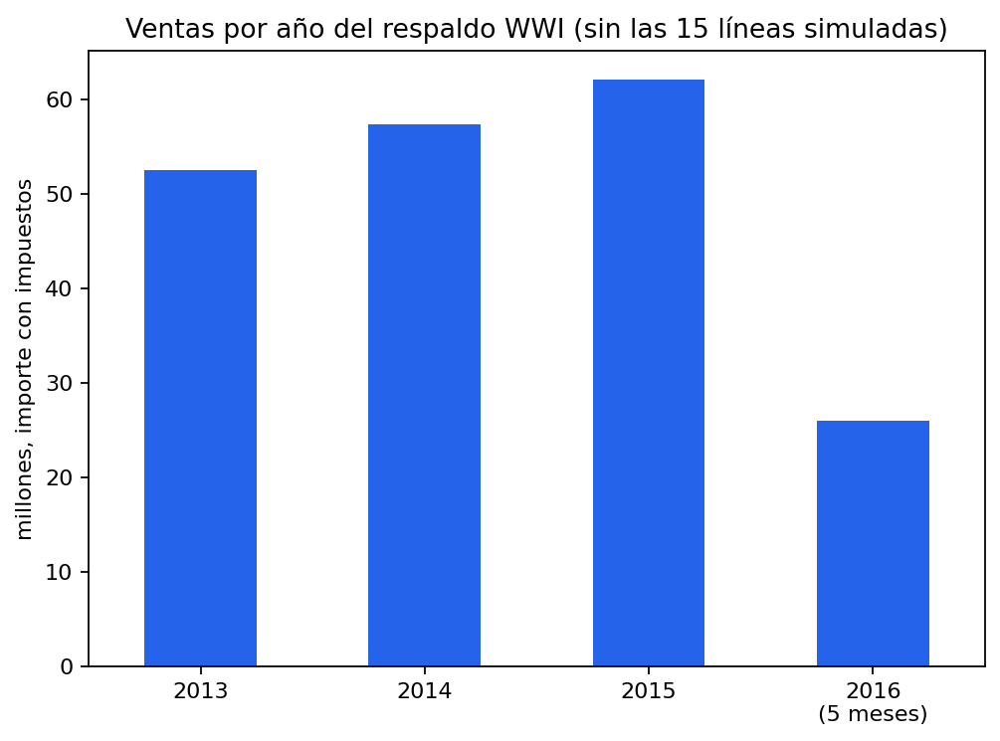
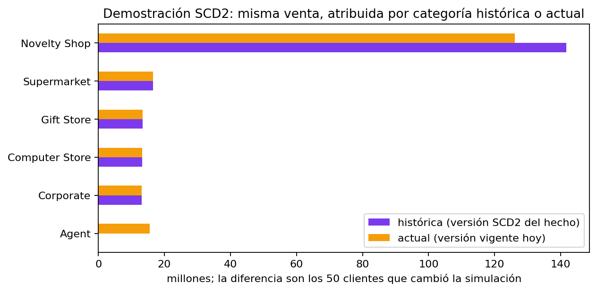
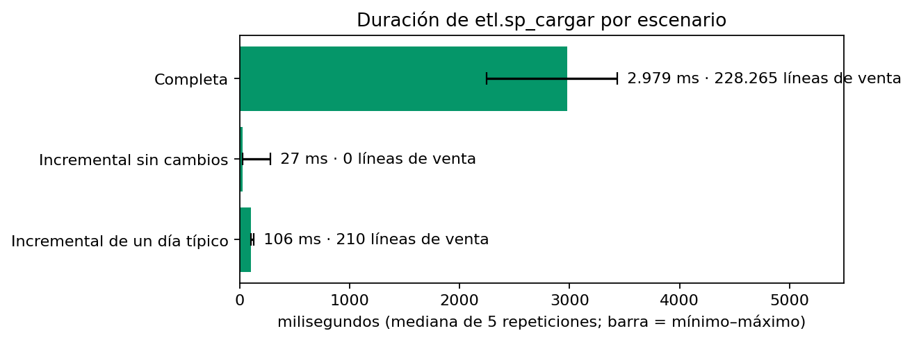
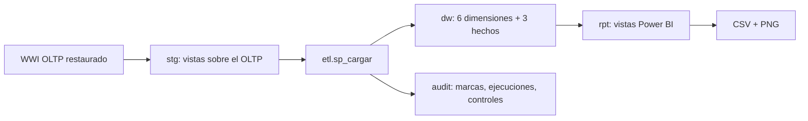

🇪🇸 **Español** · 🇺🇸 [English (summary)](README.md)

# WideWorldImporters: DW incremental y SCD tipo 2 en SQL Server

Data warehouse reproducible construido desde el OLTP oficial **WideWorldImporters**. Modela ventas, compras e inventario diario; conserva la historia de clientes y productos con SCD2; carga incrementos mediante marcas de agua y expone vistas en `rpt` listas para Power BI.


## Resultado medido

Ejecución real local sobre el respaldo oficial restaurado limpio, seguida de la simulación de cambios (`sql/08_simular_cambios.sql`):

| Métrica | Resultado |
|---|---:|
| Líneas de venta | 228.280 = 228.265 del respaldo + 15 simuladas |
| Líneas de compra | 8.367 |
| Snapshots de stock del día | 227 |
| Versiones de cliente | 713 = 663 iniciales + 50 creadas por la simulación |
| Versiones de producto | 327 = 227 iniciales + 100 creadas por la simulación |
| Carga completa (mediana de 5) | 2.979,3 ms; 228.265 líneas de venta |
| Incremental sin cambios (mediana de 5) | 26,8 ms; 0 filas y 0 versiones |
| Incremental de un día típico (mediana de 5) | 106,5 ms; 210 líneas, 5 clientes y 5 productos cambiados |
| Incremental de la simulación (1 ejecución) | 119 ms; 15 líneas, 50 + 100 versiones nuevas |
| Productos con cobertura de inventario calculada | 227 de 227 (mediana 5.452,7 días) |
| Controles | 18 OK, 0 FALLA |
| Pruebas | 6 pasan |

Las cifras se generan desde la base, no están escritas a mano: [metricas.json](reports/metricas.json), [controles](reports/tablas/controles_calidad.csv), [ejecuciones](reports/tablas/ejecuciones.csv), [tiempos](reports/tablas/tiempos_carga_resumen.csv) y [stock](reports/tablas/stock_cobertura.csv).

**Las 228.280 líneas frente a las 228.265 del [perfil](docs/perfil_oltp.md).** El perfil se tomó sobre el respaldo recién restaurado; la simulación agrega 5 facturas con 15 líneas (827,25 USD). En [ventas_anuales.csv](reports/tablas/ventas_anuales.csv) esas líneas aparecen aparte, con `origen = simulación SQL_03` y año 2026 (la fecha de ejecución); no son ventas de WWI y la figura 1 las excluye. El año 2016 del respaldo solo tiene enero a mayo.



### La diferencia histórica frente a actual es una demostración, no un hallazgo

La simulación cambia a propósito la categoría de los 50 primeros clientes (todos eran *Novelty Shop* y pasan a *Agent*) para comprobar que el SCD2 funciona. Por eso, al atribuir las ventas por la categoría vigente hoy, *Novelty Shop* pierde 15.563.997,65 USD (18.029 líneas) que pasan a *Agent*. Esa diferencia la crea el script de prueba, no el negocio: lo que demuestra es que cada hecho conserva la versión del cliente vigente cuando se facturó.

- Las 18.029 líneas anteriores al cambio siguen apuntando a la versión original (categoría histórica *Novelty Shop*).
- Solo las 15 líneas simuladas, facturadas después del cambio, usan las versiones nuevas: 827,25 USD con categoría histórica *Agent*.

Detalle en [categorias_historica_actual.csv](reports/tablas/categorias_historica_actual.csv) y `scd2_demo` en [metricas.json](reports/metricas.json).



### Versiones SCD2: cierres y aperturas

Cada cambio de atributos rastreados cierra la versión vigente y abre una nueva. `audit.ejecucion` cuenta ambas cosas por separado:

| Ejecución | Cierres de cliente | Aperturas de cliente | Cierres de producto | Aperturas de producto |
|---|---:|---:|---:|---:|
| Carga completa | 0 | 663 (versiones iniciales) | 0 | 227 (versiones iniciales) |
| Incremental de la simulación | 50 | 50 | 100 | 100 |

Es decir, la simulación crea **50 versiones nuevas de cliente y 100 de producto**. Cada versión nueva implica un cierre y una apertura, así que sumar ambas columnas contaría 100 y 200: el dato correcto es el de las aperturas.

### Tiempos de carga

[`scripts/medir_tiempos.py`](scripts/medir_tiempos.py) repite cada escenario 5 veces y guarda cada ejecución en [tiempos_carga.csv](reports/tablas/tiempos_carga.csv). El «día típico» copia como facturas de hoy las de un día real del respaldo con la mediana de líneas por día (210) y cambia 5 clientes y 5 productos. Todo ocurre en una transacción que se revierte, así que no altera la fuente. La duración es la que registra `etl.sp_cargar` en `audit.ejecucion`. La primera incremental sin cambios tardó 283,4 ms con caché fría; por eso se reporta la mediana.



### Cobertura y rotación de inventario

`rpt.stock_actual` calcula las unidades vendidas en los 365 días previos a la **fecha que describe la foto de existencias**: `LastEditedWhen` de `Warehouse.StockItemHoldings`, el 31-05-2016, que coincide con la última venta del respaldo. Anclarla a la fecha de ejecución (2026) dejaría la ventana vacía, porque el respaldo termina en 2016. Además suma por producto, no por versión, para incluir las ventas de productos con historia SCD2.

Los 227 productos tienen cobertura y rotación. Los valores son altos (mediana 5.452,7 días; solo 12 productos con 90 días o menos) porque lo es el inventario de la fuente: 221 de 227 productos tienen existencias por encima de su stock objetivo. Por ejemplo, el producto 1 tiene 175.609 unidades, un objetivo de 100 y 1.763 vendidas en el año. Es un rasgo de los datos de muestra, no un error del cálculo.

## Arquitectura



**`stg` son vistas, no tablas.** El OLTP restaurado vive en la misma instancia, así que `etl.sp_cargar` lee clientes, productos, líneas de venta, líneas de compra y existencias a través de vistas `stg`. Las vistas fijan el contrato de columnas y el grano sin duplicar unas 230 mil filas, y la marca de agua se aplica al leerlas. Las tablas pequeñas de referencia (ciudades, empleados, proveedores, categorías) se leen directamente. Si la fuente estuviera en otro servidor, `stg` se materializaría con tablas de aterrizaje.

El grano y diagrama completo están en [docs/modelo_datos.md](docs/modelo_datos.md); el perfil de las cuatro áreas del OLTP, en [docs/perfil_oltp.md](docs/perfil_oltp.md).

## Reproducir

```powershell
py -3.14 -m venv .venv
.venv\Scripts\python -m pip install -r requirements.txt
.venv\Scripts\python scripts\descargar_datos.py
icacls data\raw /grant 'NT Service\MSSQL$SQLEXPRESS:(OI)(CI)RX' /T
$bak=(Resolve-Path data\raw\WideWorldImporters-Full.bak); $variable='BackupPath="'+$bak+'"'
sqlcmd -S "localhost\SQLEXPRESS" -E -C -b -v $variable -i sql\01_restaurar_fuente.sql
.venv\Scripts\python scripts\medir_tiempos.py
sqlcmd -S "localhost\SQLEXPRESS" -E -C -I -b -f 65001 -i sql\00_EJECUTAR_TODO.sql
sqlcmd -S "localhost\SQLEXPRESS" -E -C -I -b -f 65001 -i sql\08_simular_cambios.sql
.venv\Scripts\python scripts\generar_reportes.py
.venv\Scripts\python -m pytest
```

`medir_tiempos.py` es opcional y debe ir antes de `00_EJECUTAR_TODO.sql`, porque reconstruye `DW_WWI` varias veces. Si la fuente ya tiene la simulación, se niega a medir.

> **Importante: restaure la fuente antes de volver a ejecutar `00_EJECUTAR_TODO.sql`.** `08_simular_cambios.sql` modifica la copia local de WideWorldImporters. Si después se reconstruye el DW sin restaurar el `.bak`, la carga completa toma los atributos ya cambiados como versión inicial desde 1900: los 50 clientes quedan como *Agent* en toda su historia y se pierde la demostración SCD2. Para partir limpio:
>
> ```powershell
> sqlcmd -S "localhost\SQLEXPRESS" -E -C -b -Q "ALTER DATABASE WideWorldImporters SET SINGLE_USER WITH ROLLBACK IMMEDIATE; DROP DATABASE WideWorldImporters;"
> $bak=(Resolve-Path data\raw\WideWorldImporters-Full.bak); $variable='BackupPath="'+$bak+'"'
> sqlcmd -S "localhost\SQLEXPRESS" -E -C -b -v $variable -i sql\01_restaurar_fuente.sql
> ```

**Pruebas.** [tests/test_dw.py](tests/test_dw.py) son pruebas de integración: requieren SQL Server Express local (o la variable `SQL_SERVER`), ODBC Driver 18 y `DW_WWI` construido; sin conexión se omiten. Comprueban la reconciliación con el OLTP, que cada hecho apunte a la versión vigente en su fecha, que el hash SCD2 ignore atributos no rastreados y detecte los rastreados, la búsqueda punto en el tiempo, la idempotencia de la incremental y los controles. No dependen de la simulación. Las que ejecutan el ETL lo hacen dentro de una transacción que se revierte, así que no escriben en `audit` ni en el OLTP.

La guía explica el orden, la idempotencia, el SCD2 y 10 preguntas de entrevista: [docs/GUIA_PASO_A_PASO.md](docs/GUIA_PASO_A_PASO.md).

## Estructura

```text
data/raw/       respaldo .bak de 127 MB (ignorado por Git; solo queda .gitkeep)
data/fuente.json  metadatos del respaldo: URL, licencia, tamaño y SHA-256
docs/           perfil, modelo y guía
reports/        métricas, CSV y figuras generadas
scripts/        descarga reanudable, conexión, medición de tiempos y exportación
sql/            restauración, modelo, ETL, vistas, calidad (06), consultas y simulación
tests/          integración real mediante pyodbc
```

## Fuente y licencia

Respaldo de [Microsoft SQL Server Samples — Wide World Importers](https://github.com/microsoft/sql-server-samples/tree/master/samples/databases/wide-world-importers), publicado bajo licencia MIT. El archivo descargado mide 127.111.168 bytes y su SHA-256 es `e842bad6ce02f74f166947e559dab1b476edd7eaae3da2ab9e3f522f1dd87124` (también en `data/fuente.json`).

**Licencias:** el **código** de este repositorio es [MIT](LICENSE) (copyright de Erick Guarnizo). Los **datos** (el respaldo de WideWorldImporters) son de Microsoft y siguen su propia licencia, también MIT; no se redistribuyen aquí, se descargan con `scripts/descargar_datos.py`.

## Limitaciones

- SQL Server Express no incluye SQL Agent; se documenta la programación externa, pero no se configura.
- El snapshot histórico de inventario empieza al ejecutar el proyecto y refleja las existencias del respaldo al 31-05-2016.
- La marca de agua de dimensiones usa `ValidFrom` de las tablas temporales, que registra el inicio de la transacción. Una transacción larga en el OLTP que empiece antes del corte y confirme después quedaría fuera; en producción convendría un margen de solape o Change Tracking.
- La simulación modifica únicamente la copia local restaurada y se revierte restaurando otra vez el respaldo limpio (comando arriba).
