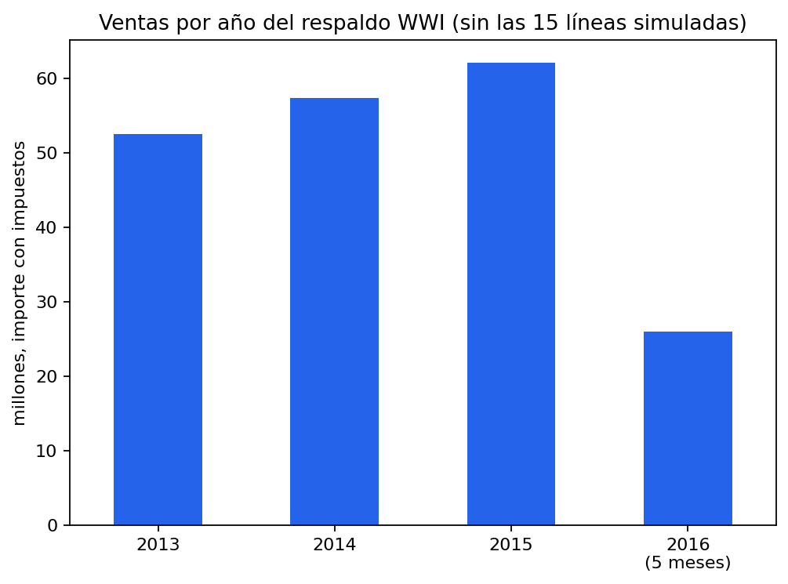
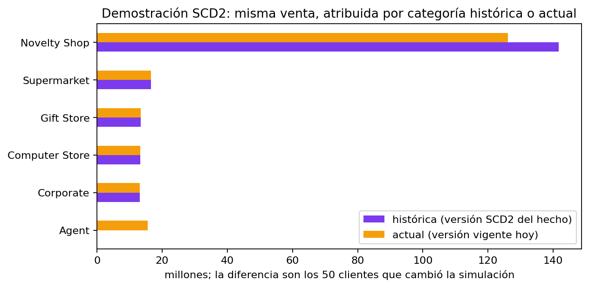

🇺🇸 **English (summary)** · 🇪🇸 [Español (full version)](README.es.md)

# WideWorldImporters: incremental DW and SCD type 2 in SQL Server

A reproducible data warehouse built from the official **WideWorldImporters** OLTP database. It models sales, purchases and daily
inventory, keeps customer and product history with SCD2, loads increments using watermarks and exposes `rpt` views ready for
Power BI.

## Measured results

Real local run on the official backup restored clean, followed by a simulation of changes (`sql/08_simular_cambios.sql`):

| Metric | Result |
|---|---:|
| Sales lines | 228,280 = 228,265 from the backup + 15 simulated |
| Purchase lines | 8,367 |
| Customer versions | 713 = 663 initial + 50 created by the simulation |
| Product versions | 327 = 227 initial + 100 created by the simulation |
| Full load (median of 5) | 2,979.3 ms; 228,265 sales lines |
| Incremental without changes (median of 5) | 26.8 ms; 0 rows and 0 versions |
| Incremental of a typical day (median of 5) | 106.5 ms; 210 lines, 5 customers and 5 products changed |
| Checks | 18 OK, 0 FAIL |
| Tests | 6 pass |

The figures are generated from the database, not typed by hand.

**The historical vs. current difference is a demonstration, not a finding.** The simulation changes the category of 50 customers
on purpose to prove that SCD2 works: attributing sales to today's category would move 15,563,997.65 USD (18,029 lines) from one
category to another, while the 18,029 earlier lines keep pointing to the original version.

**Model, load process, checks and reproduction commands:** [full README (Spanish)](README.es.md). Commands are
language-independent.
