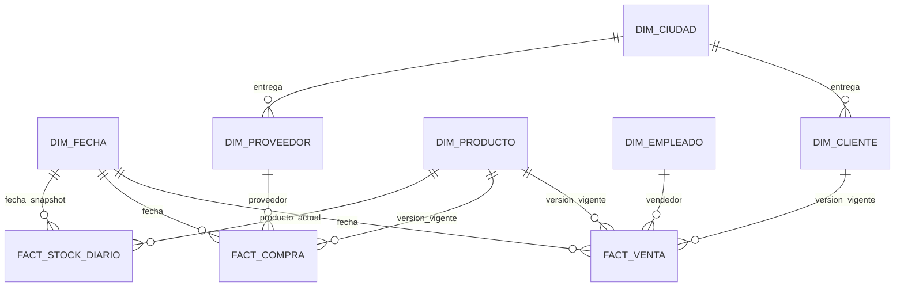

# Modelo dimensional

| Tabla | Grano | Clave de negocio |
|---|---|---|
| `dw.fact_venta` | una línea de factura | `linea_factura_id` |
| `dw.fact_compra` | una línea de orden de compra | `linea_compra_id` |
| `dw.fact_stock_diario` | un producto por día | `fecha_key`, `producto_key` |
| `dw.dim_cliente` | una versión de cliente | `cliente_id`, `valido_desde` |
| `dw.dim_producto` | una versión de producto | `producto_id`, `valido_desde` |

## Capa `stg`

`stg.cliente_actual`, `stg.producto_actual`, `stg.venta_linea`, `stg.compra_linea` y `stg.stock_actual` son **vistas** sobre `WideWorldImporters` en la misma instancia, no tablas. `etl.sp_cargar` lee de ellas y aplica la marca de agua al consultarlas. Se eligieron vistas porque la fuente es local: fijan el contrato de columnas y el grano (línea de factura, línea de compra, producto) sin duplicar unas 230 mil filas ni añadir un paso de copia. Las tablas pequeñas de referencia (ciudades, empleados, proveedores, categorías) se leen directamente. Con la fuente en otro servidor, `stg` pasaría a ser tablas de aterrizaje.

## SCD2

`dim_cliente` y `dim_producto` son SCD tipo 2. Un índice filtrado garantiza una sola fila `es_actual=1`; los checks e índices de vigencia apoyan los controles de no solapamiento.

