🇪🇸 **Español** · 🇺🇸 [English (summary)](README.md)

# 🚕 Data warehouse de los taxis amarillos de Nueva York 2024 en SQL Server

Data warehouse en **T-SQL sobre SQL Server 2025 Express** con los **41.169.720 viajes** de taxi amarillo de Nueva York de 2024 (12 archivos Parquet oficiales de la TLC). Incluye carga **incremental mes a mes e idempotente** con auditoría, modelo estrella, hecho **particionado por mes con índice columnstore agrupado ordenado**, **ventana deslizante** que mueve millones de filas en milisegundos, reglas de calidad con **cuarentena**, **cuadre al centavo contra los Parquet** y análisis de negocio con **funciones de ventana**, más vistas listas para Power BI.


---

## 📌 Problema

La Comisión de Taxis y Limusinas (TLC) publica cada viaje de taxi amarillo: unos **3,4 millones de filas al mes**. Un área de operaciones o de regulación necesita responder **cuándo y dónde hay demanda, qué rutas concentran los viajes, cómo se comportan las propinas, cuánto pesan los aeropuertos y si el precio por milla está subiendo**. Hay que hacerlo en un servidor modesto (SQL Server Express, 1 núcleo efectivo para consultas, ~1,4 GB de buffer pool) y con datos que **no están limpios**:

- Viajes con fecha de **2002, 2008 o 2026** dentro del archivo de enero de 2024.
- Llegadas **antes** de la recogida, viajes de **más de 6 horas** y velocidades de **más de 80 mph**.
- **733 mil** registros con importe negativo (reversos de disputas y anulaciones), distancias de **312.722 millas** y tarifas de **$5.000** por 0 millas.
- Un 10 % de filas sin pasajeros ni código de tarifa (`payment_type = 0`, tarifa flexible).

Y además SQL Server **no lee Parquet**.

## 🏗️ Arquitectura

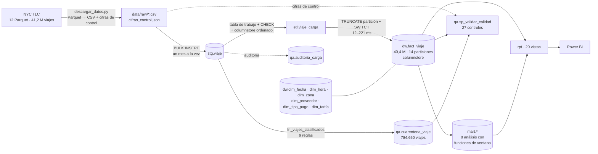

| Capa | Qué contiene |
|---|---|
| `stg` | Un mes del CSV, con los tipos de la fuente y sin restricciones (lo absurdo debe llegar a las reglas, no romper la carga). Se vacía al terminar cada carga |
| `qa` | Cifras de control de cada Parquet, **bitácora de cargas**, reglas de calidad (como datos), **cuarentena** y resultados de los controles |
| `dw` | `fact_viaje` (grano: un viaje) particionada por mes con **columnstore agrupado `ORDER (recogida)`** + 6 dimensiones |
| `mart` | 8 tablas analíticas: KPI mensual, horas pico, estacionalidad diaria, rutas, propinas por pago y por zona, aeropuertos, precio por milla |
| `rpt` | 20 vistas en español para Power BI (modelo estrella + marts + gobierno del dato) |
| `lab` | Ventana deslizante y comparación rowstore vs columnstore |

## ✅ Resultado de la ejecución (cifras reales)

| Métrica | Valor |
|---|---|
| Viajes en los 12 Parquet de 2024 | **41.169.720** (680 MB en Parquet, 5 GB en CSV) |
| Viajes en el hecho | **40.385.070** (98,09 %) |
| Viajes en cuarentena | **784.650** (1,91 %), con la regla que los detuvo |
| Cuadre Parquet = hecho + cuarentena | filas, total, tarifa, propina y distancia **al centavo** en los 12 meses: diferencia **0** |
| Controles de calidad | **27 de 27 en OK** |
| Pruebas automáticas (pytest) | **37 pasan**: conversión, cuadre independiente, prueba negativa, idempotencia, recarga forzada, particiones, columnstore, ventanas, vistas |
| Hecho en columnstore | **1,13 GB** (30 bytes por viaje), 44 grupos de filas, 12 particiones con datos + 2 vacías |
| Carga incremental | ~3–4 min por mes; el `SWITCH` de la partición, **12–221 ms** |
| Ventana deslizante (sacar y devolver 2,9 M filas) | **17 ms** en 6 operaciones |
| Columnstore vs rowstore (caliente) | de **7,6× a 60×** más rápido y **3,4×** más chico |

## ⚙️ Carga incremental, idempotente y auditada

`etl.sp_cargar_mes '2024-03'` hace todo para un mes, y `etl.sp_cargar_pendientes` recorre los 12:

1. Si ese mes ya está cargado con el **mismo `sha256`** del Parquet → `OMITIDO` (salvo `@forzar = 1`).
2. `BULK INSERT` del CSV al staging y **cuadre de filas contra el Parquet** antes de tocar el modelo.
3. Clasificación con una sola función (`etl.fn_viajes_clasificados`): lo que rompe una regla va a cuarentena; el resto, a una tabla de trabajo con la **misma estructura del hecho** (`SELECT TOP 0 INTO`), un `CHECK` del rango del mes y su columnstore ordenado.
4. En una transacción: `TRUNCATE TABLE dw.fact_viaje WITH (PARTITIONS (n))` + `ALTER TABLE … SWITCH TO … PARTITION n`. **Recargar un mes reemplaza su partición entera: nunca duplica.**

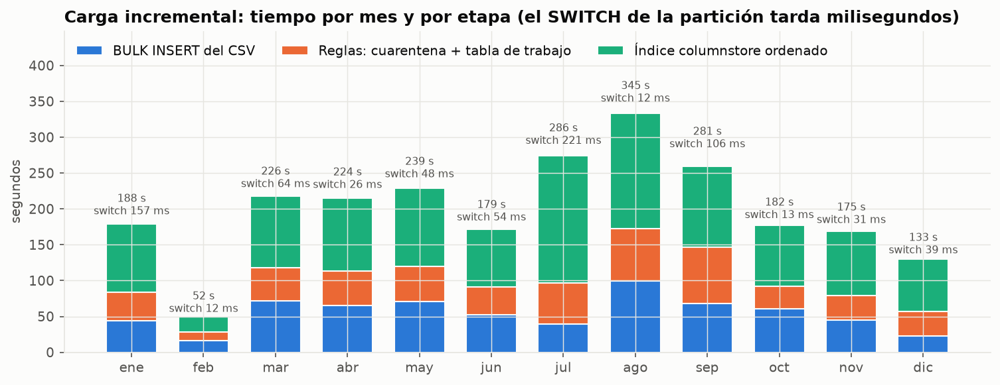

| Etapa (promedio por mes, ~3,4 M filas) | Tiempo |
|---|---:|
| `BULK INSERT` del CSV (~420 MB) | ~60 s |
| Reglas de calidad → cuarentena + tabla de trabajo | ~48 s |
| Índice columnstore ordenado (`MAXDOP 1`) | ~105 s |
| `TRUNCATE` de la partición + `SWITCH` | **12–221 ms** |

**Prueba real de robustez:** la PC se reinició en medio de la carga de diciembre. La bitácora quedó con esa carga `EN CURSO` y la partición de diciembre vacía (el `SWITCH` es el último paso y es atómico, así que el hecho nunca queda a medias). Al volver a ejecutar, el procedimiento marcó la carga interrumpida como `ERROR`, **omitió los 11 meses ya cargados** (mismo `sha256`) y cargó diciembre en 133 s. Todo queda registrado en `rpt.auditoria_cargas`, incluida la carga interrumpida. Las pruebas automáticas además **recargan febrero a la fuerza** (`@forzar = 1`, 52 s) y verifican que el hecho, la cuarentena y los 27 controles quedan idénticos.

## 🧹 Calidad: cuarentena y cuadre contra la fuente

Las reglas viven en `qa.regla_calidad` (con sus umbrales): cambiar un umbral no exige tocar código. Cada viaje recibe **la primera regla que rompe**. Nada se borra.

| Regla | Qué detecta | Viajes | % del total |
|---|---|---:|---:|
| R01 Fecha fuera del periodo | Recogida fuera del mes del archivo (2002, 2008, 2009, 2026...) | 420 | 0,001 % |
| R02 Duración no positiva | Llegada igual o anterior a la recogida | 13.510 | 0,03 % |
| R03 Duración excesiva | Más de 6 horas (taxímetro que no se detuvo; la mayoría marca ~24 h) | 21.994 | 0,05 % |
| R04 Importe negativo | Tarifa o total negativos: reversos de disputas y anulaciones, no viajes (−$16,7 M) | **733.732** | 1,78 % |
| R05 Distancia imposible | Negativa o > 200 millas (hay de 312.722) | 1.073 | 0,003 % |
| R06 Velocidad imposible | Más de 80 mph de promedio | 12.056 | 0,03 % |
| R07 Tarifa imposible | > $1.000, o > $250 en menos de 2 millas | 1.865 | 0,005 % |
| R08 / R09 | Zona fuera del catálogo / campos obligatorios nulos | 0 | — |
| **Total en cuarentena** | | **784.650** | **1,91 %** |

**Cuadre por mes contra los Parquet** (`rpt.cuadre_fuente`). Las cifras de control las calcula Python con Arrow, sin pasar por SQL Server, y por cada uno de los 12 meses se cumple con **diferencia 0**:

- filas del Parquet = hecho + cuarentena;
- suma de `total_amount`, `fare_amount`, `tip_amount` y `trip_distance` **al centavo** ($1.145.869.125,72 en total);
- pasajeros nulos;
- viajes fuera del mes contados por Python = viajes que la regla R01 manda a cuarentena en SQL (dos implementaciones independientes que coinciden).

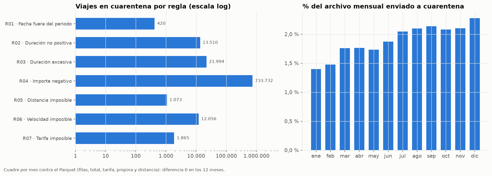

`qa.sp_validar_calidad` ejecuta **27 controles** (cuadre, auditoría, particiones, columnstore sin delta stores, reglas, integridad referencial, marts que cuadran con el hecho) y hace `THROW` si alguno falla: **27 de 27 en OK**.

## 🗂️ Particiones, columnstore y ventana deslizante

`pf_mes` es `RANGE RIGHT` sobre `fecha_key` (AAAAMMDD), con un límite por mes: **14 particiones**, 12 con datos y **una vacía en cada punta**. Las puntas vacías son lo que hace que `SPLIT` y `MERGE` sean solo metadatos.

**Ventana deslizante de 12 meses** (`etl.sp_ventana_deslizante`), demostrada sobre el hecho real y deshecha después (`lab.sp_demo_ventana_deslizante`):

| Paso | Operación | Filas | Tiempo |
|---|---|---:|---:|
| Llega 2025-01: prepara su partición y una vacía a la derecha | `SPLIT RANGE (20250201)` | 0 | 2 ms |
| Sale 2024-01 a una tabla de archivo | `SWITCH PARTITION 2 TO dw.fact_viaje_archivo_202401` | **2.923.191** | **3 ms** |
| Cierra el hueco de la izquierda | `MERGE RANGE (20240101)` | 0 | 1 ms |
| Deshacer: vuelve a abrir enero | `SPLIT RANGE (20240101)` | 0 | 3 ms |
| Enero vuelve al hecho (con `CHECK` de confianza) | `SWITCH … TO dw.fact_viaje PARTITION 2` | **2.923.191** | **7 ms** |
| Quita el límite de prueba | `MERGE RANGE (20250201)` | 0 | 1 ms |

Seis operaciones, **17 ms en total** (`reports/tablas/ventana_deslizante_log.csv`), para sacar y devolver casi 3 millones de filas. Los procedimientos **abortan** si un `SPLIT` o `MERGE` fuera a mover datos.

### Rowstore vs columnstore (las mismas 40,4 M filas)

Laboratorio `lab.sp_comparar_almacenamiento`: la misma tabla en tres formatos y 6 consultas típicas de BI, cada una en frío (`DBCC DROPCLEANBUFFERS`) y en caliente (mejor de 3).

| Almacenamiento | Espacio | Bytes por viaje | Construcción |
|---|---:|---:|---:|
| Rowstore (B-tree agrupado, sin compresión) | 3,86 GB | 102,6 | 120 s |
| Rowstore + `DATA_COMPRESSION = PAGE` | 1,81 GB | 48,0 | 339 s |
| **Columnstore agrupado ordenado** | **1,13 GB** | **30,2** | ~105 s por mes |

| Consulta (caliente, ms) | Rowstore | Rowstore PAGE | **Columnstore** | Rowstore ÷ columnstore |
|---|---:|---:|---:|---:|
| C1 Viajes e ingreso por mes | 14.532 | 19.875 | **800** | 18× |
| C2 Propina % por tipo de pago | 13.289 | 20.307 | **452** | 29× |
| C3 Top 10 rutas origen-destino | 10.061 | 16.633 | **1.329** | 7,6× |
| C4 Horas pico (join con `dim_fecha`) | 14.514 | 18.733 | **949** | 15× |
| C5 Un mes (filtro por la clave de partición) | 631 | 1.040 | **36** | 18× |
| C6 Dos horas del 4 de julio (filtro por `recogida`) | 4.040 | 3.978 | **67** | **60×** |

En frío la diferencia es parecida: el rowstore lee **509.769 páginas** (3,9 GB) de disco para cualquier agregación y el columnstore entre 1.400 y 11.000 en C1–C5 (40.747 en C6, sobre todo lectura anticipada). Tres conclusiones:

- **PAGE ahorra espacio pero cuesta CPU**: ocupa la mitad que el rowstore sin comprimir pero es entre un 30 % y un 65 % más lento en caliente (C1 a C5), porque descomprime cada página que lee. El columnstore es más chico **y** más rápido porque comprime por columna y procesa en modo batch.
- **C6 muestra la eliminación de segmentos del `ORDER (recogida)`**: `SET STATISTICS IO` informa *Segment reads 1, segment skipped 43*. El rowstore, agrupado por `fecha_key`, no tiene índice en `recogida` y recorre los 40 M de filas.
- **Express usa prácticamente un solo núcleo**: el tiempo de CPU es casi igual al tiempo transcurrido en todas las mediciones. Aun así, el columnstore responde cualquier agregación del año en menos de 1,5 s.

Durante el laboratorio el archivo de datos llegó a **7,0 GB** (columnstore + copia rowstore + reconstrucción con PAGE), todavía por debajo de los 10 GB de la consigna. Al final la copia se borra.

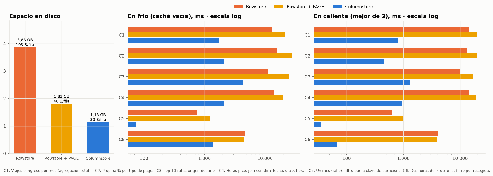

## 📊 Hallazgos

| Métrica (viajes válidos de 2024) | Valor |
|---|---|
| Viajes | **40.385.070** (~110 mil por día) |
| Ingreso total cobrado | **$1.159 M** |
| Ticket medio | **$28,71** (de $27,42 en enero a $29,46 en diciembre) |
| Distancia media | **3,36 millas** |
| Propinas registradas | **$136 M** (casi todas con tarjeta: $132,9 M de los $136 M) |

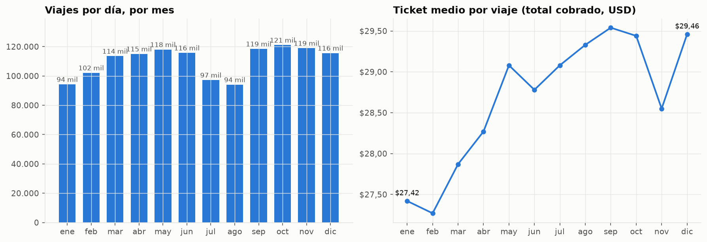

**1. La hora pico es a las 18:00 todos los días laborables, y a las 14:00 los domingos.** El jueves a las 18:00 es la hora más cargada de la semana (**9.174 viajes por hora** en promedio). Entre semana el tráfico se nota: de 15:00 a 18:00 la velocidad media cae a **~10 mph**, contra **~22 mph** a las 4 de la mañana. La hora más tranquila del año es el martes a las 3:00 (194 viajes por hora).

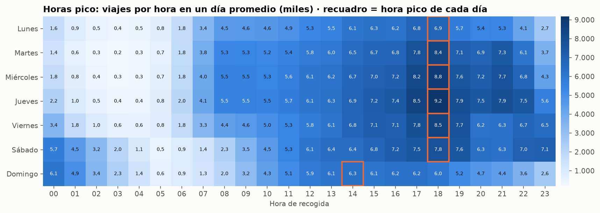

**2. Estacionalidad: el verano y los feriados vacían los taxis; diciembre los llena.** Octubre es el mes de más demanda (**121 mil viajes por día**) y agosto el de menos (94 mil, igual que enero). Los 5 días récord son de la temporada navideña (máximo: **viernes 13 de diciembre, 156.648 viajes**). Navidad (−54 % frente a un miércoles promedio), el 4 de julio (−50 %) y Acción de Gracias (−38 %) son los días más vacíos. En cambio, el Día de la Raza y el de los Veteranos no bajan la demanda (+5 % y +3 %): son feriados en los que la ciudad trabaja.

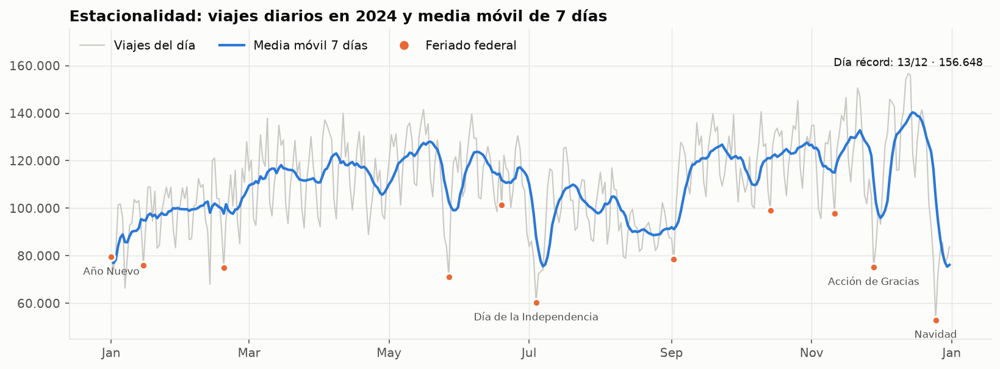

**3. El taxi amarillo es un servicio de Manhattan, y del Upper East Side en particular.** El **88,6 %** de los viajes empieza en Manhattan y el 9,3 % en Queens (casi todo aeropuertos). Hay 50.406 pares origen-destino con viajes, pero **505 rutas (1 %) concentran la mitad de todos los viajes** y 1.516 el 80 %. Las 4 rutas más frecuentes son dentro del Upper East Side (Sur ↔ Norte, ~1 milla, ~$15).

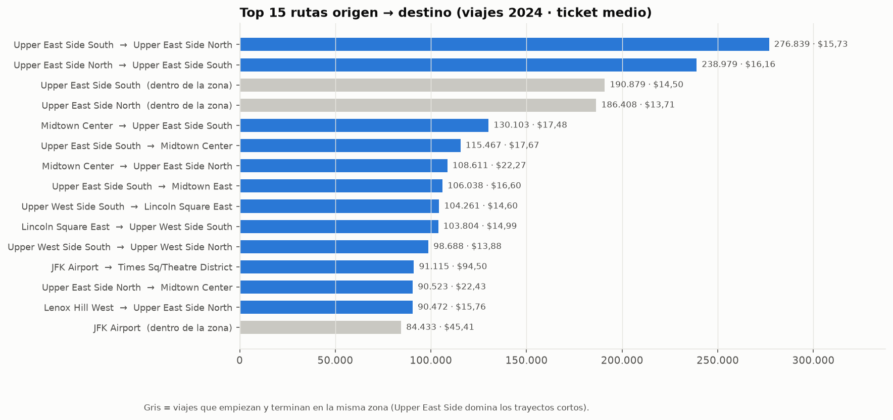

**4. Propinas: 22 % con tarjeta, con una brecha geográfica enorme.** El 75 % de los viajes se paga con tarjeta, el 94 % de ellos deja propina, y la propina equivale al **22,0 % de la tarifa**. El efectivo registra 0 %, pero es un vacío del dato (el taxímetro no la registra), no tacañería. Por zona de origen (solo tarjeta), el Upper East Side Sur y el Upper West Side dejan **~24,6 %**, mientras que zonas de Brooklyn como Brownsville, East Flatbush o Canarsie dejan **menos del 1 %**: allí casi nadie agrega propina en la pantalla.

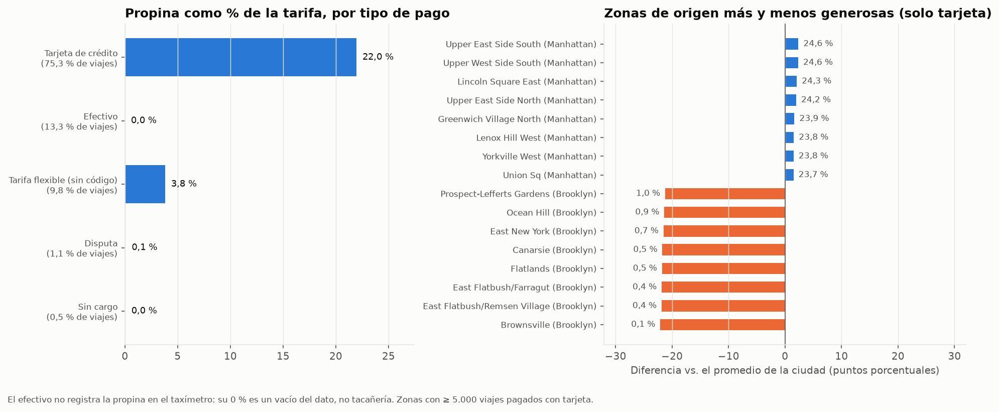

**5. Los aeropuertos son el 10,1 % de los viajes pero el 27,6 % del ingreso.** JFK genera **2,26 M viajes (5,6 %) y el 16,3 % del ingreso** con un ticket medio de **$83,65** (tarifa fija de $70 a Manhattan + peajes y recargos). LaGuardia aporta el 10,1 % del ingreso y Newark el 1,2 % con el ticket más alto ($126,94). En JFK y LaGuardia los taxis amarillos sobre todo **recogen** pasajeros (1,79 M salidas de JFK frente a 352 mil llegadas). En Newark es al revés: 101 mil viajes hacia el aeropuerto y solo 419 desde allí, porque está en Nueva Jersey, fuera de la jurisdicción de la TLC. En julio JFK llega al 18,9 % del ingreso del mes (turismo de verano).

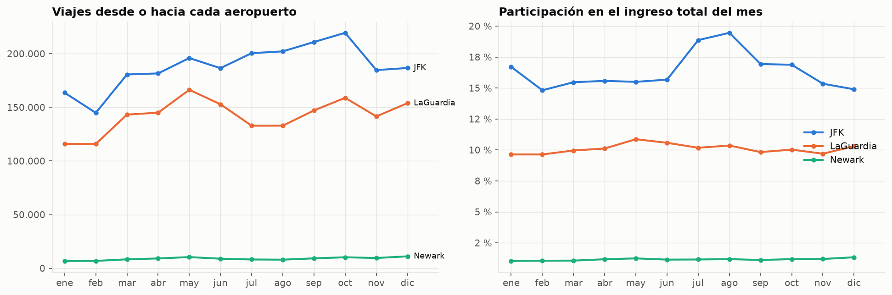

**6. El precio por milla sube porque el tráfico es más lento, no porque cambie la tarifa.** Con la tarifa estándar (sin cambios en 2024), la tarifa base por milla de los viajes cortos (0,5–2 millas) subió de **$8,40 en enero a $9,60 en diciembre (+14,3 %)**, mientras su velocidad media bajó de **7,9 a 6,4 mph**. El taxímetro cobra por distancia o por tiempo detenido o lento, así que un viaje más lento cuesta más por milla. La prueba está en el verano: en julio y agosto el tráfico se aligera (7,5–7,6 mph) y el precio por milla **baja** ($8,61–8,69). En viajes de más de 10 millas el efecto es menor (+5,0 %).

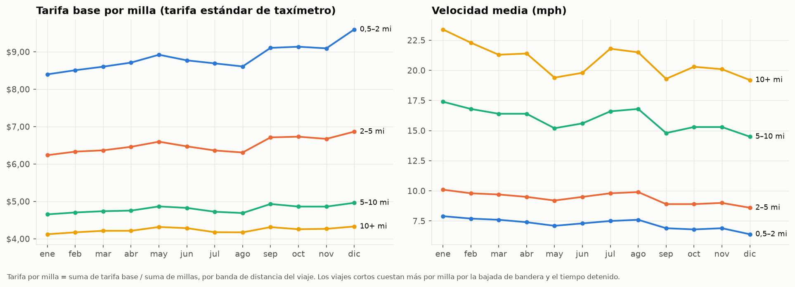

## 🧠 Decisiones técnicas

| Decisión | Por qué |
|---|---|
| **Parquet → CSV con PyArrow**, dinero a `DECIMAL(12,2)` antes de escribir | SQL Server no lee Parquet. Convertir el `double` a centavos antes del CSV hace que la cifra de control de Python y la suma de SQL sean **exactas al centavo**, no "casi iguales". El script cuenta los valores con más de 2 decimales (0 en 2024) y falla si una fecha trae fracciones de segundo |
| `pc.cast(timestamp, string)` en vez de `strftime` | Mismo texto, 0,3 s en vez de 70 s por columna: la conversión de un mes tarda ~15 s (con `strftime` serían ~190 s) |
| `BULK INSERT … FORMAT = 'CSV', ROWTERMINATOR = '0x0a'` | PyArrow escribe fin de línea `\n`; sin el terminador explícito SQL Server falla con el críptico error 7301 (`IID_IColumnsInfo`) |
| **Partición por mes + `SWITCH`** para cargar | Recargar un mes es reemplazar una partición: idempotente por construcción y el hecho nunca queda a medias. El `sha256` en la bitácora evita recargar lo que no cambió |
| **Columnstore agrupado `ORDER (recogida)`** (SQL Server 2022+) | Compresión de ~30 bytes por viaje y modo batch. El orden hace que cada segmento cubra un rango de fechas estrecho, así que los filtros por fecha y hora se saltan segmentos enteros |
| **Puntas vacías** en la función de partición | `SPLIT` y `MERGE` sobre particiones vacías son solo metadatos; sobre particiones con datos mueven filas. Los procedimientos lo verifican y abortan |
| **Sin claves foráneas declaradas** en el hecho | El `SWITCH` exige tablas idénticas, y validar FK en cada carga de 3,5 M filas cuesta. La integridad se verifica con 3 controles después de cada carga |
| Claves **naturales** de la TLC en las dimensiones (`smallint`/`tinyint`) | Linaje directo con la fuente; un código no documentado entra como **miembro inferido** en vez de perder el viaje |
| Recargos nulos (`congestion_surcharge`, `Airport_fee`) → 0 en el hecho | Solo son nulos en los registros de tarifa flexible; no afectan a las cifras de control (total, tarifa, propina y distancia) |
| Una sola función de clasificación para cuarentena y hecho | Imposible que las dos ramas usen criterios distintos: hecho + cuarentena siempre suman el archivo |
| Marts calculados en **una pasada agregada** + ventanas sobre el resultado | Las funciones de ventana trabajan sobre cientos o miles de filas agregadas, no sobre 40 M. Todos los marts se calculan en ~1 min |
| `APPROX_PERCENTILE_CONT` para medianas | `PERCENTILE_CONT` ordena millones de filas por grupo y en Express se derrama a `tempdb` |
| Zona expuesta **dos veces** en `rpt` (origen y destino) | Dimensión de rol doble: en Power BI evita relaciones inactivas y `USERELATIONSHIP` |
| ¿10 GB? | La consigna asumía el límite de 10 GB de Express. **SQL Server 2025 Express lo sube a 50 GB** (lo comprobé creando una base de 12 GB). Igual, el diseño cabe con holgura: el hecho completo ocupa **1,13 GB**, la base usa **1,2 GB** y el archivo de datos llegó como máximo a **7,0 GB** (durante el laboratorio rowstore, que después se borra) |

## ⚠️ Limitaciones

- **Solo taxis amarillos.** Los datos no incluyen taxis verdes ni vehículos de alquiler con conductor (FHV), es decir, **ni Uber ni Lyft**, que hoy mueven la mayor parte de los viajes de la ciudad. Las conclusiones de demanda, horas pico y precio describen el taxi amarillo, no la movilidad de Nueva York.
- **Un solo año (2024).** La estacionalidad se ve con un solo ciclo: no se puede separar el efecto del calendario de una tendencia ni comparar con otros años.
- **Medido en un solo equipo.** Todos los tiempos (carga, `SWITCH`, ventana deslizante, rowstore vs columnstore) salen de un Ryzen 5 4600G con SQL Server 2025 Express y un buffer pool de ~1,4 GB. Sirven para comparar formatos entre sí, no como cifras absolutas en otro hardware. Las consultas en caliente son el mejor de 3 intentos y las en frío, una sola medición.
- **Las reglas de cuarentena son criterio propio.** Los umbrales (6 horas, 80 mph, 200 millas, $1.000) son razonables pero no oficiales; cambiarlos mueve la frontera entre hecho y cuarentena (están en `qa.regla_calidad`). Los importes negativos (R04) se apartan como reversos, así que el ingreso del análisis no los descuenta.
- **La propina en efectivo no se registra**, por lo que la propina media subestima lo que realmente se deja; el análisis por zona usa solo pagos con tarjeta.
- **Sin claves foráneas declaradas** en el hecho (necesario para el `SWITCH`): la integridad referencial depende de los controles de calidad, no del motor.

## 📈 Vistas para Power BI (`rpt`)

| Vista | Uso |
|---|---|
| `rpt.fact_viajes` + `dim_fecha`, `dim_hora`, `dim_zona_origen`, `dim_zona_destino`, `dim_proveedor`, `dim_tipo_pago`, `dim_tarifa` | Modelo estrella (DirectQuery sobre el columnstore) |
| `rpt.kpi_mensual`, `rpt.demanda_diaria`, `rpt.horas_pico` | Demanda y estacionalidad (Import: pocos KB) |
| `rpt.rutas_top`, `rpt.aeropuertos`, `rpt.propinas_por_pago`, `rpt.propinas_por_zona`, `rpt.precio_por_milla` | Análisis de negocio |
| `rpt.auditoria_cargas`, `rpt.cuarentena_por_mes`, `rpt.cuadre_fuente`, `rpt.benchmark_almacenamiento` | Gobierno del dato y rendimiento |

## 🚀 Cómo reproducirlo

Guía completa, con 12 preguntas de entrevista: **[docs/GUIA_PASO_A_PASO.md](docs/GUIA_PASO_A_PASO.md)**

```powershell
# 1. Entorno y datos (~5 min: 12 Parquet, ~680 MB → 12 CSV, ~5 GB)
py -3.14 -m venv .venv
.venv\Scripts\python -m pip install -r requirements.txt
.venv\Scripts\python scripts\descargar_datos.py

# 2. Permiso de lectura para la cuenta del servicio de SQL Server sobre data\
icacls data /grant 'NT Service\MSSQL$SQLEXPRESS:(OI)(CI)RX' /T

# 3. Pipeline completo en T-SQL (~45 min de carga + ~20 min del laboratorio rowstore/columnstore)
#    El lanzador calcula la ruta de la carpeta y se la pasa a sqlcmd como la variable "Proyecto"
.\ejecutar.ps1                  # añade -SinBenchmark para saltar el laboratorio

# 4. Figuras y pruebas
.venv\Scripts\python scripts\generar_graficos.py
.venv\Scripts\python -m pytest
```

Sin el lanzador, el paso 3 equivale a este comando de `cmd` (la ruta de la carpeta es un parámetro; las comillas del valor son obligatorias y la ruta no puede tener espacios):

```bat
sqlcmd -S "localhost\SQLEXPRESS" -E -C -I -b -f 65001 -v Proyecto="%CD%" BenchmarkCompleto=1 -i sql\00_EJECUTAR_TODO.sql
```

`BenchmarkCompleto=0` salta el laboratorio rowstore/columnstore.

## 📁 Estructura

```
├── ejecutar.ps1                 lanzador: calcula la ruta y corre el pipeline completo
├── LICENSE                      MIT (código)
├── data/
│   ├── raw/                     Parquet y CSV (no versionados)
│   └── cifras_control.json      filas, sumas y sha256 de cada Parquet (calculados con Arrow)
├── docs/GUIA_PASO_A_PASO.md     ejecución paso a paso y preguntas de entrevista
├── reports/
│   ├── figures/                 10 figuras generadas desde las vistas rpt
│   └── tablas/                  resultados en CSV (cuadre, cuarentena, rutas, horas pico, benchmark...)
├── scripts/
│   ├── descargar_datos.py       descarga, Parquet → CSV, cifras de control
│   ├── generar_graficos.py      figuras y tablas desde SQL Server
│   └── conexion.py
├── sql/
│   ├── 00_EJECUTAR_TODO.sql     pipeline completo (modo SQLCMD)
│   ├── 01–02                    base, staging, cifras de control (OPENJSON), auditoría
│   ├── 03–04                    dimensiones, hecho particionado + columnstore, reglas, cuarentena
│   ├── 05                       carga incremental idempotente (BULK INSERT → SWITCH)
│   ├── 06                       ventana deslizante (SPLIT / SWITCH / MERGE)
│   ├── 07                       análisis con funciones de ventana (mart.*)
│   ├── 08                       vistas para Power BI
│   ├── 09                       27 controles de calidad
│   ├── 10–11                    laboratorio rowstore vs columnstore y demo de la ventana
│   └── 12                       consultas que respaldan cada hallazgo
└── tests/                       pytest: conversión, cuadre, prueba negativa, idempotencia, recarga, particiones, vistas
```

## 📚 Fuente y licencia de los datos

**NYC Taxi & Limousine Commission – TLC Trip Record Data** (Yellow Taxi, enero a diciembre de 2024): [página oficial](https://www.nyc.gov/site/tlc/about/tlc-trip-record-data.page) · [diccionario de datos](https://www.nyc.gov/assets/tlc/downloads/pdf/data_dictionary_trip_records_yellow.pdf) · archivos `https://d37ci6vzurychx.cloudfront.net/trip-data/yellow_tripdata_2024-MM.parquet` y [zonas](https://d37ci6vzurychx.cloudfront.net/misc/taxi_zone_lookup.csv).
Datos abiertos de la Ciudad de Nueva York, de uso libre según los [Términos de uso de NYC Open Data](https://www.nyc.gov/home/terms-of-use.page). Importes en dólares estadounidenses. Los registros no identifican a pasajeros ni conductores.

**Licencias:** el **código** de este repositorio es [MIT](LICENSE); los **datos** de la TLC siguen sus propios términos de uso (arriba) y no se redistribuyen aquí: se descargan con `scripts/descargar_datos.py`.

## 👤 Autor

**Erick Guarnizo** · Ingeniero en Sistemas · [LinkedIn](https://www.linkedin.com/in/erick-g-571a7b3b4)
