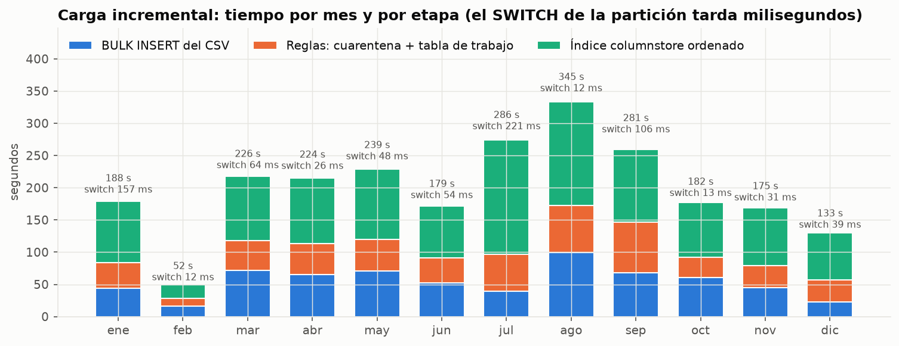

🇺🇸 **English (summary)** · 🇪🇸 [Español (full version)](README.es.md)

# 🚕 Data warehouse of New York's 2024 yellow taxis in SQL Server

A data warehouse in **T-SQL on SQL Server 2025 Express** with the **41,169,720 yellow taxi trips** of New York in 2024 (12
official TLC Parquet files). **Incremental and idempotent monthly load** with auditing, star schema, fact table **partitioned by
month with an ordered clustered columnstore index** and a sliding window.

**The real data problems:** trips dated 2002, 2008 or 2026 inside the January 2024 file; arrivals before pickups; speeds over 80
mph; 733 thousand records with a negative amount; distances of 312,722 miles; 10% of rows without passengers or rate code. And
SQL Server cannot read Parquet.

## Results (real figures)

| Metric | Value |
|---|---|
| Trips in the 12 Parquet files of 2024 | **41,169,720** (680 MB in Parquet, 5 GB in CSV) |
| Trips in the fact table | **40,385,070** (98.09%) |
| Quarantined trips | **784,650** (1.91%), with the rule that stopped them |
| Reconciliation Parquet = fact + quarantine | rows, total, fare, tip and distance **to the cent** in the 12 months: difference **0** |
| Quality checks | **27 of 27 OK** |
| Automated tests (pytest) | **37 pass** |
| Columnstore fact table | **1.13 GB** (30 bytes per trip) |
| Incremental load | ~3–4 min per month; the partition `SWITCH`, **12–221 ms** |
| Sliding window (remove and return 2.9M rows) | **17 ms** in 6 operations |
| Columnstore vs. rowstore (warm) | **7.6× to 60×** faster and **3.4×** smaller |

- **Idempotent:** a month already loaded with the same `sha256` is skipped; reloading replaces the whole partition, so it never
  duplicates.
- **A real robustness test:** the PC restarted in the middle of the December load. Since `SWITCH` is the last, atomic step, the
  fact table was never left halfway, and on re-running, the 11 loaded months were skipped.

**Architecture, quality rules, analysis, Power BI views and reproduction commands:** [full README (Spanish)](README.es.md).
Commands are language-independent.
