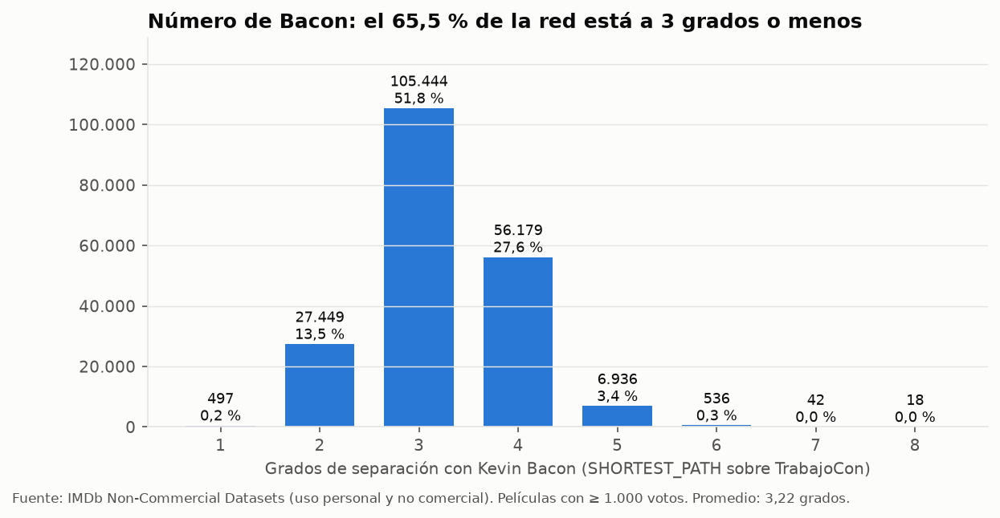

🇪🇸 [Español (full version)](README.md) · 🇬🇧 **English (summary)**

# 🎬 The film network in SQL Server: graphs, text search and windows on IMDb

Analysis of the **IMDb** catalog (6 TSV files, **205M rows**) written entirely in **T-SQL on SQL Server 2025 Express**. The TSV
files are loaded and filtered on the fly with row-by-row auditing, and a clean relational model and a **graph** are built on top.

## Results (real figures)

| Metric | Value |
|---|---|
| Rows read from the 6 TSV files | **205,515,409** (Python counts the rows and the engine reads exactly the same; **0 rejected**) |
| Filter applied | movies, non-adult, **≥ 1,000 votes** → **49,320 movies** |
| Graph | **203,547** people · **49,320** movies · **460,758** acted-in · **55,073** directed · **4,796,004** worked-with edges |
| Kevin Bacon | connected to **96.8%** of the network; **65.5%** is within **3 degrees**; average **3.22** |
| Graph vs. recursive CTE (Bacon → Shah Rukh Khan) | `SHORTEST_PATH` **2.1 s** · iterative BFS **1.2 s** · recursive CTE **62 s** (12.6M intermediate rows) |
| `MATCH` vs. `JOIN` (2-hop network) | **107 ms** vs. **22 ms**; recursive CTE, **437 ms** |
| Title search vs. `LIKE '%...%'` | **2–10 ms** vs. **~870 ms** |
| Quality checks | **29 of 29 OK** |
| Automated tests | **22 pass**, including a negative test and a recalculation of the filter in pandas |

**Findings**
- **The film world is small, but not as small as the myth says:** the largest group is at 3 degrees (51.8%) and the maximum is 8.
- **The "connectors" are not the biggest stars but the actors who work the most:** Nicolas Cage (969 collaborators), Michael
  Caine (951), Samuel L. Jackson (919) and Nassar (894), a Tamil cinema actor.
- **Directors with a loyal cast:** 6,575 director–actor pairs with 3 or more movies together.

**Architecture, all findings and reproduction commands:** [full README (Spanish)](README.md). Commands are
language-independent.
