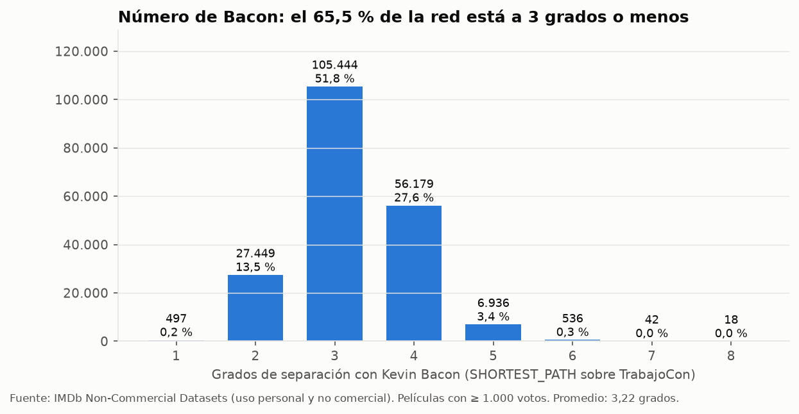
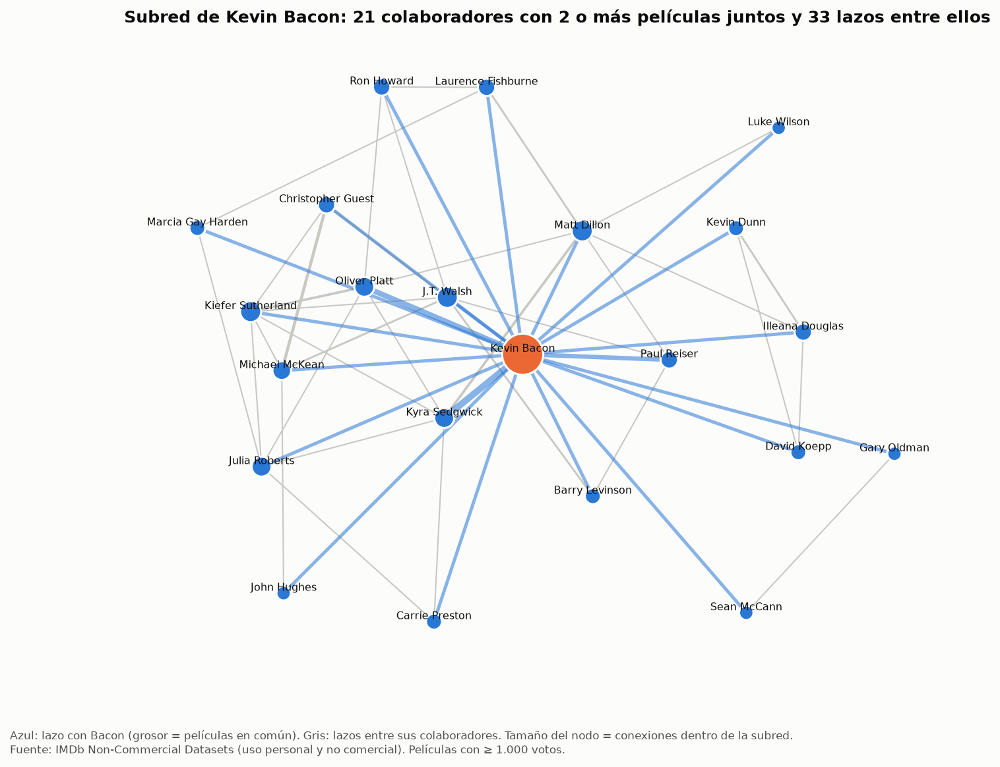
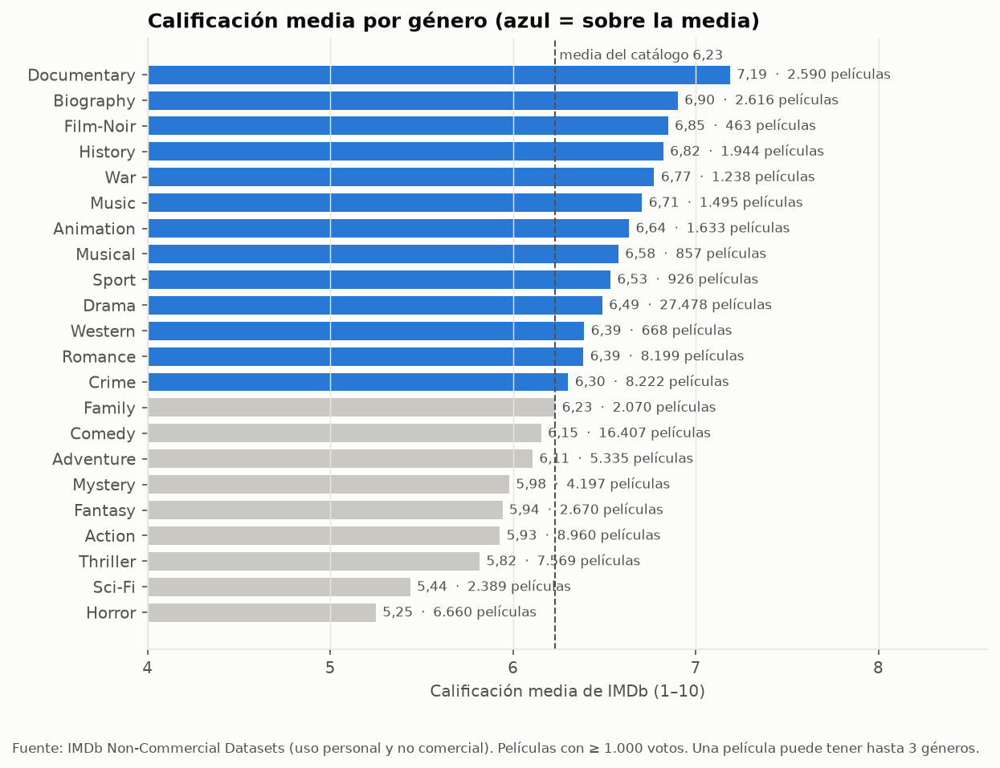
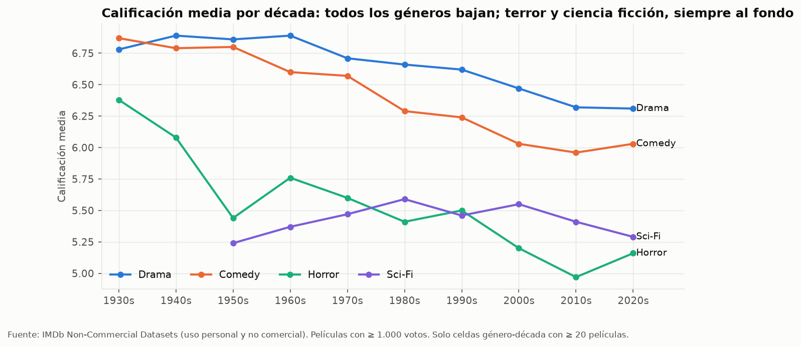
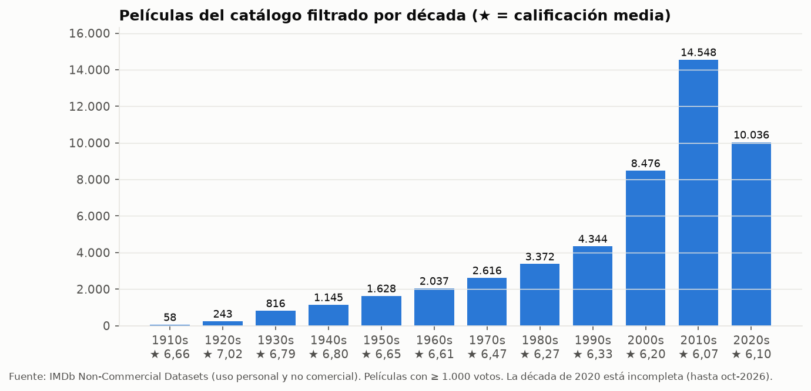
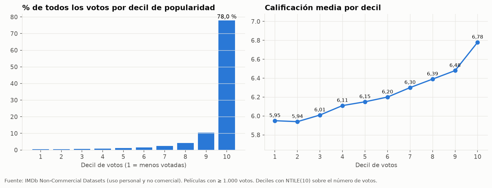
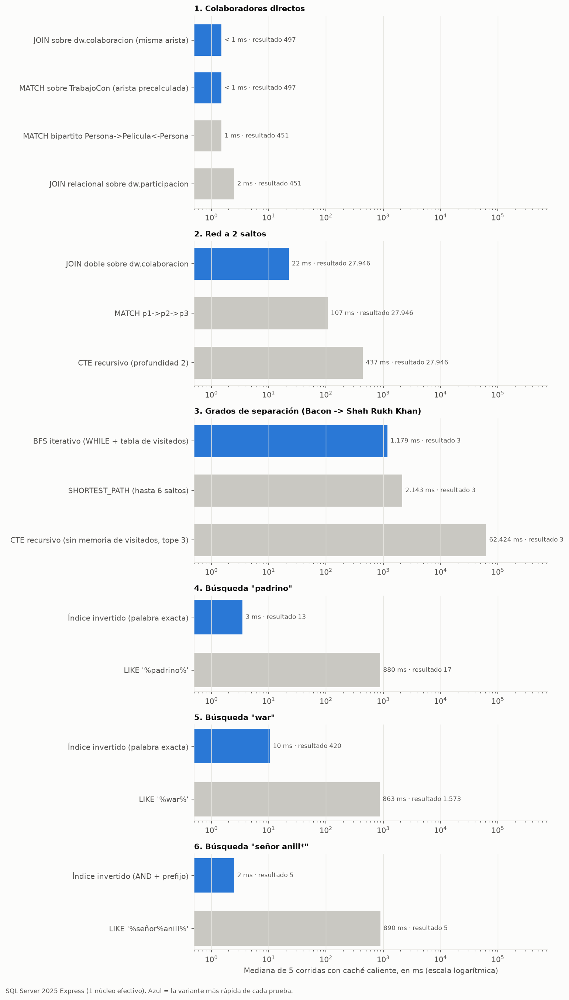
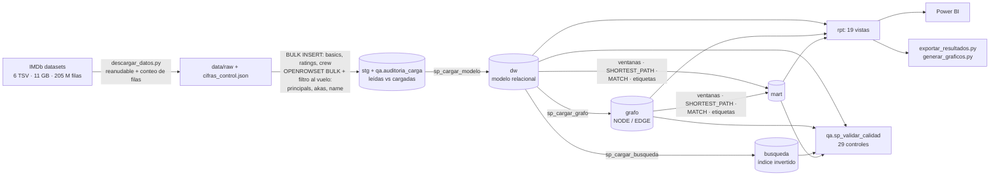
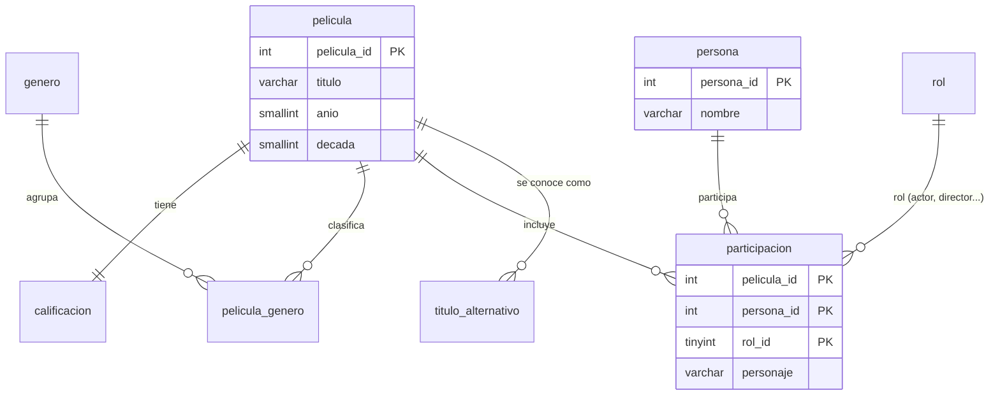
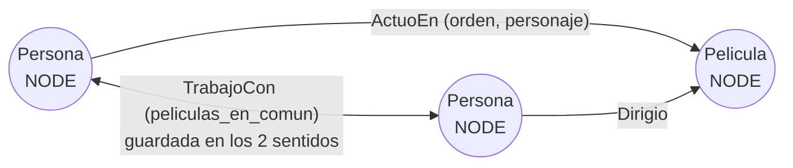

🇪🇸 **Español** · 🇬🇧 [English (summary)](README.en.md)

# 🎬 La red del cine en SQL Server: grafos, búsqueda de texto y ventanas sobre IMDb

Análisis del catálogo de **IMDb** (6 archivos TSV, **205 M de filas**, 102 M solo en `title.principals`) escrito íntegramente en **T-SQL sobre SQL Server 2025 Express**. Los TSV se cargan y filtran al vuelo con `BULK INSERT` / `OPENROWSET(BULK)` y auditoría fila a fila. Sobre esa carga se arma un modelo relacional limpio y un **grafo con SQL Graph** (`NODE`/`EDGE`, `MATCH`, `SHORTEST_PATH`) de **203.547 personas y 4,8 M de aristas**. Se agregan una búsqueda de títulos en cualquier idioma y análisis con funciones de ventana, y se compara el rendimiento del grafo con JOINs, CTE recursivo y BFS.


---

## 📌 Problema

Una plataforma de streaming quiere entender **la red de colaboración entre actores y directores**: quién trabaja con quién, a cuántos grados de separación están dos estrellas, qué núcleos de talento trabajan siempre juntos y qué directores repiten elenco. También quiere saber **qué géneros y épocas tienen mejor calificación**, para decidir qué licenciar y cómo armar colecciones. Además necesita que los usuarios encuentren una película escribiendo el título en su idioma ("El padrino", "Amelie").

## ✅ Resultados primero (cifras reales)

| Métrica | Valor |
|---|---|
| Filas leídas de los 6 TSV | **205.515.409** (auditoría: Python cuenta las filas del TSV y el motor lee exactamente las mismas; **0 rechazadas**) |
| Filtro aplicado | `titleType = movie`, no adultas, **≥ 1.000 votos** → **49.320 películas** |
| Grafo | **203.547** nodos `Persona` · **49.320** nodos `Pelicula` · **460.758** `ActuoEn` · **55.073** `Dirigio` · **4.796.004** `TrabajoCon` (2,4 M pares × 2 sentidos) |
| Kevin Bacon | conectado con el **96,8 %** de la red; el **65,5 %** está a **3 grados o menos**; promedio **3,22** grados |
| Grados de separación (`SHORTEST_PATH`) | Bacon → Tom Hanks **1** (*Apollo 13*) · Bacon → Shah Rukh Khan **3** · Ricardo Darín → Toshirō Mifune **3** |
| Grafo frente a CTE recursivo (Bacon → Shah Rukh Khan) | `SHORTEST_PATH` **2,1 s** · BFS iterativo **1,2 s** · CTE recursivo **62 s** (12,6 M filas intermedias) |
| `MATCH` frente a `JOIN` (red a 2 saltos, 27.946 personas) | **107 ms** frente a **22 ms**; el CTE recursivo, **437 ms** |
| Búsqueda de títulos frente a `LIKE '%...%'` | **2–10 ms** frente a **~870 ms**; `LIKE '%war%'` devuelve 1.573 películas, la búsqueda por palabra 420 (el resto son *Warrior*, *Edward*, *Stewart*…) |
| Controles de calidad | **29 de 29 en OK** (cero aristas huérfanas, simetría, Σ pesos = Σ k·(k−1)…) |
| Pruebas automáticas | **22 pasan** (pytest), incluida una prueba negativa y un recálculo del filtro en pandas |

### Seis grados de separación (ejemplos reales de `mart.ejemplo_separacion`, con el título original de IMDb)

| De → a | Grados | Camino (película que une cada salto) |
|---|---:|---|
| Kevin Bacon → Tom Hanks | 1 | *Apollo 13* (1995) |
| Kevin Bacon → Shah Rukh Khan | 3 | Ray Romano (*The Best You Can*, 2025) → Anupam Kher (*The Big Sick*, 2017) → Shah Rukh Khan (*Dilwale Dulhania Le Jayenge*, 1995) |
| Ricardo Darín → Toshirō Mifune | 3 | Christian Slater (*The Summit*, 2017) → James Coburn (*Young Guns II*, 1990) → Toshirō Mifune (*Midway*, 1976) |
| Penélope Cruz → Bruce Lee | 3 | Johnny Depp (*Pirates of the Caribbean: On Stranger Tides*, 2011) → John Saxon (*A Nightmare on Elm Street*, 1984) → Bruce Lee (*Enter the Dragon*, 1973) |
| Charles Chaplin → Zendaya | 3 | Tippi Hedren (*A Countess from Hong Kong*, 1967) → Michael Keaton (*Pacific Heights*, 1990) → Zendaya (*Spider-Man: Homecoming*, 2017) |
| Cantinflas → Keanu Reeves | 3 | Robert Morley (*Around the World in 80 Days*, 1956) → Rosemary Harris (*Beau Brummell*, 1954) → Keanu Reeves (*The Gift*, 2000) |



## 📊 Hallazgos

**1. El mundo del cine es pequeño, pero no tanto como dice el mito.** Con un solo `SHORTEST_PATH` desde Kevin Bacon se recorre toda la red en **35 s**. Bacon tiene **497 colaboradores directos**, 27.449 personas están a 2 grados y 105.444 a 3 (el grupo más grande: 51,8 %). El máximo es **8 grados** (18 personas). Hay **6.445 personas (3,2 %) sin ningún camino** hacia Bacon: son elencos de cines aislados con poca presencia en IMDb.

**2. Los "conectores" no son las mayores estrellas: son los actores que más trabajan.** Por número de colaboradores distintos (grado del nodo con `MATCH`) arriba están Nicolas Cage (969), Michael Caine (951), Samuel L. Jackson (919) y **Nassar** (894), actor del cine tamil. Anupam Kher (831) es el puente natural entre Hollywood y Bollywood: aparece en el camino de Bacon a Shah Rukh Khan.

**3. Directores con elenco fiel.** Hay **6.575 pares director–actor con 3 o más películas juntos**. Los récords son Kartal Tibet con Kemal Sunal (**26 películas**, comedia turca), la saga *Carry On* de Gerald Thomas (Joan Sims y Kenneth Williams, **25**), Yasujirō Ozu con Chishū Ryū (**20**) y Akira Kurosawa con Takashi Shimura (**19**) y Toshirō Mifune (**16**). Por número de actores fieles mandan Michael Curtiz (**38**), Priyadarshan (34), Ingmar Bergman, Ishirō Honda y John Ford (31 cada uno). Para una plataforma, estos pares son colecciones listas para programar.

**4. Núcleos de talento.** Si se miran solo los lazos fuertes (3+ películas juntos), la red se parte en **935 núcleos** (componentes conexas calculadas con propagación de etiquetas en 22 vueltas). El mayor reúne **5.433 personas** de Hollywood y Europa (Samuel L. Jackson, Michael Caine, Nicolas Cage, Gérard Depardieu); el segundo, **1.435**, al cine indio (Nassar, Prakash Raj, Anupam Kher, Amitabh Bachchan); siguen el anime y el cine japonés actual (412), la comedia turca de Kemal Sunal (203) y el Japón clásico de Kurosawa y Mifune (198). Sirven para detectar mercados con su propia red de talento.



**5. Documental, biografía y cine negro son los géneros mejor calificados; terror y ciencia ficción, los peores.** Calificación media (géneros con ≥ 100 películas): Documentary **7,19** · Biography 6,90 · Film-Noir 6,85 · History 6,82, frente a Sci-Fi **5,44** y Horror **5,25** (media del catálogo: 6,23). El terror y la ciencia ficción tienen muchas películas de bajo presupuesto que llegan a 1.000 votos, lo que baja su media aunque sus mejores títulos encabecen el ranking de su década (*Alien*, *Aliens* e *Inception* en ciencia ficción; *Alien* y *The Shining* en terror). Todas las líneas bajan con el tiempo: es el sesgo de supervivencia del punto 6.




**6. La producción se dispara desde los 2000.** Las décadas de 2010 (**14.548** películas) y 2020 (**10.036** hasta oct-2026) concentran la mitad del catálogo filtrado. Las décadas antiguas tienen mejor calificación media: es un sesgo de supervivencia, porque del cine de los 50 solo llegan a 1.000 votos los clásicos.



**7. La popularidad está muy concentrada.** El **10 %** de películas más votadas reúne el **78 %** de todos los votos (`NTILE(10)`). La mediana es de **3.326** votos, el percentil 90 de **46.282** y el 99 de **429.020**; el máximo, *The Shawshank Redemption*, tiene 3.255.291. Las más votadas también están algo mejor calificadas (6,78 frente a 5,95 en el decil más bajo).



**8. Mejores películas por década y género** (`ROW_NUMBER` sobre la calificación ponderada bayesiana de IMDb). Ejemplos: Drama — *The Godfather* (70s), *The Shawshank Redemption* (90s); Sci-Fi — *2001* (60s), *The Matrix* (90s), *Inception* (2010s); Horror — *Psycho* (60s), *The Shining* (80s), *The Silence of the Lambs* (90s). La tabla completa está en `reports/tablas/mejor_decada_genero.csv`.

## ⚡ Grafo frente a relacional: cuándo conviene cada uno

Mediana de 5 corridas con caché caliente (`qa.sp_medir_rendimiento`). `dw.colaboracion` tiene **exactamente las mismas aristas** que `grafo.TrabajoCon`, como tabla normal, para que la comparación sea justa.

| Prueba | Variante | ms | Resultado |
|---|---|---:|---:|
| Colaboradores directos de Bacon | `JOIN` sobre `dw.colaboracion` | < 1 | 497 |
| | `MATCH` sobre `TrabajoCon` | < 1 | 497 |
| | `MATCH` bipartito Persona→Película←Persona (solo actuación) | 1 | 451 |
| | `JOIN` sobre `dw.participacion` (solo actuación) | 2 | 451 |
| Red a 2 saltos | `JOIN` doble sobre `dw.colaboracion` | 22 | 27.946 |
| | `MATCH(p1-(t1)->p2-(t2)->p3)` | 107 | 27.946 |
| | CTE recursivo (profundidad 2) | 437 | 27.946 |
| Grados Bacon → Shah Rukh Khan | BFS iterativo (`WHILE` + visitados) | 1.179 | 3 |
| | `SHORTEST_PATH` `{1,6}` | 2.143 | 3 |
| | CTE recursivo (sin visitados, tope 3) | 62.424 | 3 |

497 frente a 451: `TrabajoCon` incluye a los directores con los que trabajó Bacon; el patrón bipartito usa solo `ActuoEn`.



**Conclusión.**
- **Saltos fijos (1–2): relacional igual o más rápido.** `MATCH` se traduce a joins, pero cada salto pasa por la tabla de nodos para resolver `$node_id`, mientras `dw.colaboracion` une enteros directamente: a 2 saltos, 107 ms frente a 22 ms. A 1 salto la diferencia no se nota. El grafo se elige aquí por legibilidad: `MATCH(d-(dg)->m<-(ae)-a)` se lee como la pregunta "director que dirigió una película donde actuó a".
- **Profundidad variable: grafo.** El CTE recursivo no recuerda qué nodos ya visitó: re-explora los mismos caminos y genera 12,6 M de filas para llegar a 3 grados (**29× más lento**). `SHORTEST_PATH` hace la búsqueda en anchura bien hecha, en una consulta.
- **El BFS a mano gana por ~1 s** porque se detiene al encontrar el destino, mientras `SHORTEST_PATH` calcula los caminos hacia todos y se filtra después. Es la opción si se consulta mucho un par concreto, a cambio de mantener un algoritmo propio.
- **Agregaciones masivas (géneros, décadas, percentiles): relacional.** Es donde SQL Server es fuerte; el grafo no aporta nada ahí.

## 🔎 Búsqueda de títulos (Full-Text y su alternativa)

`FULLTEXTSERVICEPROPERTY('IsFullTextInstalled')` devuelve **0**: esta instalación de Express no incluye *Full-Text and Semantic Extractions for Search*. El código que crea el catálogo `cat_titulos` y el índice full-text está en `07_busqueda_texto.sql` y se ejecuta solo si el componente existe (cómo instalarlo: ver la guía). **No se pudo ejecutar ni medir aquí.** La alternativa medida es un **índice invertido en T-SQL**:

- `busqueda.titulo`: **680.894** textos distintos (título, original y 1,3 M títulos alternativos de `title.akas`).
- `busqueda.palabra`: **360.706** palabras con su frecuencia documental. `busqueda.indice`: **2.002.680** pares palabra→título.
- `busqueda.sp_buscar @modo = 'todas'` imita `CONTAINS(texto, '"señor" AND "anill*"')`; `@modo = 'libre'` imita `FREETEXT` (basta una palabra, se ordena por TF-IDF).

| Consulta | Índice invertido | `LIKE '%…%'` | Comentario |
|---|---|---|---|
| `padrino` | **13** películas en 3 ms; la 1.ª es *The Godfather* (por su título en español) | 17 en 880 ms | `LIKE` también trae palabras que contienen "padrino" (plurales, compuestos); el índice, sin *stemming*, no |
| `war` | **420** en 10 ms | **1.573** en 863 ms | 1.153 películas extra de `LIKE` por subcadenas: *Warrior*, *Edward*, *Stewart*… |
| `señor anill*` | **5** en 2 ms (las 4 de *El señor de los anillos* + la animada de 1978) | 5 en 890 ms | prefijo con `*` y AND |
| `amelie` | **3**: *Amélie* y dos títulos derivados | 7 | `LIKE` trae falsos positivos como *Trzy kamelie* (título polaco de *Now, Voyager*); `CI_AI` hace que "amelie" encuentre "Amélie" |
| `ciudad de dios` (modo libre) | *City of God* primero por TF-IDF | 2 | `FREETEXT` simulado: basta una palabra y el puntaje ordena |

Tiempos: mediana de 5 corridas en `reports/tablas/rendimiento.csv`. Aprendizaje de rendimiento: un `OR` en el `JOIN` (igualdad **o** `LIKE` de prefijo) obliga a recorrer las 360 mil palabras (~360 ms). `sp_buscar` lo separa en dos ramas con `UNION ALL`, y cada una hace una búsqueda (*seek*) en el índice.

## 🏗️ Arquitectura



### Modelo relacional (`dw`) y de grafo (`grafo`)





| Tabla | Tipo | Filas |
|---|---|---:|
| `dw.pelicula` · `dw.calificacion` | tabla | 49.320 |
| `dw.persona` | tabla | 332.341 |
| `dw.participacion` (principals 968.043 + crew 12.613) | tabla | 980.656 |
| `dw.pelicula_genero` (lista "Drama,Romance" normalizada) | tabla | 114.616 |
| `dw.titulo_alternativo` | tabla | 1.301.680 |
| `grafo.Persona` (actuación o dirección) | NODE | 203.547 |
| `grafo.Pelicula` | NODE | 49.320 |
| `grafo.ActuoEn` · `grafo.Dirigio` | EDGE | 460.758 · 55.073 |
| `grafo.TrabajoCon` | EDGE | 4.796.004 |

### Carga y auditoría (`qa.auditoria_carga`)

| Archivo | Método | Filas en el TSV | Leídas por el motor | En staging | s |
|---|---|---:|---:|---:|---:|
| title.basics | `BULK INSERT` | 12.881.680 | 12.881.680 | 12.881.680 | 24 |
| title.ratings | `BULK INSERT` | 1.723.302 | 1.723.302 | 1.723.302 | 2 |
| title.principals | `OPENROWSET(BULK)` + filtro | 102.413.745 | 102.413.745 | 981.137 | 312 |
| title.akas | `OPENROWSET(BULK)` + filtro | 59.862.879 | 59.862.879 | 1.301.680 | 198 |
| name.basics | `OPENROWSET(BULK)` + filtro | 15.751.276 | 15.751.276 | 332.341 | 68 |
| title.crew | `BULK INSERT` a tabla de paso + filtro | 12.882.527 | 12.882.527 | 49.320 | 39 |

**La auditoría encontró un problema real.** Leer `title.crew` con `OPENROWSET` dejaba **4 filas leídas de menos**: series de TV (*Television Theater*, *Morgenmagazin*…) con listas de guionistas de más de 8.000 bytes, el tope de un *format file*. No eran películas del estudio, pero en vez de aceptarlo se cambió el método: crew (0,4 GB) entra completo con `BULK INSERT` a una tabla `VARCHAR(MAX)` de paso y luego se filtra. Resultado: **0 filas rechazadas** en los 6 archivos. Aparte, 16 personas citadas en las películas no existen en `name.basics` y sus participaciones no entran (control 12).

## 🧠 Decisiones técnicas

| Decisión | Por qué |
|---|---|
| **Filtrar al leer** con `OPENROWSET(BULK, FORMATFILE) … WHERE EXISTS` | Cargar los 102 M de principals en staging pedía ~6 GB. SQL Server 2025 Express admite hasta **50 GB** por base (el límite de 10 GB era de versiones anteriores de Express), así que cabía, pero habría hecho la carga y los respaldos mucho más pesados. Filtrando, los datos ocupan ~2,5 GB (1,35 GB es `title.basics` completo) y la auditoría igual cuenta las 102 M filas leídas |
| Base con intercalación **`Latin1_General_100_CI_AI_SC_UTF8`** | `VARCHAR` con Unicode real (títulos en japonés, ruso, hindi) a 1 byte por carácter latino, y búsquedas que ignoran mayúsculas y tildes |
| `OPENROWSET` con **`CODEPAGE = 'RAW'` + `CAST(… AS VARBINARY)`** | `OPENROWSET` devuelve texto en la página de códigos del servidor (1252) y estropeaba los títulos no latinos. Se detectó comparando bytes con el TSV |
| Claves **INT** sacadas del identificador (`tt0111161` → 111161) | 4 bytes frente a ~10 y joins más rápidos; se conserva `tconst`/`nconst` para enlazar con IMDb |
| `TrabajoCon` **precalculada con peso** y en **dos sentidos** | Las aristas de SQL Graph son dirigidas; guardar ambos sentidos hace correctos `MATCH` y `SHORTEST_PATH`. El peso (películas en común) permite filtrar lazos fuertes |
| Red = **actuación + dirección** (no guionistas ni productores) | Es la red de colaboración que interesa a la plataforma; con todo el equipo técnico las aristas se multiplicarían ×4 |
| **Restricciones `CONNECTION`** en las aristas | El motor impide aristas entre tipos de nodo equivocados y borrar un nodo con aristas: no puede haber huérfanas |
| Calificación **ponderada bayesiana** para los rankings | Evita que una película de 9,5 con 1.200 votos le gane a *The Godfather* |
| **Índice invertido propio** al no haber Full-Text | Se verificó primero la propiedad del servidor; el código de Full-Text queda listo para cuando se instale |
| Parámetros del filtro como **datos** (`etl.parametro`) y carga **reanudable** | Cambiar el umbral no toca código; si la PC se apaga, `@reanudar = 1` no repite archivos completos |
| `qa.sp_validar_calidad` hace **`THROW`** si hay alertas | El pipeline y las pruebas fallan de forma visible |

### Limitaciones (honestas)

- **El filtro sesga la red** hacia el cine popular en IMDb: con todos los títulos los grados de separación serían otros. Las personas sin camino a Bacon (3,2 %) son, sobre todo, de cines poco votados.
- `title.principals` solo trae a los **créditos principales** (~20 por película), no el elenco completo: hay colaboraciones reales que no aparecen.
- `SHORTEST_PATH` **no usa pesos**: cuenta saltos, no la fuerza de la relación.
- **Full-Text no se pudo probar** en esta PC; el índice invertido no tiene *stemming* (war ≠ wars), sinónimos ni tesauro.
- Los tiempos son de una PC de escritorio (Ryzen 5 4600G) con Express, que usa en la práctica **1 núcleo**; en ediciones con paralelismo las proporciones pueden cambiar.
- Los datos de IMDb se actualizan a diario: las cifras corresponden a la descarga del **21-oct-2026**.

## 📈 Vistas para Power BI (`rpt`)

| Vista | Uso |
|---|---|
| `rpt.pelicula`, `rpt.pelicula_genero`, `rpt.participacion`, `rpt.persona` | Modelo base. `rpt.persona` ya trae el número de Bacon y el núcleo de talento |
| `rpt.peliculas_por_decada`, `rpt.genero_resumen`, `rpt.genero_decada`, `rpt.mejor_decada_genero` | Épocas y géneros |
| `rpt.percentil_votos`, `rpt.decil_votos`, `rpt.actor_prolifico_decada` | Popularidad y talento por década |
| `rpt.colaboracion_frecuente`, `rpt.top_colaboradores`, `rpt.elenco_fiel`, `rpt.nucleo_talento_resumen`, `rpt.numero_bacon_distribucion`, `rpt.ejemplo_separacion` | La red |
| `rpt.auditoria_carga`, `rpt.medicion` | Calidad de la carga y rendimiento |

## 🚀 Cómo reproducirlo

Requisitos: SQL Server 2025 Express (`localhost\SQLEXPRESS`), Python 3.14, ~15 GB libres para los TSV. Guía detallada: [`docs/GUIA_PASO_A_PASO.md`](docs/GUIA_PASO_A_PASO.md).

```powershell
cd imdb-grafos-sqlserver
py -3.14 -m venv .venv
.venv\Scripts\python -m pip install -r requirements.txt
.venv\Scripts\python scripts\descargar_datos.py                       # ~2 min, reanudable
New-Item -ItemType Directory -Force data\errores | Out-Null
icacls data /grant 'NT Service\MSSQL$SQLEXPRESS:(OI)(CI)RX' /T
icacls data\errores /grant 'NT Service\MSSQL$SQLEXPRESS:(OI)(CI)M'
icacls sql /grant 'NT Service\MSSQL$SQLEXPRESS:(OI)(CI)RX' /T
.\ejecutar.ps1                                                         # ~25 min (carga ~11 min)
.venv\Scripts\python scripts\exportar_resultados.py
.venv\Scripts\python scripts\generar_graficos.py
.venv\Scripts\python -m pytest
```

`ejecutar.ps1` calcula la ruta de la carpeta y se la pasa a `sqlcmd` como la variable `Proyecto`; el SQL no fija ninguna ruta. Sin el lanzador, el equivalente en `cmd` es (comillas obligatorias, ruta sin espacios):

```bat
sqlcmd -S "localhost\SQLEXPRESS" -E -C -I -b -f 65001 -v Proyecto="%CD%" -i sql\00_EJECUTAR_TODO.sql
```

```
imdb-grafos-sqlserver/
├── ejecutar.ps1        lanzador: calcula la ruta y corre el pipeline completo
├── LICENSE             MIT (código)
├── scripts/            descargar_datos.py · conexion.py · exportar_resultados.py · generar_graficos.py
├── sql/                00_EJECUTAR_TODO.sql + 01…11 (base, staging, carga, modelo, grafo, consultas,
│   └── formatos/       búsqueda, ventanas, rendimiento, vistas, calidad) · format files de OPENROWSET
├── tests/              test_descarga.py (sin internet) · test_pipeline_sql.py
├── reports/            metricas.json · tablas/*.csv · figures/*.png
├── data/               cifras_control.json (versionado) · raw/ (TSV, ignorado)
└── docs/               GUIA_PASO_A_PASO.md (incluye 12 preguntas de entrevista)
```

No se versiona ninguna muestra de los datos: la licencia de IMDb no permite redistribuirlos. Las pruebas del script de descarga usan archivos sintéticos.

## 📚 Fuente de datos y licencia

- **IMDb Non-Commercial Datasets**: https://datasets.imdbws.com/ · documentación: https://developer.imdb.com/non-commercial-datasets/
- Archivos: `title.basics`, `title.ratings`, `title.principals`, `title.crew`, `name.basics`, `title.akas` (versión publicada el 20 y 21-oct-2026, descargada el **21-oct-2026**).
- **Licencia:** "Information courtesy of IMDb (https://www.imdb.com). Used with permission." Los datos son para **uso personal y no comercial**; este proyecto es un portafolio educativo sin fines de lucro y no redistribuye los datos (se descargan con el script).
- **Código y datos:** el **código** de este repositorio es [MIT](LICENSE); los **datos** de IMDb siguen su propia licencia no comercial (arriba) y no se incluyen.
- **Tablas derivadas (`reports/tablas/`):** son resúmenes y extractos calculados a partir de los datos de IMDb (conteos, rankings, ejemplos de caminos, colaboraciones frecuentes), no una copia del conjunto de datos ni algo desde lo que se pueda reconstruir. Se publican con fines educativos y no comerciales, con la atribución *Information courtesy of IMDb (https://www.imdb.com). Used with permission.* Quien las reutilice debe respetar la licencia de IMDb (uso personal y no comercial) y puede regenerarlas con `scripts/exportar_resultados.py` a partir de su propia descarga.
