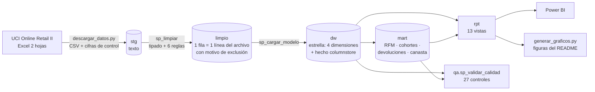
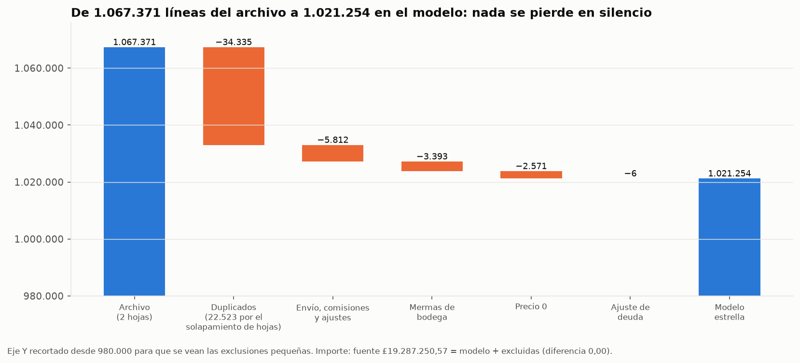
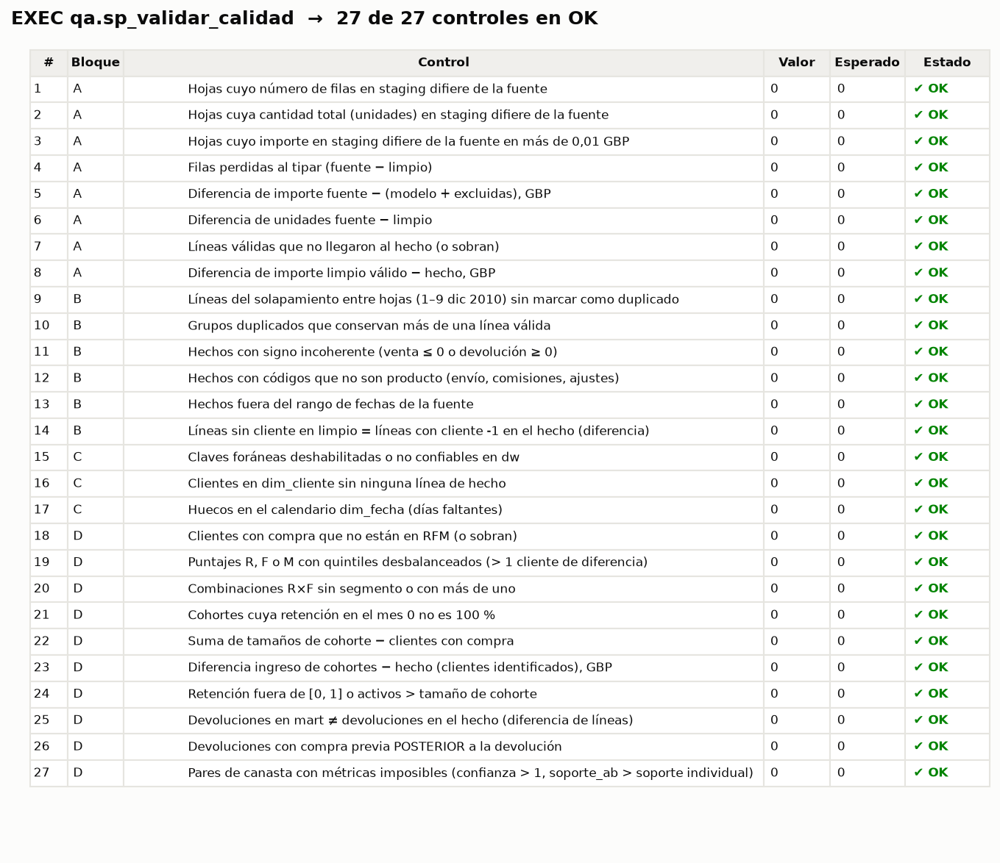
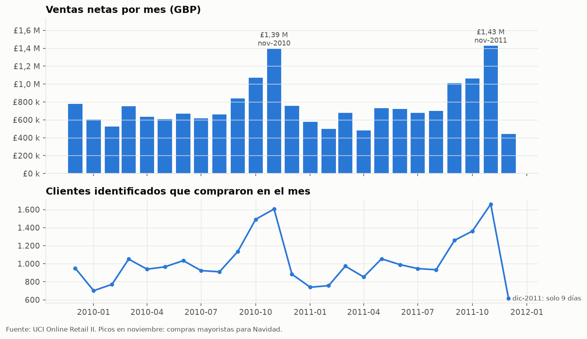
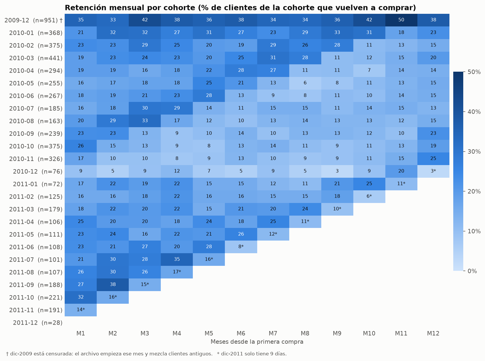
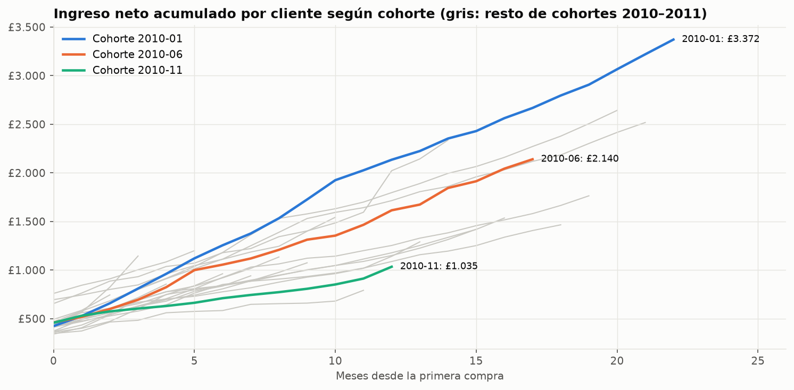
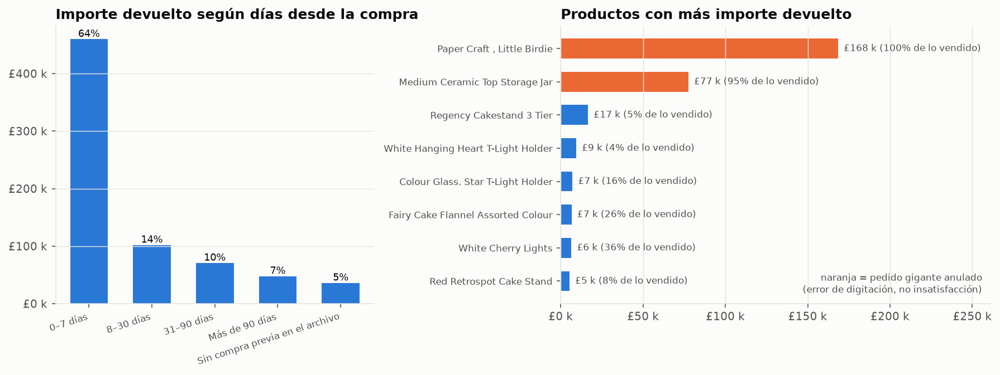
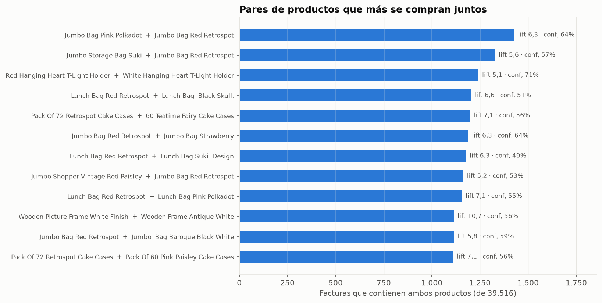

# 🛒 Clientes de un retail online: RFM, cohortes y retención en T-SQL

Análisis de clientes de una tienda online del Reino Unido (regalos y artículos para el hogar, muchos clientes mayoristas) con **1.067.371 líneas de factura de dic-2009 a dic-2011**. Todo el pipeline está escrito en **T-SQL sobre SQL Server**: carga con `BULK INSERT`, limpieza documentada línea por línea, modelo estrella, segmentación **RFM con `NTILE`**, **cohortes mensuales** con matriz de retención, devoluciones, **análisis de canasta** y vistas listas para Power BI. Cada etapa se reconcilia contra las cifras de control del archivo original.


---

## 📌 Problema

El área comercial quiere saber **quiénes son sus mejores clientes, cuántos vuelven a comprar, cuánto vale un cliente nuevo y qué productos conviene vender juntos**. Los datos vienen en un Excel de 45 MB con dos hojas, y no se pueden analizar tal como están:

- Hay **devoluciones** mezcladas con las ventas: facturas que empiezan con `C` y cantidades negativas.
- El **23 % de las líneas no tiene cliente**.
- Hay **duplicados**: las dos hojas se solapan del 1 al 9 de diciembre de 2010.
- Aparecen códigos que no son productos: envíos, comisiones de Amazon, ajustes manuales y ajustes de deuda.

Si se suman sin limpiar, los resultados salen inflados y los segmentos quedan mal armados.

## 🏗️ Arquitectura



| Capa | Qué contiene |
|---|---|
| `stg` | El CSV tal cual (todo texto), con hoja y fila de origen para el linaje |
| `limpio` | Las 1.067.371 líneas tipadas. **Ninguna se borra**: cada una lleva `motivo_exclusion` (NULL si entra al modelo) |
| `dw` | `fact_linea` (grano: línea de factura; devoluciones en negativo) + `dim_fecha`, `dim_cliente`, `dim_producto`, `dim_pais` |
| `mart` | `cliente_rfm`, `regla_segmento`, `cohorte_mes`, `devolucion_linea`, `canasta_par` |
| `rpt` | Vistas en español para Power BI: lo único que lee el reporte |
| `qa` | Cifras de control de la fuente, bitácora de cargas y resultados de los controles |

## 🧹 Limpieza: problemas reales de los datos y cómo se resolvieron

| Problema encontrado en el perfilado | Líneas | Decisión |
|---|---:|---|
| **Las dos hojas se solapan** del 1 al 9 de dic-2010 (22.523 líneas idénticas en ambas) | 22.523 | Duplicado: se conserva la de la hoja más antigua |
| Duplicados exactos dentro de la misma hoja (las 8 columnas iguales) | 11.812 | Duplicado: se conserva la primera |
| Códigos que no son producto: `POST`, `DOT`, `M`, `AMAZONFEE`, `BANK CHARGES`, `CRUK`, vales `gift_*`... | 5.812 | Fuera del modelo (no son venta de producto); quedan en `limpio.codigo_especial` |
| Cantidad negativa **sin** factura `C` y precio 0 ("damaged", "lost", "check"...) | 3.393 | Movimientos de bodega, no devoluciones de clientes |
| Precio 0 en facturas normales | 2.571 | Fuera: no generan ingreso ni representan una compra |
| Facturas `A` "Adjust bad debt" (−£147.614) | 6 | Ajuste contable, fuera |
| Facturas `C` (cancelaciones/devoluciones) | 17.914 válidas | **Entran** con cantidad e importe negativos (`es_devolucion = 1`) |
| Líneas sin `Customer ID` | 227.089 válidas | **Entran** (son £2,57 M de ingreso real, el 13,6 %) con cliente `-1`; quedan fuera de RFM y cohortes |
| 599 códigos de producto con varias descripciones | — | `dim_producto` usa la descripción más frecuente |



## ✅ Resultado de la ejecución (cifras reales)

| Métrica | Valor |
|---|---|
| Líneas en el archivo (2 hojas) | **1.067.371** (525.461 + 541.910) |
| Líneas en el modelo estrella | **1.021.254** (95,68 %) |
| Reconciliación fuente = modelo + excluidas | filas, unidades e importe (**£19.287.250,57**): diferencia **0** |
| Controles de calidad | **27 de 27 en OK** |
| Pruebas automáticas (pytest) | **27 pasan**, incluida una prueba negativa que altera un importe y verifica que el control lo detecta |
| `BULK INSERT` del CSV de 116 MB | **~4 s** |
| Pipeline completo desde cero (`00_EJECUTAR_TODO.sql`) | **~5 min** |
| Facturas de venta · clientes · productos · países | 39.516 · 5.875 · 4.738 · 43 |



## 📊 Hallazgos

| Métrica | Valor |
|---|---|
| Ventas brutas de producto | **£19,64 M** |
| Devoluciones | **£716 mil** (3,65 % de lo vendido) |
| Ventas netas | **£18,93 M** |
| Ticket promedio por factura | **£497** |
| Ingreso de clientes no identificados | **13,6 %** |



**1. Pareto extremo.** El 20 % de los clientes genera el **76,8 %** del ingreso neto (0,7677 en `pareto_clientes.csv`), y apenas 58 clientes (el 1 %) generan el **31,1 %**. Irlanda aporta el 3,2 % de las ventas con solo **3 clientes**: son mayoristas (`mercados_top.csv`).

**2. RFM: dos segmentos sostienen el negocio.** *Campeones* y *Leales* son el 34 % de los clientes y hacen el **81 %** del ingreso. *Hibernando* es el segmento más grande (26 % de los clientes) y solo aporta el 3,2 %.


| Segmento | Clientes | % ingreso | Recencia media | Facturas medias | Acción sugerida |
|---|---:|---:|---:|---:|---|
| Campeones | 838 | 52,6 % | 9 días | 19,0 | Recompensar, acceso anticipado |
| Leales | 1.150 | 28,4 % | 66 días | 9,8 | Venta cruzada, fidelización |
| En riesgo | 741 | 6,2 % | 369 días | 3,9 | Campaña de recuperación |
| **No se pueden perder** | **74** | **3,1 %** | **331 días** | **16,1** | **Contacto directo** |
| Hibernando | 1.527 | 3,2 % | 457 días | 1,3 | Reactivación barata o dejar ir |

> **74 clientes "No se pueden perder"** compraban en promedio 16 veces (£6.868 cada uno) y llevan casi un año sin volver. Suman **£508 mil**: es la lista de llamadas con mejor retorno para el equipo comercial.

**3. Retención: 1 de cada 5 vuelve al mes siguiente.** Sin contar la cohorte censurada, la retención promedio es **20,7 % en el mes 1**, **17,3 % en el mes 6** y **17,9 % en el mes 12**. El **27,6 %** de los clientes compró una sola vez. La cohorte de dic-2009 muestra 35–50 % porque el archivo empieza ese mes y mezcla clientes que ya eran antiguos. Es un sesgo de censura, no un mejor mes de captación, y por eso se marca y se excluye de los promedios (cifras en `retencion_promedio.csv`).



**4. Estacionalidad dentro de la matriz.** El otoño de 2011 aparece como una diagonal más oscura. Las cohortes de septiembre, octubre y noviembre de 2010 venían con 8–15 % de retención y suben a **23 %, 19 % y 25 %** justo en su mes 12: la temporada navideña reactiva a clientes dormidos.

**5. No todos los clientes nuevos valen lo mismo.** A 12 meses, un cliente captado en enero de 2010 acumula **£2.136** netos, y uno captado en noviembre de 2010 solo **£1.035**: la mitad. Los clientes que llegan en temporada navideña compran una vez y se van. Conviene medir el costo de adquisición por cohorte, no solo en promedio.



**6. Dos errores de digitación explican un tercio de las devoluciones.** Un pedido de **80.995 unidades** de "Paper Craft, Little Birdie" (£168.470) se anuló **12 minutos después**, y otro de **74.215** frascos de cerámica (£77.184) se anuló 16 minutos después. Juntos son el **34 %** de todo el importe devuelto. Sin ellos la tasa de devolución baja de 3,65 % a ~2,4 %. Además, el **64 %** del importe devuelto vuelve en los primeros 7 días (mediana: 10 días; `devoluciones_plazo.csv`), y España tiene la tasa más alta entre los mercados relevantes (**13,3 %**; `devoluciones_por_pais.csv`).



**7. Canasta: se compran colecciones, no productos sueltos.** El par más frecuente (Jumbo Bag Pink Polkadot + Jumbo Bag Red Retrospot) aparece en **1.428 facturas**, con lift 6,3. Los lifts más altos son variantes de una misma línea: vasos y platos *Skull* (**lift 77**, confianza 81 %), platos *Regency* rosa y verde (lift 74), habitaciones de *Poppy's Playhouse*. La recomendación es vender por colección (packs y "completa el set") en lugar de recomendar productos sueltos.



Las cifras de los hallazgos 1, 3 y 6 que no salen de una figura están en `reports/tablas/` (`pareto_clientes.csv`, `mercados_top.csv`, `retencion_promedio.csv`, `devoluciones_por_pais.csv`, `devoluciones_plazo.csv`), generadas por `scripts/exportar_hallazgos.py` desde las vistas `rpt` y los marts.

## 🧠 Decisiones técnicas

| Decisión | Por qué |
|---|---|
| **No borrar nada en la limpieza**: cada línea lleva un `motivo_exclusion` | Permite reconciliar fuente = modelo + excluidas por filas, unidades e importe. Cualquier exclusión se puede auditar y revertir |
| **Cifras de control calculadas fuera de SQL** (Python lee el Excel) y leídas con `OPENROWSET … SINGLE_CLOB` + `OPENJSON` | El control es independiente del motor que se controla |
| Devoluciones **dentro** del hecho, en negativo | `SUM(importe)` da ventas netas sin lógica extra en Power BI; `es_devolucion` separa bruto y devuelto |
| Clientes nulos **dentro** del hecho con clave `-1` | Son el 13,6 % del ingreso: excluirlos subestimaría las ventas. Solo se excluyen de los análisis por cliente |
| `NTILE(5)` con **desempate explícito** (F se desempata por monto, todo termina en `cliente_id`) | El 27,6 % de los clientes tiene frecuencia 1 y `NTILE` reparte los empates de forma arbitraria. El desempate hace el resultado determinista y con sentido de negocio. Un control verifica que los quintiles difieran como máximo en 1 cliente |
| Reglas de segmento como **datos** (`mart.regla_segmento`) | Negocio puede cambiar el mapa R×F sin tocar código. Un control garantiza que las 25 combinaciones tengan exactamente un segmento |
| Matriz de cohortes en **formato largo** + `PIVOT` dinámico | El formato largo es el que necesita Power BI (matriz con formato condicional). El `PIVOT` es solo para leerla en SSMS |
| Rejilla completa cohorte × mes (`LEFT JOIN`) | Los meses sin actividad quedan con 0 % en lugar de desaparecer, así el promedio de retención no sale inflado |
| Canasta con **auto-join acotado** (productos en ≥ 200 facturas, pares con ≥ 100) en tablas temporales indexadas | El auto-join crece con el cuadrado de los productos por factura. Acotado, tarda menos de 1 min y produce 28.635 pares |
| Días hasta la devolución con `MAX() OVER (… ROWS UNBOUNDED PRECEDING)` | Una sola pasada sobre el hecho en lugar de 18 mil `OUTER APPLY` |
| Hecho con **columnstore agrupado** + PK no agrupada | Agregaciones rápidas sin renunciar a la unicidad de `linea_id` (linaje hasta la fila del Excel) |
| `qa.sp_validar_calidad` hace `THROW` si hay alertas | El pipeline y las pruebas fallan de forma visible: nada pasa en silencio |

## ⚠️ Limitaciones

- **Un solo comercio, de otro país y de otra época.** Es una tienda mayorista y minorista del Reino Unido entre 2009 y 2011; los patrones de retención, estacionalidad y canasta no se pueden extrapolar a otro negocio sin revisarlos.
- **La cohorte de dic-2009 está censurada y dic-2011 está incompleto** (9 días). Se marcan y se excluyen de los promedios de retención, pero eso deja pocas cohortes en los meses lejanos (11 cohortes en el mes 12).
- **El 13,6 % del ingreso no tiene cliente.** Entra a las ventas, pero no a RFM, cohortes ni retención, que miden solo a los clientes identificados.
- **Retención = volver a comprar en el mes exacto.** No distingue a quien vuelve dos meses después; un cliente mayorista que compra cada trimestre aparece con meses de 0 %.
- **RFM con cortes por quintiles** (`NTILE`): los cortes dependen de la distribución de este archivo y el mapa de segmentos (`mart.regla_segmento`) es criterio propio, no un estándar.
- **Las exclusiones de limpieza son decisiones documentadas, no verdades.** Precio 0, códigos especiales y movimientos de bodega se apartan por criterio; cada una conserva su `motivo_exclusion` para revertirla.
- **Las devoluciones no se enlazan a su factura original.** El archivo no lo permite: los días hasta la devolución se calculan contra la última compra previa del mismo cliente y producto, y 1.858 líneas no tienen compra previa en el archivo (compra anterior a dic-2009).
- **Solo hay asociación, no causalidad.** El lift de la canasta muestra qué se compra junto, no qué se vendería más recomendándolo.

## 📈 Vistas para Power BI (`rpt`)

| Vista | Uso |
|---|---|
| `rpt.fact_ventas` + `rpt.dim_fecha`, `rpt.dim_cliente`, `rpt.dim_producto`, `rpt.dim_pais` | Modelo estrella. `dim_cliente` ya trae el segmento RFM para filtrar cualquier visual |
| `rpt.kpi_mensual` | Ventas brutas/netas, devoluciones, facturas, clientes activos, ticket, tasa de devolución |
| `rpt.rfm_cliente`, `rpt.rfm_segmentos` | Detalle por cliente y resumen por segmento con acción sugerida |
| `rpt.cohorte_retencion` | Matriz (cohorte × mes) con banderas de censura y de mes incompleto |
| `rpt.devoluciones_producto`, `rpt.devoluciones_pais`, `rpt.devoluciones_tiempo` | Tasas de devolución y días hasta la devolución |
| `rpt.canasta_pares` | Pares con soporte, confianza y lift |

## 🚀 Cómo reproducirlo

Guía completa, con preguntas de entrevista: **[docs/GUIA_PASO_A_PASO.md](docs/GUIA_PASO_A_PASO.md)**

```powershell
# 1. Entorno y datos (~3 min: descarga 45 MB y convierte el Excel a CSV)
py -3.14 -m venv .venv
.venv\Scripts\python -m pip install -r requirements.txt
.venv\Scripts\python scripts\descargar_datos.py

# 2. Permiso de lectura para la cuenta del servicio de SQL Server sobre data\
icacls data /grant 'NT Service\MSSQL$SQLEXPRESS:(OI)(CI)RX' /T

# 3. Pipeline completo en T-SQL (~5 min)
#    El lanzador calcula la ruta de la carpeta y se la pasa a sqlcmd como la variable "Proyecto"
.\ejecutar.ps1

# 4. Figuras, tablas de hallazgos y pruebas
.venv\Scripts\python scripts\generar_graficos.py
.venv\Scripts\python scripts\exportar_hallazgos.py
.venv\Scripts\python -m pytest
```

Sin el lanzador, el paso 3 equivale a este comando de `cmd` (la ruta de la carpeta es un parámetro; las comillas del valor son obligatorias y la ruta no puede tener espacios):

```bat
sqlcmd -S "localhost\SQLEXPRESS" -E -C -I -b -f 65001 -v Proyecto="%CD%" -i sql\00_EJECUTAR_TODO.sql
```

Cifras para verificar tu ejecución: **[docs/cifras_control.md](docs/cifras_control.md)**

## 📁 Estructura

```
├── ejecutar.ps1                 lanzador: calcula la ruta y corre el pipeline completo
├── LICENSE                      MIT (código)
├── data/
│   ├── raw/                     Excel, zip y CSV (no versionados)
│   └── cifras_control.json      filas, unidades e importe por hoja, calculados del Excel
├── docs/                        guía paso a paso y cifras de control
├── reports/
│   ├── figures/                 8 figuras generadas desde las vistas rpt
│   └── tablas/                  resultados en CSV (matriz de retención, segmentos, pares...)
├── scripts/
│   ├── descargar_datos.py       descarga, Excel → CSV, cifras de control
│   ├── generar_graficos.py      figuras desde SQL Server
│   ├── exportar_hallazgos.py    CSV con las cifras del README que no salen de una figura
│   └── conexion.py
├── sql/
│   ├── 00_EJECUTAR_TODO.sql     pipeline completo (modo SQLCMD)
│   ├── 01–03                    base, staging, BULK INSERT + cifras de control
│   ├── 04                       limpieza documentada (6 reglas)
│   ├── 05                       modelo estrella
│   ├── 06–09                    RFM, cohortes, devoluciones, canasta
│   ├── 10                       vistas para Power BI
│   ├── 11                       27 controles de calidad
│   └── 12                       consultas que respaldan cada hallazgo
└── tests/                       pytest: controles, prueba negativa, RFM, cohortes, canasta, vistas
```

## 📚 Fuente y licencia de los datos

**Online Retail II**: Chen, D. (2012). UCI Machine Learning Repository. [https://doi.org/10.24432/C5CG6D](https://doi.org/10.24432/C5CG6D) · [descarga](https://archive.ics.uci.edu/static/public/502/online+retail+ii.zip).
Licencia **[CC BY 4.0](https://creativecommons.org/licenses/by/4.0/)**. Importes en libras esterlinas (GBP). Los `Customer ID` son identificadores anónimos.

**Licencias:** el **código** de este repositorio es [MIT](LICENSE); los **datos** de Online Retail II siguen su propia licencia (CC BY 4.0, con atribución a Chen, D., 2012) y no se redistribuyen aquí: se descargan con `scripts/descargar_datos.py`.

## 👤 Autor

**Erick Guarnizo** · Ingeniero en Sistemas · [LinkedIn](https://www.linkedin.com/in/erick-g-571a7b3b4)
