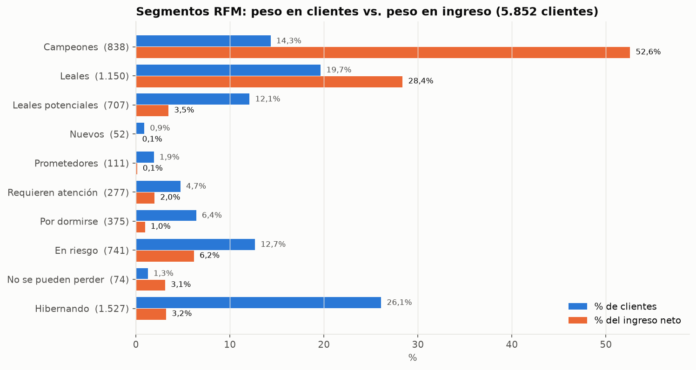

🇺🇸 **English (summary)** · 🇪🇸 [Español (full version)](README.es.md)

# 🛒 Customers of an online retailer: RFM, cohorts and retention in T-SQL

Customer analysis of a UK online store (gifts and homeware, many wholesale customers) with **1,067,371 invoice lines from Dec
2009 to Dec 2011**. The whole pipeline is written in **T-SQL on SQL Server**: load, line-by-line documented cleaning, star
schema, **RFM** segmentation, cohorts and basket analysis.

## Results (real figures)

| Metric | Value |
|---|---|
| Lines in the file (2 sheets) | **1,067,371** |
| Lines in the star schema | **1,021,254** (95.68%) |
| Reconciliation source = model + excluded | rows, units and amount (**£19,287,250.57**): difference **0** |
| Quality checks | **27 of 27 OK** |
| Automated tests (pytest) | **27 pass**, including a negative test that alters an amount and checks that the control detects it |
| Full pipeline from scratch | **~5 min** |

**No line is deleted:** each of the 1,067,371 lines keeps the reason why it does or does not enter the model (for example, 22,523
lines repeated between the two sheets, or 227,089 valid lines without a customer, which do count as revenue).

## Findings

- **Extreme Pareto:** 20% of customers generate **76.8%** of net revenue, and just 58 customers (1%) generate **31.1%**.
- **Two segments support the business:** *Champions* and *Loyal* are 34% of customers and make **81%** of revenue.
- Gross product sales **£19.64M**, returns **£716 thousand** (3.65%), net sales **£18.93M**, average ticket **£497**; unidentified
  customers are **13.6%** of revenue.

| Segment | Customers | % revenue | Mean recency | Suggested action |
|---|---:|---:|---:|---|
| Champions | 838 | 52.6% | 9 days | Reward, early access |
| Loyal | 1,150 | 28.4% | 66 days | Cross-selling, loyalty |
| At risk | 741 | 6.2% | 369 days | Win-back campaign |
| **Cannot lose them** | **74** | **3.1%** | **331 days** | **Direct contact** |

**Architecture, cleaning rules, cohorts and reproduction commands:** [full README (Spanish)](README.es.md). Commands are
language-independent.
