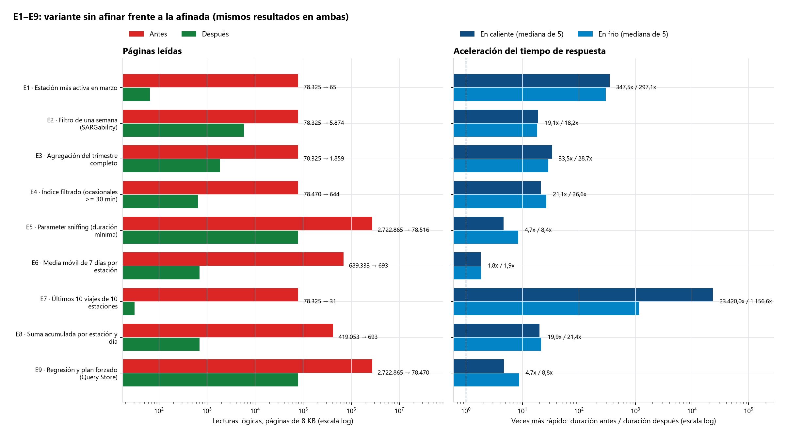

🇺🇸 **English (summary)** · 🇪🇸 [Español (full version)](README.es.md)

# Performance lab in SQL Server with Citi Bike New York (January–March 2024)

**Question:** how much do response time and pages read change when the physical design is chosen well (heap, covering indexes,
filtered indexes, columnstore) and when the query is rewritten (SARGable predicates, window functions, `CROSS APPLY`, set-based
operations), and how much of the improvement comes from each change?

**Data:** 6,672,881 Citi Bike New York trips; after cleaning, **6,653,987 valid trips** (99.72%).

**Method:** each variant runs once to compile and warm up, 5 times **warm** and 5 times **cold**; the **median** is reported.
260 measured runs, 40/40 quality checks OK.

## Results

In the nine experiments, the tuned variant reads between **92.50%** and **99.96%** fewer pages than the original and returns
exactly the same result. The large speedups appear when the original query scans the whole table and the tuned one reads a few
pages (E1, E7); when both versions scan the same data, the gain comes from CPU and is moderate (E6: 1.8x warm).

| Experiment | Before | After | Page reduction | Speedup (warm) |
|---|---|---|---:|---:|
| E1 · covering index | Table scan on a heap | Index seek with `INCLUDE` | 99.92% | 347x |
| E2 · SARGable predicate + clustered index | `YEAR()/MONTH()/DAY()` on a heap | `>=` / `<` range with a clustered index | 92.5% | 19.1x |
| E3 · columnstore | Row-mode table scan | Clustered columnstore, batch mode | 97.6% | 33.5x |
| E4 · filtered index | Clustered index scan | Filtered index | 99.18% | 21.1x |

2×2 designs in E2 and E7 separate how much the index contributes and how much the rewrite does: in E2, rewriting alone on a heap
saves no pages (0.00%) and the index alone does not either (−0.19%); only both together reach 92.5%.

**All nine experiments, execution plans, caveats and reproduction commands:** [full README (Spanish)](README.es.md). Commands are
language-independent.
