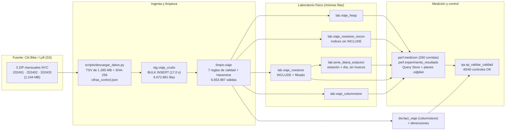
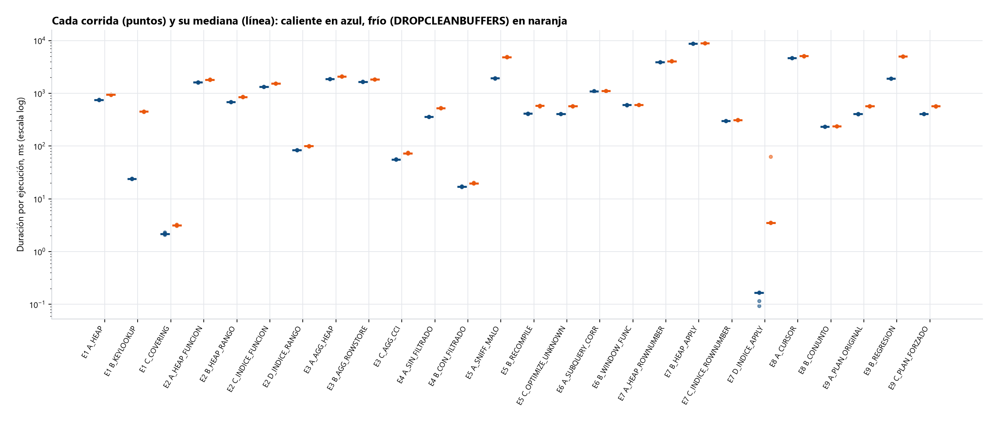
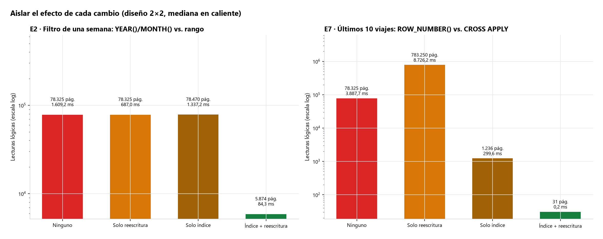
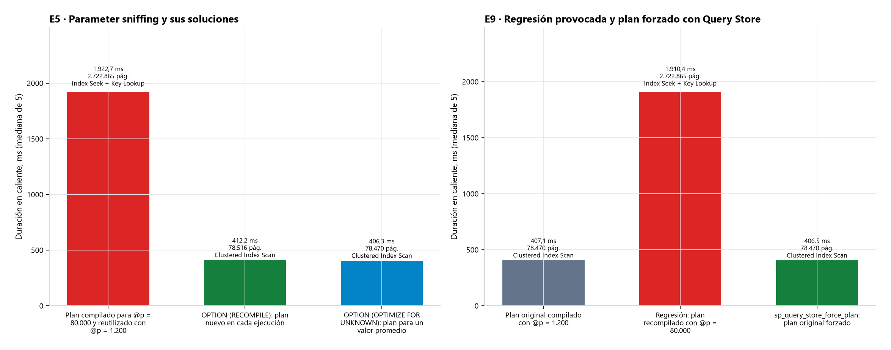
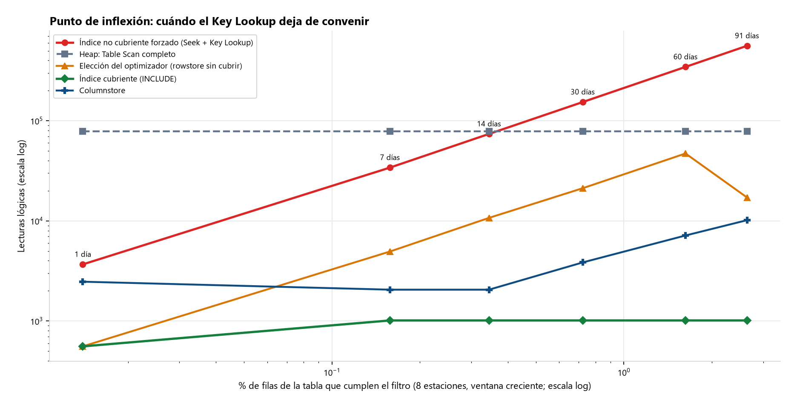
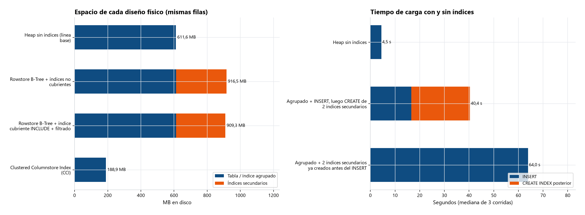
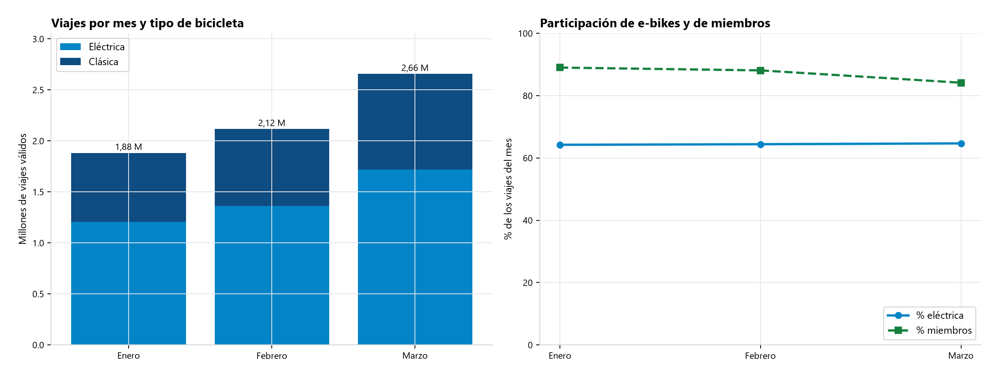
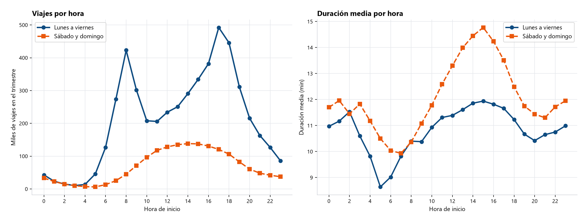
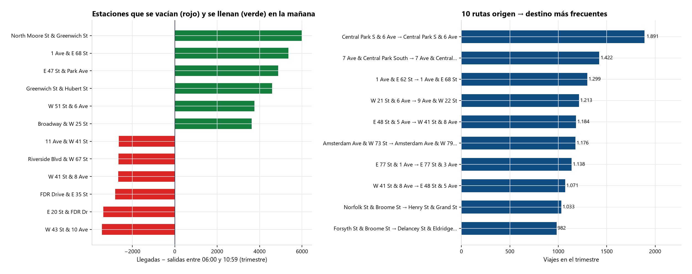
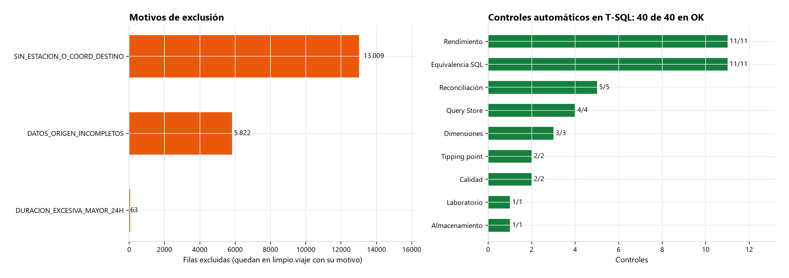

🇪🇸 **Español** · 🇬🇧 [English (summary)](README.en.md)

# Laboratorio de rendimiento en SQL Server con Citi Bike Nueva York (enero–marzo 2024)

[](sql/00_EJECUTAR_TODO.sql)
[](data/cifras_control.json)
[-15803d)](sql/06_laboratorio_tuning.sql)
[](sql/08_calidad_y_reconciliacion.sql)
[](tests/)

**Pregunta:** ¿cuánto cambian el tiempo de respuesta y las páginas leídas cuando se elige bien el diseño físico (heap, índices cubrientes, índices filtrados, columnstore) y cuando se reescribe la consulta (predicados SARGables, funciones de ventana, `CROSS APPLY`, operaciones en conjunto), y qué parte de la mejora corresponde a cada cambio?

**Datos:** 6.672.881 viajes de **Citi Bike Nueva York** (sistema principal, no Jersey City) de enero, febrero y marzo de 2024, publicados por Lyft en [s3.amazonaws.com/tripdata](https://s3.amazonaws.com/tripdata/index.html). Después de la limpieza quedan **6.653.987 viajes válidos** (99,72 %). Se usa un trimestre y no el año completo para que las cuatro copias físicas de la tabla que se comparan quepan con holgura en SQL Server Express: la base ocupa unos 6 GB (SQL Server 2025 Express admite hasta 50 GB por base, no 10 GB) y cada experimento tarda minutos en vez de horas.

**Método:** cada variante se ejecuta 1 vez para compilar y calentar, 5 veces **en caliente** y 5 veces **en frío** (`CHECKPOINT` + `DBCC DROPCLEANBUFFERS` antes de cada corrida). Se reporta la **mediana**. Lecturas lógicas, CPU, memoria y duración (en microsegundos) salen de `sys.dm_exec_query_stats` (o de `sys.dm_exec_procedure_stats` para el cursor de E8); las variantes con `OPTION (RECOMPILE)` no quedan en esas vistas y se miden con los contadores de `sys.dm_exec_requests` y el reloj. El plan real sale de `sys.dm_exec_query_plan_stats`. Todas las variantes de un experimento devuelven las mismas filas y el mismo checksum (lo verifica `qa.sp_validar_calidad`).

> Las cifras de este README las escribe `scripts/generar_readme.py` a partir de `reports/` y `data/cifras_control.json`. Un test comprueba que el README coincide con esos archivos. Equipo de la corrida: Windows 11 Pro, 12 hilos lógicos y 32 GB de RAM, con SQL Server 2025 Express (que usa como máximo 4 núcleos y ~1,4 GB de caché de datos). Los milisegundos dependen del equipo; las lecturas lógicas, casi no.

---

## 1. Resultados en una línea

En los nueve experimentos la variante afinada lee entre un **92,50 %** y un **99,96 %** menos páginas que la original y devuelve exactamente el mismo resultado. Las aceleraciones grandes aparecen cuando la consulta original recorre toda la tabla y la afinada lee unas pocas páginas (E1, E7); cuando las dos versiones recorren los mismos datos, la ganancia viene de la CPU y es moderada (E6: 1,8x en caliente). Los diseños 2×2 de E2 y E7 (sección 4) separan cuánto aporta el índice y cuánto la reescritura.


## 2. Arquitectura



## 3. Experimentos E1–E9

Mediana de 5 corridas por modo. «Δ lecturas» y «x» comparan con la fila **Antes** del mismo experimento.

| Exp. | Rol | Variante | Operador principal (plan real) | Modo | Lecturas lógicas | ms caliente | ms frío | Memoria KB | Δ lecturas | x caliente | x frío |
| :--- | :--- | :--- | :--- | :---: | ---: | ---: | ---: | ---: | ---: | ---: | ---: |
| E1 | Antes | Heap sin índices | `Table Scan (heap)` | Row | 78.325 | 755 | 939 | 0 | — | — | — |
| E1 | Intermedio | Índice no cubriente (forzado con INDEX()) | `Index Seek + Key Lookup` | Row | 35.174 | 24,0 | 453 | 0 | 55,1 % | 31,4x | 2,1x |
| E1 | **Después** | Índice cubriente con INCLUDE | `Index Seek` | Row | 65 | 2,17 | 3,16 | 0 | 99,92 % | 347x | 297x |
| E2 | Antes | Heap + YEAR()/MONTH()/DAY() | `Table Scan (heap)` | Row | 78.325 | 1.609 | 1.817 | 0 | — | — | — |
| E2 | Solo reescritura | Heap + rango >= / < | `Table Scan (heap)` | Row | 78.325 | 687 | 856 | 0 | 0,00 % | 2,3x | 2,1x |
| E2 | Solo índice | agrupado por fecha + YEAR()/MONTH()/DAY() | `Clustered Index Scan` | Row | 78.470 | 1.337 | 1.525 | 0 | -0,19 % | 1,2x | 1,2x |
| E2 | **Después** | agrupado por fecha + rango >= / < | `Clustered Index Seek` | Row | 5.874 | 84,3 | 99,8 | 0 | 92,5 % | 19,1x | 18,2x |
| E3 | Antes | Heap (modo fila) | `Table Scan (heap)` | Row | 78.325 | 1.877 | 2.100 | 1.104 | — | — | — |
| E3 | Intermedio | Rowstore con índice agrupado | `Clustered Index Scan` | Row | 78.470 | 1.653 | 1.830 | 1.088 | -0,19 % | 1,1x | 1,1x |
| E3 | **Después** | Clustered Columnstore (CCI) | `Columnstore Index Scan` | Batch | 1.859 | 56,0 | 73,3 | 3.168 | 97,6 % | 33,5x | 28,7x |
| E4 | Antes | Sin índice filtrado | `Clustered Index Scan` | Row | 78.470 | 360 | 524 | 0 | — | — | — |
| E4 | **Después** | Índice filtrado WHERE es_miembro = 0 AND duracion_seg >= 1800 | `Index Scan del índice filtrado` | Row | 644 | 17,1 | 19,7 | 0 | 99,18 % | 21,1x | 26,6x |
| E5 | Antes | Plan compilado para @p = 80.000 y reutilizado con @p = 1.200 | `Index Seek + Key Lookup` | Row | 2.722.865 | 1.923 | 4.878 | 1.024 | — | — | — |
| E5 | **Después** | OPTION (RECOMPILE): plan nuevo en cada ejecución | `Clustered Index Scan` | Row | 78.516 | 412 | 578 | — | 97,1 % | 4,7x | 8,4x |
| E5 | Alternativa | OPTION (OPTIMIZE FOR UNKNOWN): plan para un valor promedio | `Clustered Index Scan` | Row | 78.470 | 406 | 569 | 0 | 97,1 % | 4,7x | 8,6x |
| E6 | Antes | Subconsulta correlacionada | `Clustered Index Scan + Seek por fila (Nested Loops)` | Row | 689.333 | 1.101 | 1.112 | 0 | — | — | — |
| E6 | **Después** | Función de ventana AVG() OVER (ROWS 6 PRECEDING) | `Clustered Index Scan + Window Spool` | Row | 693 | 599 | 601 | 0 | 99,90 % | 1,8x | 1,9x |
| E7 | Antes | Heap + ROW_NUMBER() | `Table Scan (heap) + Sort` | Row | 78.325 | 3.888 | 4.078 | 22.024 | — | — | — |
| E7 | Solo reescritura | Heap + CROSS APPLY TOP (10) | `Table Scan (heap) por cada estación + Sort` | Row | 783.250 | 8.726 | 8.886 | 1.024 | -900,0 % | 0,5x | 0,5x |
| E7 | Solo índice | (estación, fecha) + ROW_NUMBER() | `Index Seek + Sort` | Row | 1.236 | 300 | 313 | 21.352 | 98,4 % | 13,0x | 13,1x |
| E7 | **Después** | (estación, fecha) + CROSS APPLY TOP (10) | `Index Seek + Top (10) por estación` | Row | 31 | 0,17 | 3,53 | 0 | 99,96 % | 23.420x | 1.157x |
| E8 | Antes | Cursor FAST_FORWARD fila a fila | `Cursor FAST_FORWARD (fila a fila)` | Row | 419.053 | 4.650 | 5.069 | 0 | — | — | — |
| E8 | **Después** | SUM() OVER (ROWS UNBOUNDED PRECEDING) en una sola consulta | `Clustered Index Scan + Window Spool` | Row | 693 | 233 | 237 | 0 | 99,83 % | 19,9x | 21,4x |
| E9 | Referencia | Plan original compilado con @p = 1.200 | `Clustered Index Scan` | Row | 78.470 | 407 | 570 | 0 | 97,1 % | 4,7x | 8,7x |
| E9 | Antes | Regresión: plan recompilado con @p = 80.000 | `Index Seek + Key Lookup` | Row | 2.722.865 | 1.910 | 4.982 | 1.024 | — | — | — |
| E9 | **Después** | sp_query_store_force_plan: plan original forzado | `Clustered Index Scan` | Row | 78.470 | 406 | 569 | 0 | 97,1 % | 4,7x | 8,8x |

Qué mide cada uno (detalle en [docs/GUIA_PASO_A_PASO.md](docs/GUIA_PASO_A_PASO.md)):

- **E1** · viajes de la estación más activa en marzo (11.022 filas). El índice no cubriente forzado lee **0,4 veces** las páginas del heap por los *Key Lookups*; el índice con `INCLUDE` lee 65.
- **E2 / E7** · diseños 2×2 (sección 4).
- **E3** · agregación de las 6.653.987 filas del trimestre: el columnstore lee 1.859 páginas frente a 78.470 del rowstore y se ejecuta en modo *batch*.
- **E4** · viajes de ocasionales de 30 min o más (114.724 filas): el índice filtrado lee 644 páginas.
- **E5** · *parameter sniffing* (sección 5).
- **E6** · media móvil de 7 días en 206.479 combinaciones estación-día. La tabla tiene todos los días del trimestre, así que la subconsulta y `AVG() OVER (ROWS 6 PRECEDING)` dan el mismo resultado; un control lo comprueba fila a fila con `EXCEPT`.
- **E8** · suma acumulada por estación: un cursor `FAST_FORWARD` tarda 4.650 ms en caliente; la misma lógica con `SUM() OVER` tarda 233 ms.
- **E9** · regresión provocada y plan forzado con Query Store (sección 5).

Los planes reales de cada variante están en [`reports/planes/`](reports/planes/) (`.sqlplan`, se abren en SSMS o Azure Data Studio).



## 4. Aislar el efecto de cada cambio

**E2 · filtro de una semana.** `YEAR()/MONTH()/DAY()` sobre la columna frente a un rango `>= / <`, cada uno con y sin índice agrupado por fecha:

| Cambio aplicado | Variante | Lecturas lógicas | % de la base | ms caliente | ms frío | x caliente |
| :--- | :--- | ---: | ---: | ---: | ---: | ---: |
| Ninguno | Heap + YEAR()/MONTH()/DAY() | 78.325 | 100,0 % | 1.609 | 1.817 | 1,0x |
| Solo reescritura | Heap + rango >= / < | 78.325 | 100,0 % | 687 | 856 | 2,3x |
| Solo índice | agrupado por fecha + YEAR()/MONTH()/DAY() | 78.470 | 100,2 % | 1.337 | 1.525 | 1,2x |
| Índice + reescritura | agrupado por fecha + rango >= / < | 5.874 | 7,5 % | 84,3 | 99,8 | 19,1x |

**E7 · últimos 10 viajes de las 10 estaciones más activas.** `ROW_NUMBER()` frente a `CROSS APPLY (SELECT TOP (10) …)`, con y sin índice `(estacion_origen_id, fecha_inicio)`:

| Cambio aplicado | Variante | Lecturas lógicas | % de la base | ms caliente | ms frío | x caliente |
| :--- | :--- | ---: | ---: | ---: | ---: | ---: |
| Ninguno | Heap + ROW_NUMBER() | 78.325 | 100,0 % | 3.888 | 4.078 | 1,0x |
| Solo reescritura | Heap + CROSS APPLY TOP (10) | 783.250 | 1.000,0 % | 8.726 | 8.886 | 0,5x |
| Solo índice | (estación, fecha) + ROW_NUMBER() | 1.236 | 1,6 % | 300 | 313 | 13,0x |
| Índice + reescritura | (estación, fecha) + CROSS APPLY TOP (10) | 31 | 0,04 % | 0,17 | 3,53 | 23.420x |

En **E2** ni la reescritura sola ni el índice solo reducen las páginas leídas (100,0 % y 100,2 % de la base): un rango no sirve en un heap sin orden, y una función sobre la columna impide buscar en el índice. La reescritura sola sí ahorra CPU (de 1.609 a 687 ms en caliente) porque deja de evaluar tres funciones por fila. Las lecturas solo bajan cuando se combinan ambos cambios (7,5 %).

En **E7** el índice solo ya baja las lecturas al 1,6 % (300 ms) y `CROSS APPLY` sobre el índice las deja en 0,04 % (0,17 ms en caliente y 3,53 ms en frío: con tan pocas páginas, casi todo el tiempo en frío es leerlas del disco). Sin índice, `CROSS APPLY` es peor que la consulta original: recorre el heap una vez por estación (783.250 lecturas, 8.726 ms).



## 5. Parameter sniffing y plan forzado con Query Store

**E5.** La consulta `WHERE duracion_seg >= @p` se compila primero con `@p = 80.000` s: el optimizador estima 871 filas y elige *Index Seek + Key Lookup*. Al reutilizar ese plan con `@p = 1.200` s se procesan 853.566 filas, una búsqueda por fila: 2.722.865 lecturas lógicas (34,7 veces las del plan con escaneo) y 1.923 ms. Con `OPTION (RECOMPILE)` baja a 412 ms (4,7x) y con `OPTIMIZE FOR UNKNOWN` a 406 ms (4,7x).

**E9.** Misma consulta, mismo texto, tres pasos (query_id 44 en Query Store):

| Paso | Situación | plan_id | ¿Forzado? | Operador | Lecturas lógicas | ms caliente | ms frío |
| :---: | :--- | ---: | :---: | :--- | ---: | ---: | ---: |
| 1 | Plan original compilado con @p = 1.200 | 46 | No | `Clustered Index Scan` | 78.470 | 407 | 570 |
| 2 | Regresión: plan recompilado con @p = 80.000 | 47 | No | `Index Seek + Key Lookup` | 2.722.865 | 1.910 | 4.982 |
| 3 | sp_query_store_force_plan: plan original forzado | 46 | Sí | `Clustered Index Scan` | 78.470 | 406 | 569 |

La regresión hace la consulta 4,7 veces más lenta en caliente. Tras `sp_query_store_force_plan` el plan 46 se aplica aunque la consulta se vuelva a compilar con el valor atípico. Al final del laboratorio se quita el forzado (`sp_query_store_unforce_plan`) para que la base quede como estaba.



## 6. Punto de inflexión del Key Lookup

Las 8 estaciones más activas, con ventanas de 1 a 91 días (lecturas lógicas de una ejecución; son deterministas):

| Ventana | Filas | % tabla | Heap (scan) | Seek + Key Lookup forzado | Rowstore sin cubrir (elección del optimizador) | Índice cubriente | Columnstore |
| :--- | ---: | ---: | ---: | ---: | :--- | ---: | ---: |
| 1 día | 950 | 0,01 % | 78.325 | 3.678 | 558 · Clustered Index Seek (rango de fechas) | 558 | 2.470 |
| 7 días | 10.490 | 0,16 % | 78.325 | 34.086 | 4.948 · Clustered Index Seek (rango de fechas) | 1.013 | 2.056 |
| 14 días | 22.985 | 0,34 % | 78.325 | 73.914 | 10.721 · Clustered Index Seek (rango de fechas) | 1.013 | 2.056 |
| 30 días | 48.100 | 0,72 % | 78.325 | 153.969 | 21.219 · Clustered Index Seek (rango de fechas) | 1.013 | 3.849 |
| 60 días | 108.179 | 1,63 % | 78.325 | 345.471 | 47.146 · Clustered Index Seek (rango de fechas) | 1.013 | 7.150 |
| 91 días (trimestre) | 175.748 | 2,64 % | 78.325 | 560.847 | 17.144 · Intersección de 2 índices | 1.013 | 10.166 |

Con pocas filas, buscar en el índice y hacer un lookup por fila lee menos que recorrer el heap. El cruce está entre 14 días y 30 días, hacia el **0,37 %** de la tabla. Con el trimestre completo el lookup forzado lee 560.847 páginas, 7,2 veces el scan del heap (78.325); el índice cubriente, 1.013. El optimizador, cuando puede elegir, usa el índice agrupado por fecha y no cae en la trampa.



## 7. Espacio en disco y tiempo de carga

| Diseño | Tabla | Datos (MB) | Índices secundarios (MB) | Total (MB) | Bytes por fila | Compresión vs. heap |
| :--- | :--- | ---: | ---: | ---: | ---: | ---: |
| Heap sin índices (línea base) | `lab.viaje_heap` | 611,6 | 0,0 | 611,6 | 96,4 | 1,00x |
| Rowstore B-Tree + índices no cubrientes | `lab.viaje_rowstore_nocov` | 613,0 | 303,5 | 916,5 | 96,6 | 1,00x |
| Rowstore B-Tree + índice cubriente INCLUDE + filtrado | `lab.viaje_rowstore` | 613,0 | 296,2 | 909,3 | 96,6 | 1,00x |
| Clustered Columnstore Index (CCI) | `lab.viaje_columnstore` | 188,9 | 0,0 | 188,9 | 29,8 | 3,24x |

Los índices secundarios suman 303,5 MB en la tabla no cubriente (dos índices: por estación y fecha, y por duración) y 296,2 MB en la afinada (cubriente con `INCLUDE` + filtrado); el columnstore guarda la misma tabla en 188,9 MB frente a 611,6 MB del heap (3,24x).

Copiar las 6.653.987 filas a una tabla de prueba (mediana de 3 corridas en orden rotado):

| Estrategia | INSERT (s) | CREATE INDEX (s) | Total (s, mediana) | Rango de las 3 corridas (s) |
| :--- | ---: | ---: | ---: | ---: |
| Heap sin índices | 4,5 | 0,0 | 4,5 | 4,4 – 5,1 |
| Agrupado + INSERT, luego CREATE de 2 índices secundarios | 16,5 | 23,8 | 40,3 | 39,5 – 40,7 |
| Agrupado + 2 índices secundarios ya creados antes del INSERT | 64,0 | 0,0 | 64,0 | 62,8 – 65,7 |

Cargar con los índices ya creados tarda 14,3 veces lo que cargar un heap y 1,59 veces lo que cargar primero y crear los índices después.



## 8. Analítica del trimestre

Consultas sobre el modelo estrella (`dw.fact_viaje` en columnstore). Es un trimestre de invierno: sirve para ver la tendencia mes a mes y los patrones diarios, no la estacionalidad del año.

- **Volumen:** 6.653.987 viajes válidos; por fecha de inicio, enero 1.881.782, febrero 2.115.986 y marzo 2.655.855 (marzo tiene 41,1 % más viajes que enero). Otros 364 viajes del archivo de enero empezaron el 31 de diciembre de 2023.
- **E-bikes y miembros:** el 64,5 % de los viajes se hizo en bicicleta eléctrica (enero 64,2 %, marzo 64,7 %) y el 86,8 % lo hicieron miembros con suscripción.
- **Horas:** de lunes a viernes hay dos picos, 08:00 (422.915 viajes en el trimestre) y 17:00 (492.268); el fin de semana el máximo es a las 14:00. Los viajes de fin de semana duran en promedio 12,8 min frente a 11,0 min entre semana (16 % más).
- **Rebalanceo:** el balance de la mañana y el de la tarde tienen una correlación de -0,84 entre estaciones: las que se vacían en la mañana tienden a llenarse en la tarde.

| Mañana | Estación | ID | Llegadas − salidas 06–10 h | Llegadas − salidas 16–20 h |
| :--- | :--- | :--- | ---: | ---: |
| Se vacía | W 43 St & 10 Ave | `6756.01` | -3.429 | +2.878 |
| Se vacía | E 20 St & FDR Dr | `5886.13` | -3.365 | +1.538 |
| Se vacía | FDR Drive & E 35 St | `6230.04` | -2.803 | +2.200 |
| Se llena | North Moore St & Greenwich St | `5470.12` | +5.994 | -5.903 |
| Se llena | 1 Ave & E 68 St | `6822.09` | +5.361 | -5.081 |
| Se llena | E 47 St & Park Ave | `6584.12` | +4.875 | -4.231 |

- **Ruta más frecuente:** Central Park S & 6 Ave → Central Park S & 6 Ave (1.891 viajes).

| | |
| :---: | :---: |
|  |  |
|  |  |

## 9. Calidad y reconciliación

- De 6.672.881 filas brutas, 18.894 se marcan con un motivo de exclusión y se conservan en `limpio.viaje` (ninguna se borra). Los conteos por motivo de SQL Server coinciden con los que calcula pandas sobre los CSV originales ([`docs/cifras_control.md`](docs/cifras_control.md)).
- `qa.sp_validar_calidad`: 40 de 40 controles en OK (reconciliación, integridad del modelo, equivalencia de resultados en cada experimento, dirección esperada de cada mejora y Query Store).
- Tiempos del ETL: `BULK INSERT` 17,0 s, limpieza 1.189,3 s, benchmark completo 7,8 min.

## 10. Estructura

```text
tuning-sqlserver-citibike/
├── descargar_datos.py                 # Atajo a scripts/descargar_datos.py
├── LICENSE                            # MIT (código)
├── requirements.txt                   # Versiones fijadas
├── data/
│   ├── cifras_control.json            # Conteos, SHA-256 y motivos de exclusión calculados en Python
│   ├── muestra_citibike_2024T1.csv    # 150 filas por mes (versionada)
│   └── raw/                           # Ignorado en Git: citibike_2024T1.tsv (1.285 MB)
├── sql/
│   ├── 00_EJECUTAR_TODO.sql           # Orquestador sqlcmd
│   ├── 01_crear_base.sql              # Base, esquemas, Query Store, LAST_QUERY_PLAN_STATS
│   ├── 02_staging_y_carga.sql         # stg.viaje_crudo + BULK INSERT
│   ├── 03_limpieza.sql                # 7 reglas de calidad + Haversine → limpio.viaje
│   ├── 04_modelo_estrella.sql         # dw.dim_* + dw.fact_viaje (columnstore)
│   ├── 05_estructuras_laboratorio.sql # 4 diseños físicos, serie diaria densa, tiempos de carga
│   ├── 06_laboratorio_tuning.sql      # Arnés de medición, E1–E9, punto de inflexión, Query Store
│   ├── 07_vistas_analiticas.sql       # Vistas rpt.*
│   └── 08_calidad_y_reconciliacion.sql# qa.sp_validar_calidad
├── scripts/
│   ├── conexion.py                    # pyodbc con autenticación de Windows
│   ├── descargar_datos.py             # Descarga, TSV, muestra y cifras de control
│   ├── ejecutar_sql.py                # Corre sqlcmd con la ruta del proyecto
│   ├── generar_graficos.py            # reports/tablas, reports/planes, resultados.json y figuras
│   ├── generar_notebooks.py           # Arma y ejecuta los 3 notebooks
│   └── generar_readme.py              # Este README, desde docs/plantilla_README.md
├── notebooks/                         # 01 ingesta · 02 laboratorio · 03 analítica (ejecutados)
├── reports/
│   ├── tablas/                        # CSV exportados de rpt.* y qa.*
│   ├── planes/                        # Planes reales .sqlplan de cada variante
│   ├── figures/                       # 10 figuras
│   └── resultados.json
├── docs/
│   ├── GUIA_PASO_A_PASO.md            # Explicación de cada experimento y preguntas de entrevista
│   ├── cifras_control.md              # Auditoría de la ingesta (generada)
│   └── plantilla_README.md            # Plantilla de este README
└── tests/
    ├── test_descarga.py               # Reglas de calidad en Python y cifras de control
    ├── test_pipeline_sql.py           # Base en vivo: controles, equivalencia, Query Store, reports/
    └── test_readme_cifras.py          # README = plantilla + reports/
```

## 11. Cómo reproducirlo

Requisitos: Windows, SQL Server Express con instancia `localhost\SQLEXPRESS`, `sqlcmd` y Python 3.14. Unos 4 GB libres para los ZIP y el TSV y unos 7 GB para la base.

```powershell
py -3.14 -m venv .venv
.\.venv\Scripts\pip.exe install -r requirements.txt

# 1. Descarga los 3 ZIP de NYC (~1.244 MB) y genera el TSV. Con --cache se reutilizan ZIP ya descargados.
.\.venv\Scripts\python.exe descargar_datos.py

# 2. Pipeline completo en SQL Server (unos 40 min: ~20 de limpieza y ~8 de benchmark)
.\.venv\Scripts\python.exe scripts\ejecutar_sql.py

# 3. Tablas, planes y figuras → notebooks → README
.\.venv\Scripts\python.exe scripts\generar_graficos.py
.\.venv\Scripts\python.exe scripts\generar_notebooks.py
.\.venv\Scripts\python.exe scripts\generar_readme.py

# 4. Pruebas
.\.venv\Scripts\python.exe -m pytest
```

`DBCC DROPCLEANBUFFERS` vacía la caché de datos de **toda la instancia**: ejecuta el laboratorio solo en una instancia local de pruebas.

## 12. Limitaciones

- Un solo equipo y una sola corrida del pipeline: los milisegundos cambian con el hardware y con lo que haga el sistema en ese momento; por eso se reportan medianas, se muestra la dispersión (figura 03) y se acompañan de lecturas lógicas.
- El modo «frío» vacía la caché de datos, pero no la del sistema operativo ni la del disco; en un servidor con discos más lentos la diferencia frío/caliente sería mayor.
- Un trimestre de invierno: las conclusiones de negocio no se extienden al resto del año.
- SQL Server Express limita la memoria y los núcleos; en ediciones mayores el optimizador puede elegir planes paralelos distintos.

## 13. Fuente y licencia

- **Datos:** viajes de **Citi Bike Nueva York**, publicados por Lyft Bikes and Scooters, LLC (el operador del sistema) en [s3.amazonaws.com/tripdata](https://s3.amazonaws.com/tripdata/index.html), archivos `202401`, `202402` y `202403-citibike-tripdata.zip`.
- **Licencia de los datos:** el operador conserva la propiedad de los datos y los licencia en los términos del [Citi Bike Data License Agreement](https://citibikenyc.com/data-sharing-policy): se pueden descargar, analizar y usar con cualquier fin lícito, comercial o no, pero **no** se pueden alojar, publicar ni vender como un conjunto de datos independiente, no se pueden enlazar con datos personales de clientes y no se puede sugerir respaldo del operador ni usar la marca Citi Bike sin permiso. Este repositorio no redistribuye los datos: el TSV completo se genera con `descargar_datos.py`, y `data/muestra_citibike_2024T1.csv` es solo un extracto ilustrativo de 450 viajes (150 por mes) que sirve de muestra (una prueba comprueba que existe y es liviano). Los demás archivos de `reports/` son agregados y mediciones, no viajes individuales. Los términos pueden cambiar: consulta siempre la versión vigente.
- **Código:** [MIT](LICENSE), copyright 2026 Erick Guarnizo. Los datos siguen su propia licencia, descrita arriba. Este proyecto es independiente y no tiene relación con Citi Bike ni con Lyft.

## 14. Autor

**Erick Guarnizo** · Ingeniero en Sistemas · [LinkedIn](https://www.linkedin.com/in/erick-g-571a7b3b4)
