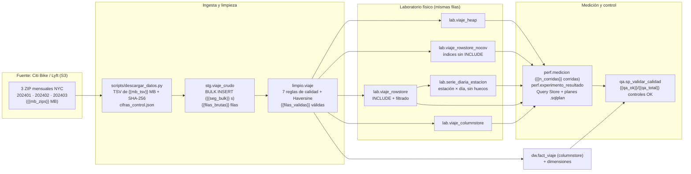

<!-- PLANTILLA: no editar README.md a mano -->
🇪🇸 **Español** · 🇬🇧 [English (summary)](README.en.md)

# Laboratorio de rendimiento en SQL Server con Citi Bike Nueva York (enero–marzo 2024)

[](sql/00_EJECUTAR_TODO.sql)
[](data/cifras_control.json)
[-15803d)](sql/06_laboratorio_tuning.sql)
[](sql/08_calidad_y_reconciliacion.sql)
[](tests/)

**Pregunta:** ¿cuánto cambian el tiempo de respuesta y las páginas leídas cuando se elige bien el diseño físico (heap, índices cubrientes, índices filtrados, columnstore) y cuando se reescribe la consulta (predicados SARGables, funciones de ventana, `CROSS APPLY`, operaciones en conjunto), y qué parte de la mejora corresponde a cada cambio?

**Datos:** {{filas_brutas}} viajes de **Citi Bike Nueva York** (sistema principal, no Jersey City) de enero, febrero y marzo de 2024, publicados por Lyft en [s3.amazonaws.com/tripdata](https://s3.amazonaws.com/tripdata/index.html). Después de la limpieza quedan **{{filas_validas}} viajes válidos** ({{pct_retencion}} %). Se usa un trimestre y no el año completo para que las cuatro copias físicas de la tabla que se comparan quepan con holgura en SQL Server Express: la base ocupa unos 6 GB (SQL Server 2025 Express admite hasta 50 GB por base, no 10 GB) y cada experimento tarda minutos en vez de horas.

**Método:** cada variante se ejecuta 1 vez para compilar y calentar, 5 veces **en caliente** y 5 veces **en frío** (`CHECKPOINT` + `DBCC DROPCLEANBUFFERS` antes de cada corrida). Se reporta la **mediana**. Lecturas lógicas, CPU, memoria y duración (en microsegundos) salen de `sys.dm_exec_query_stats` (o de `sys.dm_exec_procedure_stats` para el cursor de E8); las variantes con `OPTION (RECOMPILE)` no quedan en esas vistas y se miden con los contadores de `sys.dm_exec_requests` y el reloj. El plan real sale de `sys.dm_exec_query_plan_stats`. Todas las variantes de un experimento devuelven las mismas filas y el mismo checksum (lo verifica `qa.sp_validar_calidad`).

> Las cifras de este README las escribe `scripts/generar_readme.py` a partir de `reports/` y `data/cifras_control.json`. Un test comprueba que el README coincide con esos archivos. Equipo de la corrida: Windows 11 Pro, 12 hilos lógicos y 32 GB de RAM, con SQL Server 2025 Express (que usa como máximo 4 núcleos y ~1,4 GB de caché de datos). Los milisegundos dependen del equipo; las lecturas lógicas, casi no.

---

## 1. Resultados en una línea

En los nueve experimentos la variante afinada lee entre un **{{min_red}} %** y un **{{max_red}} %** menos páginas que la original y devuelve exactamente el mismo resultado. Las aceleraciones grandes aparecen cuando la consulta original recorre toda la tabla y la afinada lee unas pocas páginas (E1, E7); cuando las dos versiones recorren los mismos datos, la ganancia viene de la CPU y es moderada (E6: {{e6_b_window_func_xc}} en caliente). Los diseños 2×2 de E2 y E7 (sección 4) separan cuánto aporta el índice y cuánto la reescritura.


## 2. Arquitectura



## 3. Experimentos E1–E9

Mediana de 5 corridas por modo. «Δ lecturas» y «x» comparan con la fila **Antes** del mismo experimento.

{{tabla_experimentos}}

Qué mide cada uno (detalle en [docs/GUIA_PASO_A_PASO.md](docs/GUIA_PASO_A_PASO.md)):

- **E1** · viajes de la estación más activa en marzo ({{e1_a_heap_filas}} filas). El índice no cubriente forzado lee **{{e1_lookup_vs_heap}} veces** las páginas del heap por los *Key Lookups*; el índice con `INCLUDE` lee {{e1_c_covering_lec}}.
- **E2 / E7** · diseños 2×2 (sección 4).
- **E3** · agregación de las {{filas_validas}} filas del trimestre: el columnstore lee {{e3_c_agg_cci_lec}} páginas frente a {{e3_b_agg_rowstore_lec}} del rowstore y se ejecuta en modo *batch*.
- **E4** · viajes de ocasionales de 30 min o más ({{e4_a_sin_filtrado_filas}} filas): el índice filtrado lee {{e4_b_con_filtrado_lec}} páginas.
- **E5** · *parameter sniffing* (sección 5).
- **E6** · media móvil de 7 días en {{e6_a_subquery_corr_filas}} combinaciones estación-día. La tabla tiene todos los días del trimestre, así que la subconsulta y `AVG() OVER (ROWS 6 PRECEDING)` dan el mismo resultado; un control lo comprueba fila a fila con `EXCEPT`.
- **E8** · suma acumulada por estación: un cursor `FAST_FORWARD` tarda {{e8_a_cursor_msc}} ms en caliente; la misma lógica con `SUM() OVER` tarda {{e8_b_conjunto_msc}} ms.
- **E9** · regresión provocada y plan forzado con Query Store (sección 5).

Los planes reales de cada variante están en [`reports/planes/`](reports/planes/) (`.sqlplan`, se abren en SSMS o Azure Data Studio).


## 4. Aislar el efecto de cada cambio

**E2 · filtro de una semana.** `YEAR()/MONTH()/DAY()` sobre la columna frente a un rango `>= / <`, cada uno con y sin índice agrupado por fecha:

{{tabla_e2}}

**E7 · últimos 10 viajes de las 10 estaciones más activas.** `ROW_NUMBER()` frente a `CROSS APPLY (SELECT TOP (10) …)`, con y sin índice `(estacion_origen_id, fecha_inicio)`:

{{tabla_e7}}

En **E2** ni la reescritura sola ni el índice solo reducen las páginas leídas ({{e2_b_heap_rango_pct}} % y {{e2_c_indice_funcion_pct}} % de la base): un rango no sirve en un heap sin orden, y una función sobre la columna impide buscar en el índice. La reescritura sola sí ahorra CPU (de {{e2_a_heap_funcion_msc}} a {{e2_b_heap_rango_msc}} ms en caliente) porque deja de evaluar tres funciones por fila. Las lecturas solo bajan cuando se combinan ambos cambios ({{e2_d_indice_rango_pct}} %).

En **E7** el índice solo ya baja las lecturas al {{e7_c_indice_rownumber_pct}} % ({{e7_c_indice_rownumber_msc}} ms) y `CROSS APPLY` sobre el índice las deja en {{e7_d_indice_apply_pct}} % ({{e7_d_indice_apply_msc}} ms en caliente y {{e7_d_indice_apply_msf}} ms en frío: con tan pocas páginas, casi todo el tiempo en frío es leerlas del disco). Sin índice, `CROSS APPLY` es peor que la consulta original: recorre el heap una vez por estación ({{e7_b_heap_apply_lec}} lecturas, {{e7_b_heap_apply_msc}} ms).


## 5. Parameter sniffing y plan forzado con Query Store

**E5.** La consulta `WHERE duracion_seg >= @p` se compila primero con `@p = 80.000` s: el optimizador estima {{e5_a_sniff_malo_est}} filas y elige *Index Seek + Key Lookup*. Al reutilizar ese plan con `@p = 1.200` s se procesan {{e5_a_sniff_malo_real}} filas, una búsqueda por fila: {{e5_a_sniff_malo_lec}} lecturas lógicas ({{e5_lookup_vs_recompile}} veces las del plan con escaneo) y {{e5_a_sniff_malo_msc}} ms. Con `OPTION (RECOMPILE)` baja a {{e5_b_recompile_msc}} ms ({{e5_b_recompile_xc}}) y con `OPTIMIZE FOR UNKNOWN` a {{e5_c_optimize_unknown_msc}} ms ({{e5_c_optimize_unknown_xc}}).

**E9.** Misma consulta, mismo texto, tres pasos (query_id {{qs_query_id}} en Query Store):

{{tabla_qs}}

La regresión hace la consulta {{e9_regresion_x}} veces más lenta en caliente. Tras `sp_query_store_force_plan` el plan {{qs_plan_bueno}} se aplica aunque la consulta se vuelva a compilar con el valor atípico. Al final del laboratorio se quita el forzado (`sp_query_store_unforce_plan`) para que la base quede como estaba.


## 6. Punto de inflexión del Key Lookup

Las 8 estaciones más activas, con ventanas de 1 a 91 días (lecturas lógicas de una ejecución; son deterministas):

{{tabla_tipping}}

Con pocas filas, buscar en el índice y hacer un lookup por fila lee menos que recorrer el heap. El cruce está entre {{tp_cruce_entre}}, hacia el **{{tp_cruce_pct}} %** de la tabla. Con el trimestre completo el lookup forzado lee {{tp_91_lookup}} páginas, {{tp_91_ratio}} veces el scan del heap ({{tp_91_heap}}); el índice cubriente, {{tp_91_cov}}. El optimizador, cuando puede elegir, usa el índice agrupado por fecha y no cae en la trampa.


## 7. Espacio en disco y tiempo de carga

{{tabla_huella}}

Los índices secundarios suman {{nocov_idx_mb}} MB en la tabla no cubriente (dos índices: por estación y fecha, y por duración) y {{cov_idx_mb}} MB en la afinada (cubriente con `INCLUDE` + filtrado); el columnstore guarda la misma tabla en {{cci_mb}} MB frente a {{heap_mb}} MB del heap ({{cci_ratio}}x).

Copiar las {{filas_validas}} filas a una tabla de prueba (mediana de 3 corridas en orden rotado):

{{tabla_carga}}

Cargar con los índices ya creados tarda {{carga_antes_vs_heap}} veces lo que cargar un heap y {{carga_antes_vs_despues}} veces lo que cargar primero y crear los índices después.


## 8. Analítica del trimestre

Consultas sobre el modelo estrella (`dw.fact_viaje` en columnstore). Es un trimestre de invierno: sirve para ver la tendencia mes a mes y los patrones diarios, no la estacionalidad del año.

- **Volumen:** {{viajes_t1}} viajes válidos; por fecha de inicio, enero {{viajes_enero}}, febrero {{viajes_febrero}} y marzo {{viajes_marzo}} (marzo tiene {{crec_ene_mar}} % más viajes que enero). Otros {{viajes_dic2023}} viajes del archivo de enero empezaron el 31 de diciembre de 2023.
- **E-bikes y miembros:** el {{pct_ebike_t1}} % de los viajes se hizo en bicicleta eléctrica (enero {{ebike_enero}} %, marzo {{ebike_marzo}} %) y el {{pct_miembro_t1}} % lo hicieron miembros con suscripción.
- **Horas:** de lunes a viernes hay dos picos, {{pico_manana_h}} ({{pico_manana_n}} viajes en el trimestre) y {{pico_tarde_h}} ({{pico_tarde_n}}); el fin de semana el máximo es a las {{pico_finde_h}}. Los viajes de fin de semana duran en promedio {{dur_fin}} min frente a {{dur_lab}} min entre semana ({{dur_fin_vs_lab}} % más).
- **Rebalanceo:** el balance de la mañana y el de la tarde tienen una correlación de {{corr_manana_tarde}} entre estaciones: las que se vacían en la mañana tienden a llenarse en la tarde.

{{tabla_estaciones}}

- **Ruta más frecuente:** {{ruta1}} ({{ruta1_n}} viajes).

| | |
| :---: | :---: |
|  |  |
|  |  |

## 9. Calidad y reconciliación

- De {{filas_brutas}} filas brutas, {{filas_excluidas}} se marcan con un motivo de exclusión y se conservan en `limpio.viaje` (ninguna se borra). Los conteos por motivo de SQL Server coinciden con los que calcula pandas sobre los CSV originales ([`docs/cifras_control.md`](docs/cifras_control.md)).
- `qa.sp_validar_calidad`: {{qa_ok}} de {{qa_total}} controles en OK (reconciliación, integridad del modelo, equivalencia de resultados en cada experimento, dirección esperada de cada mejora y Query Store).
- Tiempos del ETL: `BULK INSERT` {{seg_bulk}} s, limpieza {{seg_limpieza}} s, benchmark completo {{min_benchmark}} min.

## 10. Estructura

```text
tuning-sqlserver-citibike/
├── descargar_datos.py                 # Atajo a scripts/descargar_datos.py
├── LICENSE                            # MIT (código)
├── requirements.txt                   # Versiones fijadas
├── data/
│   ├── cifras_control.json            # Conteos, SHA-256 y motivos de exclusión calculados en Python
│   ├── muestra_citibike_2024T1.csv    # 150 filas por mes (versionada)
│   └── raw/                           # Ignorado en Git: citibike_2024T1.tsv ({{mb_tsv}} MB)
├── sql/
│   ├── 00_EJECUTAR_TODO.sql           # Orquestador sqlcmd
│   ├── 01_crear_base.sql              # Base, esquemas, Query Store, LAST_QUERY_PLAN_STATS
│   ├── 02_staging_y_carga.sql         # stg.viaje_crudo + BULK INSERT
│   ├── 03_limpieza.sql                # 7 reglas de calidad + Haversine → limpio.viaje
│   ├── 04_modelo_estrella.sql         # dw.dim_* + dw.fact_viaje (columnstore)
│   ├── 05_estructuras_laboratorio.sql # 4 diseños físicos, serie diaria densa, tiempos de carga
│   ├── 06_laboratorio_tuning.sql      # Arnés de medición, E1–E9, punto de inflexión, Query Store
│   ├── 07_vistas_analiticas.sql       # Vistas rpt.*
│   └── 08_calidad_y_reconciliacion.sql# qa.sp_validar_calidad
├── scripts/
│   ├── conexion.py                    # pyodbc con autenticación de Windows
│   ├── descargar_datos.py             # Descarga, TSV, muestra y cifras de control
│   ├── ejecutar_sql.py                # Corre sqlcmd con la ruta del proyecto
│   ├── generar_graficos.py            # reports/tablas, reports/planes, resultados.json y figuras
│   ├── generar_notebooks.py           # Arma y ejecuta los 3 notebooks
│   └── generar_readme.py              # Este README, desde docs/plantilla_README.md
├── notebooks/                         # 01 ingesta · 02 laboratorio · 03 analítica (ejecutados)
├── reports/
│   ├── tablas/                        # CSV exportados de rpt.* y qa.*
│   ├── planes/                        # Planes reales .sqlplan de cada variante
│   ├── figures/                       # 10 figuras
│   └── resultados.json
├── docs/
│   ├── GUIA_PASO_A_PASO.md            # Explicación de cada experimento y preguntas de entrevista
│   ├── cifras_control.md              # Auditoría de la ingesta (generada)
│   └── plantilla_README.md            # Plantilla de este README
└── tests/
    ├── test_descarga.py               # Reglas de calidad en Python y cifras de control
    ├── test_pipeline_sql.py           # Base en vivo: controles, equivalencia, Query Store, reports/
    └── test_readme_cifras.py          # README = plantilla + reports/
```

## 11. Cómo reproducirlo

Requisitos: Windows, SQL Server Express con instancia `localhost\SQLEXPRESS`, `sqlcmd` y Python 3.14. Unos 4 GB libres para los ZIP y el TSV y unos 7 GB para la base.

```powershell
py -3.14 -m venv .venv
.\.venv\Scripts\pip.exe install -r requirements.txt

# 1. Descarga los 3 ZIP de NYC (~{{mb_zips}} MB) y genera el TSV. Con --cache se reutilizan ZIP ya descargados.
.\.venv\Scripts\python.exe descargar_datos.py

# 2. Pipeline completo en SQL Server (unos 40 min: ~20 de limpieza y ~8 de benchmark)
.\.venv\Scripts\python.exe scripts\ejecutar_sql.py

# 3. Tablas, planes y figuras → notebooks → README
.\.venv\Scripts\python.exe scripts\generar_graficos.py
.\.venv\Scripts\python.exe scripts\generar_notebooks.py
.\.venv\Scripts\python.exe scripts\generar_readme.py

# 4. Pruebas
.\.venv\Scripts\python.exe -m pytest
```

`DBCC DROPCLEANBUFFERS` vacía la caché de datos de **toda la instancia**: ejecuta el laboratorio solo en una instancia local de pruebas.

## 12. Limitaciones

- Un solo equipo y una sola corrida del pipeline: los milisegundos cambian con el hardware y con lo que haga el sistema en ese momento; por eso se reportan medianas, se muestra la dispersión (figura 03) y se acompañan de lecturas lógicas.
- El modo «frío» vacía la caché de datos, pero no la del sistema operativo ni la del disco; en un servidor con discos más lentos la diferencia frío/caliente sería mayor.
- Un trimestre de invierno: las conclusiones de negocio no se extienden al resto del año.
- SQL Server Express limita la memoria y los núcleos; en ediciones mayores el optimizador puede elegir planes paralelos distintos.

## 13. Fuente y licencia

- **Datos:** viajes de **Citi Bike Nueva York**, publicados por Lyft Bikes and Scooters, LLC (el operador del sistema) en [s3.amazonaws.com/tripdata](https://s3.amazonaws.com/tripdata/index.html), archivos `202401`, `202402` y `202403-citibike-tripdata.zip`.
- **Licencia de los datos:** el operador conserva la propiedad de los datos y los licencia en los términos del [Citi Bike Data License Agreement](https://citibikenyc.com/data-sharing-policy): se pueden descargar, analizar y usar con cualquier fin lícito, comercial o no, pero **no** se pueden alojar, publicar ni vender como un conjunto de datos independiente, no se pueden enlazar con datos personales de clientes y no se puede sugerir respaldo del operador ni usar la marca Citi Bike sin permiso. Este repositorio no redistribuye los datos: el TSV completo se genera con `descargar_datos.py`, y `data/muestra_citibike_2024T1.csv` es solo un extracto ilustrativo de 450 viajes (150 por mes) que sirve de muestra (una prueba comprueba que existe y es liviano). Los demás archivos de `reports/` son agregados y mediciones, no viajes individuales. Los términos pueden cambiar: consulta siempre la versión vigente.
- **Código:** [MIT](LICENSE), copyright 2026 Erick Guarnizo. Los datos siguen su propia licencia, descrita arriba. Este proyecto es independiente y no tiene relación con Citi Bike ni con Lyft.

## 14. Autor

**Erick Guarnizo** · Ingeniero en Sistemas · [LinkedIn](https://www.linkedin.com/in/erick-g-571a7b3b4)
