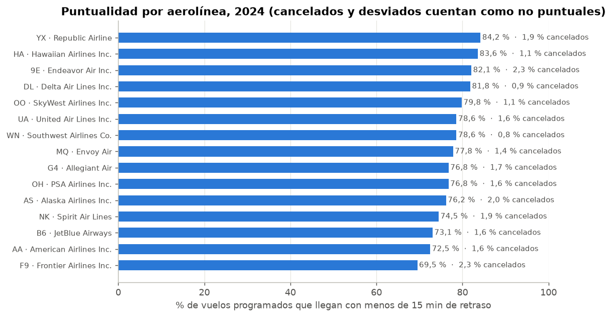

🇪🇸 [Español (full version)](README.md) · 🇬🇧 **English (summary)**

# Punctuality of U.S. commercial flights in PostgreSQL (2024)

**Question:** which airlines, airports, hours and routes concentrate the delays of U.S. flights, why are they delayed and how
much does a delay propagate to the next flights of the same aircraft? And on the technical side: how much do partitioning, BRIN
and partial indexes and a materialized view help in PostgreSQL, measured with `EXPLAIN`?

**Data:** 7,079,061 flights from January to December 2024 by the 15 reporting airlines (Bureau of Transportation Statistics),
loaded with `COPY` into PostgreSQL 17.11 on Docker; 7,078,250 pass the quality checks.

## Results

| Indicator (2024) | Value |
|:---|---:|
| Scheduled flights (after quarantine) | 7,078,250 |
| On time (arrive less than 15 min late) | **77.92%** |
| Cancelled | 96,285 (1.36%) |
| Diverted | 17,009 (0.24%) |
| Mean arrival delay (flights that arrived) | 7.09 min |

- **Airlines:** the most punctual is Republic Airline (84.2%) and the least, Frontier (69.5%): 14.7 points apart.
- **Worst day of the year:** on July 19, only 34.8% of flights arrived on time and 16.5% were cancelled; it coincides with that
  day's worldwide IT outage.
- **Time of day:** at 6:00, 7.6% of flights leave 15+ min late; at 20:00, 31.5%.
- **Causes:** 40.5% of delay minutes are due to **the aircraft arriving late from its previous flight**, 34.5% to the airline
  itself, 18.9% to the national airspace system and 6.0% to extreme weather.
- **Chained delays (recursive CTE):** of 824,295 delays that originate in a flight, **48.8%** propagate to at least the next
  flight of the same aircraft.
- **Performance:** partition pruning reads 9.0% of the pages (2.3x); the BRIN index takes 0.039 MB vs. 47.0 MB for the B-tree; the
  partial index on cancellations speeds up its query 46.7x using 0.945 MB.

**Architecture, quality rules, full analysis, execution plans and reproduction commands:** [full README (Spanish)](README.md).
Commands are language-independent.
