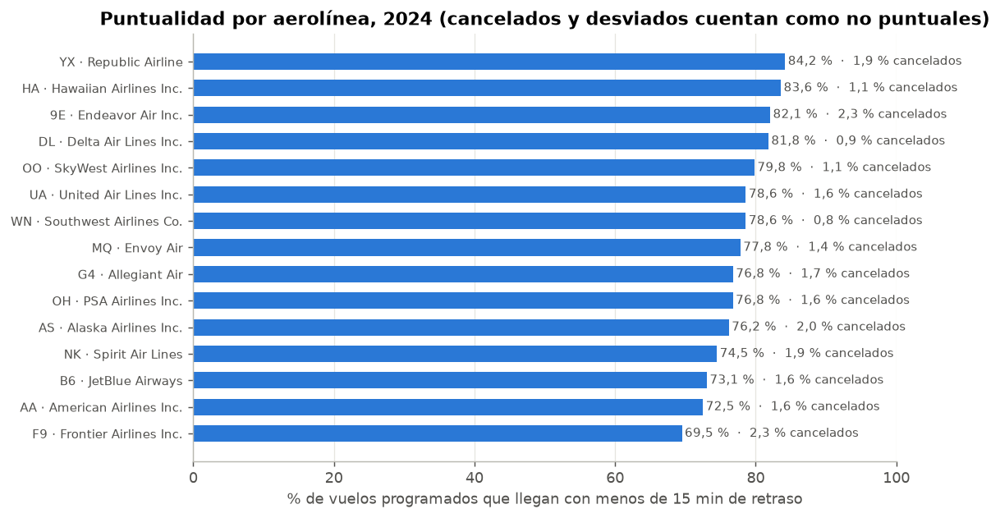
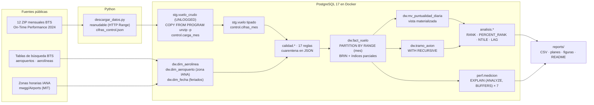
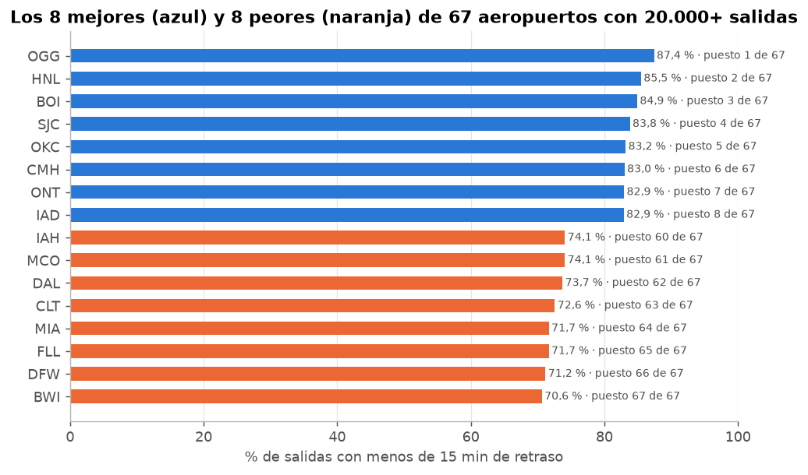
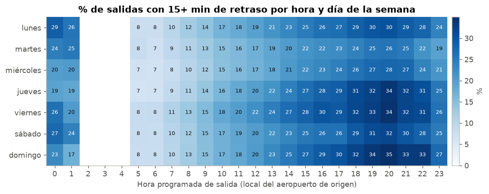
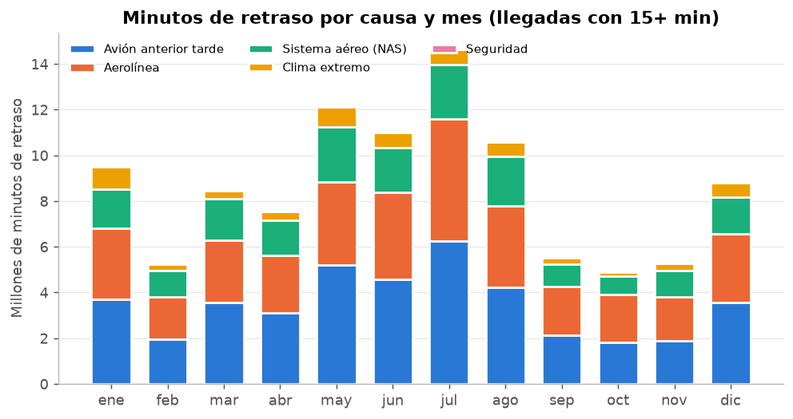
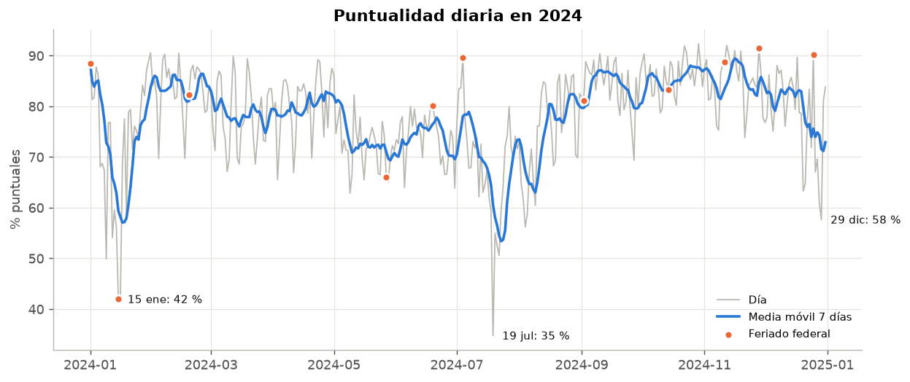
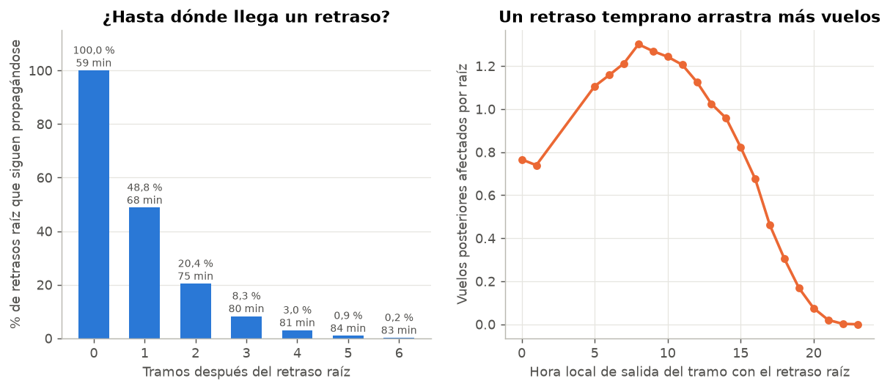
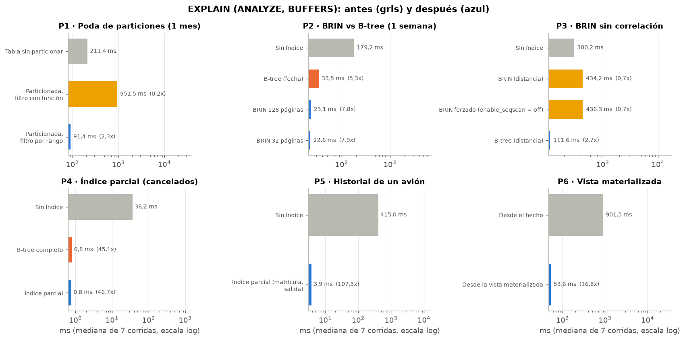
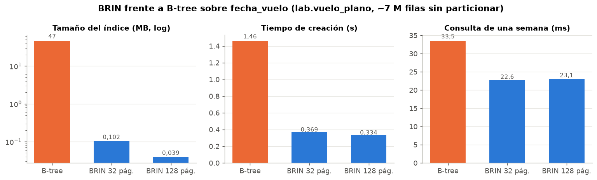
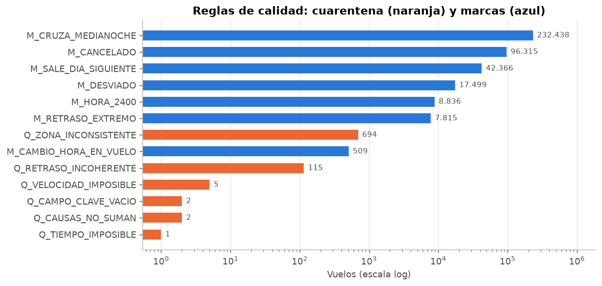

🇪🇸 **Español** · 🇬🇧 [English (summary)](README.en.md)

# Puntualidad de los vuelos comerciales de EE. UU. en PostgreSQL (2024)

[-336791?logo=postgresql&logoColor=white)](docker-compose.yml)
[](data/cifras_control.json)
[-6250d6)](sql/04_modelo_estrella.sql)
[](sql/11_verificaciones.sql)
[](tests/)

**Pregunta:** ¿qué aerolíneas, aeropuertos, horas y rutas concentran los retrasos de los vuelos de EE. UU., por qué se retrasan y cuánto se propaga un retraso a los vuelos siguientes del mismo avión? Y, del lado técnico: ¿cuánto ayudan el particionado, los índices BRIN y parciales y una vista materializada en PostgreSQL, medido con `EXPLAIN (ANALYZE, BUFFERS)`?

**Datos:** 7.079.061 vuelos de enero a diciembre de 2024 de las 15 aerolíneas que reportan al Departamento de Transporte (*Reporting Carrier On-Time Performance*, Bureau of Transportation Statistics). Se cargan los 12 ZIP mensuales (354 MB) con `COPY` en PostgreSQL 17.11 dentro de Docker; 7.078.250 vuelos pasan los controles de calidad y 811 (0,011 %) quedan en cuarentena.

> Las cifras de este README las escribe `scripts/generar_readme.py` a partir de `reports/` y `data/cifras_control.json`; una prueba comprueba que el README coincide con esos archivos. Contenedor con 4 GB de memoria, `shared_buffers = 1GB`, `work_mem = 64MB` y hasta 2 workers paralelos, en un Ryzen 5 4600G con disco SSD. Los milisegundos dependen del equipo; las páginas leídas, casi no.

---

## 1. Resultados

| Indicador (2024) | Valor |
| :--- | ---: |
| Vuelos programados (después de la cuarentena) | 7.078.250 |
| Puntuales (llegan con menos de 15 min de retraso) | **77,92 %** |
| Cancelados | 96.285 (1,36 %) |
| Desviados | 17.009 (0,24 %) |
| Retraso medio de llegada (vuelos que llegaron) | 7,09 min |
| Aeropuertos de origen · días | 348 · 366 |

- **Aerolíneas:** la más puntual es Republic Airline (YX, 84,2 %) y la menos puntual Frontier Airlines Inc. (F9, 69,5 %): 14,7 puntos de diferencia.
- **Peor día del año:** el 19 de julio solo llegó a tiempo el 34,8 % de los vuelos y se canceló el 16,5 %. Coincide con la falla informática mundial de ese día (una actualización defectuosa de CrowdStrike dejó fuera de servicio equipos con Windows). Delta Air Lines (DL) canceló 5.781 vuelos entre el 19 y el 24 de julio y tuvo los cuatro peores días de cancelaciones de cualquier aerolínea en el año.
- **Hora del día:** el retraso se acumula a lo largo del día: a las 6:00 sale con 15+ min de retraso el 7,6 % de los vuelos y a las 20:00 el 31,5 %.
- **Causas:** de los minutos de retraso de las llegadas con 15+ min, el 40,5 % se debe a que **el avión llegó tarde de su vuelo anterior**, el 34,5 % a la propia aerolínea y el 18,9 % al sistema aéreo nacional; el clima extremo explica el 6,0 %.
- **Retrasos en cadena (CTE recursiva):** de 824.295 retrasos que nacen en un vuelo, el **48,8 %** se propaga al menos al vuelo siguiente del mismo avión; en total arrastran a 672.363 vuelos más. Un retraso en el vuelo de las 8:00 afecta en promedio a 1,30 vuelos posteriores; uno después de las 21:00, a casi ninguno.
- **Rendimiento:** la poda de particiones lee el 9,0 % de las páginas que lee la tabla sin particionar (2,3x); el índice BRIN sobre la fecha ocupa 0,039 MB frente a 47,0 MB del B-tree y responde la consulta de una semana en 23,1 ms frente a 33,5 ms; el índice parcial de cancelados acelera su consulta 46,7x ocupando 0,945 MB.



## 2. Arquitectura



## 3. Puntualidad: aerolíneas, aeropuertos, horas, rutas y temporadas

Puntual = llega menos de 15 minutos después de la hora programada; los cancelados y desviados cuentan como no puntuales, igual que en el *Air Travel Consumer Report* del DOT. Los porcentajes se calculan sobre vuelos programados.

### 3.1 Aerolíneas (`RANK` y `PERCENT_RANK`)

| Rango | Aerolínea | Vuelos | Mercado | Puntuales | Cancelados | Retraso medio (min) | PERCENT_RANK | Rango en cancelaciones (1 = la que menos cancela) |
| :---: | :--- | ---: | ---: | ---: | ---: | ---: | ---: | ---: |
| 1 | Republic Airline (YX) | 301.392 | 4,3 % | **84,2 %** | 1,85 % | -1,8 | 1,000 | 11 |
| 2 | Hawaiian Airlines Inc. (HA) | 78.529 | 1,1 % | **83,6 %** | 1,05 % | 4,2 | 0,929 | 3 |
| 3 | Endeavor Air Inc. (9E) | 200.093 | 2,8 % | **82,1 %** | 2,30 % | 1,7 | 0,857 | 14 |
| 4 | Delta Air Lines Inc. (DL) | 1.009.072 | 14,3 % | **81,8 %** | 0,91 % | 3,6 | 0,786 | 2 |
| 5 | SkyWest Airlines Inc. (OO) | 744.645 | 10,5 % | **79,8 %** | 1,14 % | 7,3 | 0,714 | 4 |
| 6 | United Air Lines Inc. (UA) | 760.451 | 10,7 % | **78,6 %** | 1,64 % | 5,7 | 0,643 | 8 |
| 7 | Southwest Airlines Co. (WN) | 1.418.955 | 20,1 % | **78,6 %** | 0,83 % | 5,1 | 0,571 | 1 |
| 8 | Envoy Air (MQ) | 279.947 | 4,0 % | **77,8 %** | 1,42 % | 6,5 | 0,500 | 5 |
| 9 | Allegiant Air (G4) | 117.198 | 1,7 % | **76,8 %** | 1,72 % | 9,7 | 0,429 | 10 |
| 10 | PSA Airlines Inc. (OH) | 227.968 | 3,2 % | **76,8 %** | 1,65 % | 10,0 | 0,357 | 9 |
| 11 | Alaska Airlines Inc. (AS) | 245.819 | 3,5 % | **76,2 %** | 1,96 % | 4,5 | 0,286 | 13 |
| 12 | Spirit Air Lines (NK) | 261.048 | 3,7 % | **74,5 %** | 1,91 % | 8,4 | 0,214 | 12 |
| 13 | JetBlue Airways (B6) | 240.282 | 3,4 % | **73,1 %** | 1,55 % | 10,7 | 0,143 | 7 |
| 14 | American Airlines Inc. (AA) | 984.234 | 13,9 % | **72,5 %** | 1,55 % | 15,3 | 0,071 | 6 |
| 15 | Frontier Airlines Inc. (F9) | 208.617 | 3,0 % | **69,5 %** | 2,32 % | 15,2 | 0,000 | 15 |

Delta (DL) queda en el puesto 4 de puntualidad pese al episodio de julio. Southwest (WN), la que más vuela (20,1 % del mercado), es la que menos cancela (0,83 %). Tres regionales que operan vuelos para las grandes (Republic, Endeavor y SkyWest) están entre las cinco más puntuales.

### 3.2 Aeropuertos de origen

67 aeropuertos con 20.000 salidas o más en el año (unas 55 al día), ordenados por % de salidas puntuales. Además del rango nacional se calcula el cuartil (`NTILE(4)`) y el rango dentro del estado (`RANK() OVER (PARTITION BY estado ...)`).

| Rango | Aeropuerto | Estado | Salidas | Salidas puntuales | Retraso medio salida (min) | PERCENT_RANK | Cuartil | Rango en el estado |
| ---: | :--- | :--- | ---: | ---: | ---: | ---: | :---: | :---: |
| 1 | OGG · Kahului Airport | HI | 26.543 | 87,4 % | 3,9 | 1,000 | 1 | 1 de 2 |
| 2 | HNL · Daniel K Inouye International | HI | 61.548 | 85,5 % | 5,8 | 0,985 | 1 | 2 de 2 |
| 3 | BOI · Boise Air Terminal | ID | 22.859 | 84,9 % | 6,6 | 0,970 | 1 | 1 de 1 |
| 4 | SJC · Norman Y. Mineta San Jose International | CA | 50.386 | 83,8 % | 6,5 | 0,955 | 1 | 1 de 9 |
| 5 | OKC · Okc Will Rogers International | OK | 22.789 | 83,2 % | 9,1 | 0,939 | 1 | 1 de 1 |
| 63 | CLT · Charlotte Douglas International | NC | 217.539 | 72,6 % | 18,4 | 0,061 | 4 | 2 de 2 |
| 64 | MIA · Miami International | FL | 109.906 | 71,7 % | 19,6 | 0,045 | 4 | 6 de 7 |
| 65 | FLL · Fort Lauderdale-Hollywood International | FL | 91.879 | 71,7 % | 17,2 | 0,030 | 4 | 7 de 7 |
| 66 | DFW · Dallas/Fort Worth International | TX | 313.568 | 71,2 % | 18,9 | 0,015 | 4 | 6 de 6 |
| 67 | BWI · Baltimore/Washington International Thurgood Marshall | MD | 98.544 | 70,6 % | 15,3 | 0,000 | 4 | 1 de 1 |

Los dos aeropuertos de Hawái encabezan la lista; al final quedan BWI (Baltimore/Washington International Thurgood Marshall), DFW (Dallas/Fort Worth International), FLL (Fort Lauderdale-Hollywood International), MIA (Miami International).



### 3.3 Hora del día y día de la semana

El porcentaje de salidas con 15+ min de retraso sube casi sin pausa de la mañana a la noche: los primeros vuelos salen con el avión ya en la puerta desde la noche anterior, y cada vuelo posterior hereda lo que se acumuló antes (sección 4). El martes es el día con menos salidas retrasadas (17,5 %) y el viernes el que más (22,7 %).



### 3.4 Causas del retraso

BTS reparte los minutos de cada llegada con 15+ min de retraso entre cinco causas; en todo el año suman 103,7 millones de minutos.

| Causa | % de los minutos de retraso |
| :--- | ---: |
| Avión anterior tarde | 40,45 % |
| Aerolínea (tripulación, mantenimiento, limpieza...) | 34,51 % |
| Sistema aéreo nacional (NAS: tráfico, aeropuerto, clima no extremo) | 18,90 % |
| Clima extremo | 5,97 % |
| Seguridad | 0,17 % |

"Avión anterior tarde" no es una causa original, sino la consecuencia de un retraso anterior del mismo avión: por eso la sección 4 la sigue tramo a tramo.



### 3.5 Rutas más problemáticas

1.522 rutas con 1.500 vuelos o más en el año (unos 4 al día), ordenadas de menor a mayor puntualidad:

| Rango | Ruta | Vuelos | Puntuales | Cancelados | Retraso medio (min) | Percentil 90 del retraso (min) |
| :---: | :--- | ---: | ---: | ---: | ---: | ---: |
| 1 | SAN → SFO | 6.364 | 59,6 % | 1,54 % | 21,2 | 73 |
| 2 | CLT → SFO | 1.616 | 59,6 % | 0,87 % | 22,3 | 79 |
| 3 | MIA → SFO | 1.530 | 59,7 % | 1,70 % | 22,7 | 86 |
| 4 | DFW → SFO | 4.061 | 61,5 % | 1,58 % | 21,4 | 75 |
| 5 | PSP → SFO | 2.294 | 62,1 % | 1,09 % | 19,4 | 70 |
| 6 | LAS → SFO | 5.771 | 63,4 % | 1,70 % | 18,1 | 66 |
| 7 | DFW → MSY | 3.023 | 64,2 % | 2,02 % | 19,7 | 75 |
| 8 | DFW → SAT | 4.548 | 64,4 % | 2,40 % | 22,3 | 87 |

6 de las 10 rutas menos puntuales llegan a San Francisco (SFO), un aeropuerto con pistas paralelas muy juntas que reduce las llegadas cuando hay niebla o nubes bajas.

### 3.6 Estacionalidad, episodios y feriados

| Mes | Vuelos | Puntuales | Cancelados | Retraso medio (min) | Cambio vs. mes anterior (pp, LAG) | Rango |
| :--- | ---: | ---: | ---: | ---: | ---: | :---: |
| enero | 547.225 | 72,9 % | 3,73 % | 10,3 | — | 10 |
| febrero | 519.209 | 83,4 % | 0,58 % | 0,6 | 10,54 | 4 |
| marzo | 591.616 | 78,3 % | 0,86 % | 6,5 | -5,12 | 6 |
| abril | 582.172 | 80,2 % | 0,69 % | 5,4 | 1,89 | 5 |
| mayo | 609.738 | 72,3 % | 1,35 % | 14,1 | -7,89 | 11 |
| junio | 610.994 | 73,9 % | 1,29 % | 11,8 | 1,55 | 9 |
| julio | 634.290 | 68,1 % | 2,90 % | 18,1 | -5,75 | 12 |
| agosto | 618.960 | 74,7 % | 2,05 % | 10,6 | 6,60 | 8 |
| septiembre | 582.618 | 83,9 % | 0,60 % | 1,0 | 9,14 | 3 |
| octubre | 615.483 | 85,8 % | 1,02 % | -1,3 | 1,95 | 1 |
| noviembre | 575.379 | 84,8 % | 0,46 % | -0,3 | -0,99 | 2 |
| diciembre | 590.566 | 78,1 % | 0,70 % | 7,1 | -6,74 | 7 |

El mejor mes es octubre (85,8 %) y el peor julio (68,1 %): julio suma el mayor volumen del año y la falla del día 19. Los cinco peores días del año:

| Rango | Fecha | Día | Vuelos | Puntuales | Cancelados | Feriado |
| :---: | :--- | :--- | ---: | ---: | ---: | :--- |
| 1 | 19 de julio | viernes | 21.460 | 34,8 % | 16,5 % |  |
| 2 | 15 de enero | lunes | 18.617 | 42,0 % | 15,9 % | Martin Luther King Jr. |
| 3 | 16 de enero | martes | 16.529 | 42,2 % | 12,8 % |  |
| 4 | 9 de enero | martes | 16.771 | 49,9 % | 7,6 % |  |
| 5 | 22 de julio | lunes | 21.421 | 50,6 % | 8,2 % |  |

2 de los cinco caen en el episodio de julio y 3 en la primera quincena de enero, que coincide con la ola de frío ártico de esa semana; el feriado de Martin Luther King (15 de enero) cayó en plena ola de frío.

**Feriados federales.** Para cada feriado se toma la ventana de ±3 días (`dw.dim_fecha.ventana_feriado`) y se compara con el año completo:

| Feriado | Ventana | Vuelos por día | Vuelos vs. promedio (%) | Puntuales | Diferencia vs. año (pp) | Cancelados |
| :--- | :--- | ---: | ---: | ---: | ---: | ---: |
| Año Nuevo | 1 de enero – 4 de enero | 18.207 | -5,9 | 84,8 % | 6,83 | 0,17 % |
| Martin Luther King Jr. | 12 de enero – 18 de enero | 17.477 | -9,6 | 57,2 % | -20,70 | 8,99 % |
| Día de los Presidentes | 16 de febrero – 22 de febrero | 18.253 | -5,6 | 81,7 % | 3,78 | 0,27 % |
| Memorial Day | 24 de mayo – 30 de mayo | 19.586 | 1,3 | 69,9 % | -7,98 | 2,57 % |
| Juneteenth | 16 de junio – 22 de junio | 20.531 | 6,2 | 77,2 % | -0,74 | 0,56 % |
| Día de la Independencia | 1 de julio – 7 de julio | 19.539 | 1,0 | 78,6 % | 0,70 | 0,84 % |
| Labor Day | 30 de agosto – 5 de septiembre | 18.789 | -2,8 | 82,4 % | 4,46 | 0,59 % |
| Columbus Day | 11 de octubre – 17 de octubre | 20.280 | 4,9 | 84,8 % | 6,84 | 0,72 % |
| Día de los Veteranos | 8 de noviembre – 14 de noviembre | 19.160 | -0,9 | 87,0 % | 9,04 | 0,79 % |
| Acción de Gracias | 25 de noviembre – 1 de diciembre | 19.242 | -0,5 | 83,1 % | 5,16 | 0,14 % |
| Navidad | 22 de diciembre – 28 de diciembre | 18.860 | -2,5 | 73,9 % | -4,00 | 1,10 % |

El feriado en sí no empeora la puntualidad: promediando los 11 feriados, el día del feriado llega a tiempo el 79,6 % de los vuelos, por encima del promedio anual (77,9 %), y el tercer día antes es el peor de la ventana (74,0 %). Las tres ventanas peores son Martin Luther King (-20,7 pp, la ola de frío), Memorial Day y Navidad.



## 4. Retrasos en cadena: seguir un avión a lo largo del día (`WITH RECURSIVE`)

`dw.tramo_avion` numera los 6.964.956 vuelos operados con matrícula por avión y día (6.099 aviones, 4,04 tramos por avión y día en promedio) y calcula con `LAG` la holgura programada en tierra entre un tramo y el siguiente. La función `analisis.cadenas_retraso()` contiene la CTE recursiva:

```sql
WITH RECURSIVE cadena AS (
    -- Raíz: llega con 15+ min de retraso y el tramo anterior del día llegó a tiempo
    SELECT t.matricula, t.fecha_vuelo, t.n_tramo AS tramo_raiz, 0 AS paso, t.n_tramo, ...
      FROM dw.tramo_avion t
     WHERE t.retraso_llegada >= 15 AND coalesce(t.retraso_llegada_anterior, 0) < 15
    UNION ALL
    -- Paso: siguiente tramo del mismo avión, que sale de donde llegó el anterior y sale tarde
    SELECT s.matricula, s.fecha_vuelo, c.tramo_raiz, c.paso + 1, s.n_tramo, ...
      FROM cadena c
      JOIN dw.tramo_avion s ON s.matricula = c.matricula AND s.fecha_vuelo = c.fecha_vuelo
                           AND s.n_tramo = c.n_tramo + 1
     WHERE c.retraso_llegada >= 15 AND s.continua AND s.retraso_salida >= 15
)
SELECT * FROM cadena;
```

| Resultado | Valor |
| :--- | ---: |
| Retrasos raíz (nacen en ese vuelo) | 824.295 |
| Se propagan al menos un tramo | 402.019 (48,77 %) |
| Tramos afectados por propagación | 672.363 |
| Largo medio de la cadena cuando se propaga | 1,67 tramos |
| Cadena más larga | 10 tramos |
| Minutos de retraso de salida aguas abajo por cada minuto de retraso raíz | 0,874 |

| Paso | Vuelos | % de las raíces | Retraso medio de salida (min) | Holgura programada media (min) | Con causa «avión anterior» en BTS |
| :---: | ---: | ---: | ---: | ---: | ---: |
| 0 | 824.295 | 100,0 % | 58,9 | — | 25,7 % |
| 1 | 402.019 | 48,8 % | 67,6 | 68,0 | 71,5 % |
| 2 | 168.017 | 20,4 % | 75,4 | 60,8 | 77,1 % |
| 3 | 68.058 | 8,3 % | 79,7 | 58,3 | 78,8 % |
| 4 | 24.697 | 3,0 % | 81,1 | 53,6 | 78,7 % |
| 5 | 7.654 | 0,9 % | 84,1 | 53,1 | 78,2 % |
| 6 | 1.578 | 0,2 % | 82,9 | 47,0 | 78,3 % |

- **El tamaño de la raíz importa, pero no de forma lineal.** Un retraso de 15–29 min se propaga en el 38,7 % de los casos; uno de 60–119 min, en el 60,2 %; uno de 4 horas o más, solo en el 33,0 %: con retrasos tan grandes la aerolínea suele cambiar de avión o cancelar los tramos siguientes, y la cadena "se rompe" en los datos.
- **La hora define cuántos vuelos quedan por delante.** El pico está en las 8:00 (1,30 vuelos afectados por raíz); a partir de las 21:00 casi no quedan tramos ese día.
- **El modelo de negocio se nota.** Southwest (WN), con 5,2 tramos por avión y día y rotaciones cortas, tiene el mayor multiplicador (1,49 minutos aguas abajo por minuto raíz); United (UA), con 3,4 tramos, el menor (0,60).
- **Contraste con BTS:** los minutos de "avión anterior tarde" que BTS registra en los tramos de las cadenas son el 67,4 % de todos los minutos de esa causa en el año. El resto queda fuera por la definición de cadena usada (sección 8).

**Ejemplo:** la cadena más larga del año (desempate por mayor retraso raíz), el avión N485HA de HA el 23 de mayo, hora local:

| Tramo | Ruta | Salida programada | Holgura (min) | Retraso salida | Retraso llegada | Paso |
| :---: | :--- | :---: | ---: | ---: | ---: | :---: |
| 1 | HNL → LIH | 06:35 | — | 59 | 58 | raíz |
| 2 | LIH → HNL | 07:45 | 29 | 57 | 88 | 1 |
| 3 | HNL → LIH | 09:04 | 41 | 78 | 81 | 2 |
| 4 | LIH → HNL | 10:14 | 28 | 82 | 73 | 3 |
| 5 | HNL → OGG | 12:00 | 60 | 67 | 60 | 4 |
| 6 | OGG → LIH | 13:25 | 40 | 57 | 54 | 5 |
| 7 | LIH → HNL | 15:00 | 44 | 41 | 40 | 6 |
| 8 | HNL → OGG | 16:30 | 49 | 32 | 27 | 7 |
| 9 | OGG → ITO | 17:44 | 30 | 27 | 27 | 8 |
| 10 | ITO → HNL | 18:52 | 29 | 43 | 42 | 9 |
| 11 | HNL → LIH | 20:24 | 35 | 33 | 40 | 10 |



## 5. Rendimiento: `EXPLAIN (ANALYZE, BUFFERS)` antes y después

Cada variante se ejecuta 1 vez para calentar la caché y 7 veces con `EXPLAIN (ANALYZE, BUFFERS, FORMAT JSON)`; se reporta la **mediana** (`perf.medir` en `sql/10_rendimiento.sql`). "Páginas" son bloques de 8 KB leídos de `shared_buffers` o del sistema operativo. Todas las variantes de un experimento devuelven las mismas filas: un control compara el `md5` de cada resultado. Los planes completos están en [`reports/planes/`](reports/planes/) y cada corrida en `reports/tablas/rendimiento_corridas.csv`.

| Exp. | Rol | Variante | Lectura en el plan | Tablas leídas | Páginas | ms (mediana) | Rango (ms) | x vs. antes |
| :--- | :--- | :--- | :--- | :--- | ---: | ---: | ---: | ---: |
| P1 | Antes | Tabla sin particionar | `Seq Scan` | 1 | 110.864 | 211 | 194 – 245 | — |
| P1 | Intermedio | Particionada, filtro con función | `Seq Scan` | 13 | 110.913 | 951 | 916 – 997 | 0,2x |
| P1 | Después | Particionada, filtro por rango | `Seq Scan` | 1 | 10.014 | 91,4 | 76,3 – 104 | 2,3x |
| P2 | Antes | Sin índice | `Seq Scan` | 1 | 110.864 | 179 | 154 – 198 | — |
| P2 | Alternativa | B-tree (fecha) | `Index Scan (lab_btree_fecha)` | 1 | 2.517 | 33,5 | 33,4 – 35,8 | 5,3x |
| P2 | Después | BRIN 128 páginas | `Bitmap Heap Scan ← Bitmap Index Scan (lab_brin_fecha_128)` | 1 | 2.580 | 23,1 | 22,6 – 24,5 | 7,8x |
| P2 | Después | BRIN 32 páginas | `Bitmap Heap Scan ← Bitmap Index Scan (lab_brin_fecha_32)` | 1 | 2.464 | 22,6 | 22,4 – 27,7 | 7,9x |
| P3 | Antes | Sin índice | `Seq Scan` | 1 | 110.864 | 300 | 287 – 325 | — |
| P3 | Intermedio | BRIN (distancia) | `Bitmap Heap Scan ← Bitmap Index Scan (lab_brin_distancia_32)` | 1 | 110.880 | 434 | 417 – 444 | 0,7x |
| P3 | Intermedio | BRIN forzado (enable_seqscan = off) | `Bitmap Heap Scan ← Bitmap Index Scan (lab_brin_distancia_32)` | 1 | 110.880 | 436 | 429 – 468 | 0,7x |
| P3 | Después | B-tree (distancia) | `Bitmap Heap Scan ← Bitmap Index Scan (lab_btree_distancia)` | 1 | 58.106 | 112 | 106 – 122 | 2,7x |
| P4 | Antes | Sin índice | `Seq Scan` | 1 | 10.112 | 36,2 | 35,9 – 38,9 | — |
| P4 | Alternativa | B-tree completo | `Index Only Scan (aerolinea_fecha_vuelo_cancelado_idx)` | 1 | 23 | 0,80 | 0,78 – 0,87 | 45,1x |
| P4 | Después | Índice parcial | `Index Only Scan (fact_vuelo_cancelados)` | 1 | 9 | 0,77 | 0,75 – 1,02 | 46,7x |
| P5 | Antes | Sin índice | `Seq Scan` | 13 | 110.915 | 415 | 383 – 451 | — |
| P5 | Después | Índice parcial (matrícula, salida) | `Index Scan (fact_vuelo_avion)` | 13 | 3.340 | 3,87 | 3,82 – 3,89 | 107x |
| P6 | Antes | Desde el hecho | `Seq Scan` | 13 | 110.815 | 902 | 855 – 958 | — |
| P6 | Después | Desde la vista materializada | `Seq Scan` | 1 | 10.192 | 53,6 | 53,4 – 53,7 | 16,8x |

- **P1 · Poda de particiones.** Julio con un rango sobre `fecha_vuelo` lee 1 de las 13 particiones (10.014 páginas frente a 110.864). Con `extract(month FROM fecha_vuelo) = 7` el planificador no puede podar: lee las 13 particiones y además evalúa dos funciones por fila, así que es 4,5 veces más lento que la tabla sin particionar (951 ms frente a 211 ms).
- **P2 · BRIN frente a B-tree (una semana, 145.204 vuelos).** Con BRIN el plan es un *Bitmap Heap Scan* que revisa todas las filas de los bloques candidatos: descarta 5.642 filas por *recheck* (3,7 % de lo que revisa). Lee casi las mismas páginas que el B-tree (2.580 frente a 2.517) y es más rápido (23,1 ms frente a 33,5 ms) porque recorre bloques contiguos en vez de buscar entrada por entrada.
- **P3 · BRIN sin correlación.** Sobre `distancia_millas` (correlación física -0,0150) el planificador igual elige el BRIN (su estimación de costo es optimista) y la consulta pasa de 300 a 434 ms. Forzado con `enable_seqscan = off`, no descarta ningún bloque: lee 110.880 páginas, revisa 2.326.776 filas de más y tarda 436 ms, más que el *Seq Scan*. Ahí el B-tree sí sirve.
- **P4 · Índice parcial.** Las cancelaciones de Delta del 18 al 25 de julio: el índice `WHERE cancelado` permite un *Index Only Scan* de 9 páginas. Un B-tree completo sobre las mismas columnas es casi igual de rápido (0,80 ms), pero ocupa 49,3 MB frente a 0,945 MB y hay que mantenerlo en cada `INSERT`.
- **P5 · Historial de un avión.** La matrícula no es la clave de partición, así que no hay poda; el índice `(matricula, salida_prog_utc)` hace un *Index Scan* en cada partición y entrega las filas ya ordenadas (sin *Sort*). Es parcial (`WHERE matricula IS NOT NULL AND NOT cancelado`), aunque aquí deja fuera solo el 1,4 % de las filas: ocupa 210 MB.
- **P6 · Vista materializada.** El reporte anual por aerolínea lee 10.192 páginas de la vista frente a 110.815 del hecho. Refrescarla con `REFRESH MATERIALIZED VIEW CONCURRENTLY` tarda 4,8 s.



### 5.1 BRIN frente a B-tree: tamaño y tiempo de creación

Misma tabla sin particionar (`lab.vuelo_plano`, 866 MB, ordenada por hora de salida); cada índice se crea 3 veces y se toma la mediana.

| Índice | Tipo | Columna | pages_per_range | Tamaño (MB) | Creación (s) | Correlación física |
| :--- | :--- | :--- | ---: | ---: | ---: | ---: |
| `lab_btree_distancia` | B-tree | distancia_millas | — | 47,3 | 3,05 | -0,0150 |
| `lab_brin_distancia_32` | BRIN | distancia_millas | 32 | 0,102 | 0,54 | -0,0150 |
| `lab_btree_fecha` | B-tree | fecha_vuelo | — | 47,0 | 1,46 | 1,0000 |
| `lab_brin_fecha_32` | BRIN | fecha_vuelo | 32 | 0,102 | 0,37 | 1,0000 |
| `lab_brin_fecha_128` | BRIN | fecha_vuelo | 128 | 0,039 | 0,33 | 1,0000 |

El BRIN de 128 páginas ocupa 1.202 veces menos que el B-tree y se crea en 0,33 s frente a 1,46 s. Con 32 páginas por rango el índice crece, pero cada rango candidato es más chico: el *recheck* descarta 2.948 filas en vez de 5.642.



## 6. Calidad de datos y reconciliación

Cada vuelo se evalúa contra 17 reglas en una sola pasada. Las de **cuarentena** describen datos imposibles: el vuelo va completo (en JSON, con sus motivos) a `calidad.vuelo_cuarentena` y no entra al hecho. Las **marcas** describen casos válidos pero especiales que entran al hecho y se cuentan.

| Regla | Tipo | Qué detecta | Vuelos | % del total |
| :--- | :--- | :--- | ---: | ---: |
| `Q_ZONA_INCONSISTENTE` | cuarentena | Salida programada + duración programada no da la llegada programada en la zona del destino | 694 | 0,0098 % |
| `Q_RETRASO_INCOHERENTE` | cuarentena | El retraso informado no es la diferencia entre la hora real y la programada | 115 | 0,0016 % |
| `Q_VELOCIDAD_IMPOSIBLE` | cuarentena | Velocidad media en el aire > 800 mph o < 50 mph | 5 | 0,0001 % |
| `Q_CAUSAS_NO_SUMAN` | cuarentena | Llegada con 15+ min de retraso cuyas cinco causas no suman el retraso | 2 | 0,0000 % |
| `Q_CAMPO_CLAVE_VACIO` | cuarentena | Sin número de vuelo, hora de salida programada o duración programada | 2 | 0,0000 % |
| `Q_TIEMPO_IMPOSIBLE` | cuarentena | Tiempo en aire <= 0, duración real < tiempo en aire, taxi negativo, distancia <= 0 u origen = destino | 1 | 0,0000 % |
| `Q_SIN_DATOS_LLEGADA` | cuarentena | Vuelo operado y no desviado sin retraso de llegada o sin tiempo en aire | 0 | 0,0000 % |
| `Q_SIN_ZONA` | cuarentena | Origen o destino sin zona horaria IANA válida | 0 | 0,0000 % |
| `Q_DUPLICADO` | cuarentena | Misma fecha, aerolínea, número de vuelo, origen y hora programada que otro vuelo | 0 | 0,0000 % |
| `M_CRUZA_MEDIANOCHE` | marca | La llegada programada cae en el día siguiente (hora local del destino) | 232.438 | 3,2835 % |
| `M_CANCELADO` | marca | Vuelo cancelado (sin horas reales ni retrasos) | 96.315 | 1,3606 % |
| `M_SALE_DIA_SIGUIENTE` | marca | Por el retraso, la salida real ocurre después de la medianoche | 42.366 | 0,5985 % |
| `M_DESVIADO` | marca | Vuelo desviado a otro aeropuerto (sin retraso de llegada) | 17.499 | 0,2472 % |
| `M_HORA_2400` | marca | Hora real escrita como 2400: es las 00:00 del día siguiente | 8.836 | 0,1248 % |
| `M_RETRASO_EXTREMO` | marca | Retraso de salida o de llegada mayor a 12 horas | 7.815 | 0,1104 % |
| `M_CAMBIO_HORA_EN_VUELO` | marca | El cambio de horario de verano ocurre mientras el avión está en el aire | 509 | 0,0072 % |
| `M_SIN_MATRICULA` | marca | Vuelo operado sin matrícula del avión (no sirve para el análisis en cadena) | 0 | 0,0000 % |

- **Horas `2400` y medianoche.** BTS escribe la medianoche como `2400`; convertir `hhmm` a minutos y sumarlos a la fecha la lleva sola a las 00:00 del día siguiente. Las llegadas programadas al día siguiente y las salidas reales pasada la medianoche quedan marcadas.
- **Zonas horarias.** Las horas de BTS son locales. Cada aeropuerto recibe su zona IANA (`America/Chicago`, `Pacific/Honolulu`...) y todas las horas se guardan también en UTC (`timestamptz`); 509 vuelos estaban en el aire durante un cambio de horario de verano. La asignación se valida con los propios datos: si la zona de un aeropuerto estuviera mal, casi todos sus vuelos fallarían `Q_ZONA_INCONSISTENTE`; el aeropuerto con más fallos tiene el 0,59 % de sus vuelos en esa regla.
- **Cuarentena total:** 819 disparos de reglas en 811 vuelos. La mayoría (694) son horarios en los que la llegada programada no coincide con la salida programada más la duración programada.

**Reconciliación.** Tres capas, todas automáticas: (1) `scripts/descargar_datos.py` calcula con Python, leyendo cada CSV dentro de su ZIP, las filas, cancelados, desviados y sumas de retrasos y distancias por mes; (2) `control.cifras_mes` calcula lo mismo en SQL sobre el texto copiado; (3) por mes, filas copiadas = hecho + cuarentena. Las pruebas comparan (1) con (2) métrica por métrica y `sql/11_verificaciones.sql` revisa 15 controles (15 OK).

| Mes | Filas en el CSV (Python) | Filas copiadas (COPY) | Hecho | Cuarentena | Diferencia | COPY (s) |
| :--- | ---: | ---: | ---: | ---: | ---: | ---: |
| enero | 547.271 | 547.271 | 547.225 | 46 | 0 | 3,8 |
| febrero | 519.221 | 519.221 | 519.209 | 12 | 0 | 3,3 |
| marzo | 591.767 | 591.767 | 591.616 | 151 | 0 | 3,7 |
| abril | 582.185 | 582.185 | 582.172 | 13 | 0 | 3,6 |
| mayo | 609.743 | 609.743 | 609.738 | 5 | 0 | 3,8 |
| junio | 611.132 | 611.132 | 610.994 | 138 | 0 | 4,1 |
| julio | 634.613 | 634.613 | 634.290 | 323 | 0 | 4,0 |
| agosto | 619.025 | 619.025 | 618.960 | 65 | 0 | 3,9 |
| septiembre | 582.622 | 582.622 | 582.618 | 4 | 0 | 3,6 |
| octubre | 615.497 | 615.497 | 615.483 | 14 | 0 | 3,8 |
| noviembre | 575.404 | 575.404 | 575.379 | 25 | 0 | 3,5 |
| diciembre | 590.581 | 590.581 | 590.566 | 15 | 0 | 3,8 |

`COPY ... FROM PROGRAM 'unzip -p ...'` carga los 7.079.061 vuelos en 45 s en total, sin descomprimir los CSV en disco.



## 7. Decisiones técnicas

- **¿Por qué PostgreSQL?** Es gratuito, corre igual en Docker en cualquier sistema operativo y tiene las piezas que este proyecto quería practicar: particionado declarativo, BRIN, índices parciales, vistas materializadas, CTE recursivas y `EXPLAIN (ANALYZE, BUFFERS)`. Un motor columnar como DuckDB agregaría los 7 M de filas más rápido, pero no tiene índices BRIN ni parciales y no es un motor transaccional; la versión se fija (`postgres:17.11-bookworm`) para que los planes sean reproducibles.
- **¿Por qué BRIN sobre la fecha?** Los vuelos se cargan en orden cronológico, así que la correlación física de la fecha es 1,0000. En ese caso un BRIN ocupa kilobytes en lugar de decenas de megabytes, se crea en una fracción del tiempo, casi no encarece los `INSERT` y para rangos de días o semanas responde igual o mejor que un B-tree (P2). No se usaría para buscar un vuelo suelto ni sobre columnas sin orden físico (P3).
- **Particionado por mes.** Los análisis y las cargas son mensuales: la poda lee solo los meses pedidos y una carga o un borrado de un mes toca una sola partición (`DETACH PARTITION` en vez de `DELETE`). La partición `DEFAULT` existe para que una fecha fuera de rango no rompa la carga y un control exige que quede vacía.
- **Staging `UNLOGGED` y carga por mes con `COMMIT`.** El staging se puede reconstruir desde el ZIP, así que no necesita WAL. El procedimiento `control.cargar_rango` confirma cada mes: si la PC se apaga, la siguiente corrida salta los meses en estado `OK`.
- **UTC para la cadena, hora local para el pasajero.** La hora local agrupa por "hora del día"; las restas entre aeropuertos (holgura, orden de los tramos) se hacen en `timestamptz`.
- **Cuarentena en JSON, no `DELETE`.** `to_jsonb(fila)` guarda el vuelo completo con sus motivos: se puede auditar o reprocesar sin volver al ZIP.
- **Vista materializada para el reporte.** El reporte se recalcula en milisegundos desde un resumen de 80 MB; el costo es refrescarla después de cada carga.
- **Configuración del contenedor.** 4 GB de memoria, `shared_buffers` ~25 % del total, `work_mem` moderado porque cada nodo de ordenamiento o hash de cada worker puede usarlo, `random_page_cost = 1.1` para SSD y `jit = off` para que los tiempos no dependan de la compilación JIT.

## 8. Limitaciones

- Los tiempos se miden **en caliente** (después de una corrida de calentamiento); no se vacía la caché del sistema operativo entre corridas, así que "páginas leídas" puede incluir lecturas de la caché del sistema y no del disco.
- La cadena de retrasos solo sigue a un avión **dentro del mismo día** (fecha local del vuelo): un retraso que viene de la noche anterior aparece como raíz. Se corta también si un tramo se cancela, se desvía o no tiene matrícula.
- La propagación se mide con horas reales (sale tarde porque llegó tarde), no con un modelo causal: un tramo puede salir tarde por otra razón aunque el anterior haya llegado tarde.
- Solo incluye a las aerolíneas obligadas a reportar al DOT (las de mayores ingresos) y vuelos dentro de EE. UU. y sus territorios. Las zonas horarias vienen de una tabla externa (mwgg/Airports) y se validan con los horarios, pero un error de unos minutos en un horario programado manda el vuelo a cuarentena aunque sea real.
- Las referencias a la falla informática del 19 de julio y a la ola de frío de enero son contexto externo; los datos solo muestran el efecto.

## 9. Cómo reproducir

```bash
python -m venv .venv
.venv/Scripts/python -m pip install -r requirements.txt     # Linux/macOS: .venv/bin/python
.venv/Scripts/python scripts/ejecutar_todo.py               # Docker encendido; ~12 min + 10 de descarga
.venv/Scripts/python -m pytest -p no:cacheprovider          # con el contenedor encendido
docker compose down                                         # conserva el volumen; -v lo borra
```

`ejecutar_todo.py --meses 1-6` carga solo el primer semestre y `--desde 07` retoma desde un script SQL. Detalle paso a paso, conceptos y preguntas de entrevista en [docs/GUIA_PASO_A_PASO.md](docs/GUIA_PASO_A_PASO.md).

```
├── docker-compose.yml          PostgreSQL 17.11, 4 GB, configuración de memoria
├── docker/Dockerfile           imagen oficial + unzip (para COPY FROM PROGRAM)
├── sql/01 … 11                 esquemas → carga → modelo → calidad → índices → análisis → cadenas → laboratorio → rendimiento → verificaciones
├── scripts/                    descarga, ejecución completa, exportación, figuras y README
├── tests/                      pytest + psycopg
├── data/cifras_control.json    cifras de control calculadas sobre los CSV
└── reports/                    tablas CSV, planes de EXPLAIN, figuras y resultados.json
```

## 10. Fuente y licencia

- **Vuelos:** Bureau of Transportation Statistics (U.S. Department of Transportation), *Reporting Carrier On-Time Performance (1987–present)*, archivos mensuales de 2024 en [transtats.bts.gov/PREZIP](https://transtats.bts.gov/PREZIP/). Tablas de búsqueda `L_AIRPORT_ID` y `L_UNIQUE_CARRIERS` de [TranStats](https://www.transtats.bts.gov/). Obra del gobierno de EE. UU., de **dominio público**.
- **Zonas horarias de aeropuertos:** [mwgg/Airports](https://github.com/mwgg/Airports), licencia MIT.
- **Código:** licencia MIT (ver [LICENSE](LICENSE)). Los datos conservan la licencia de su fuente.
